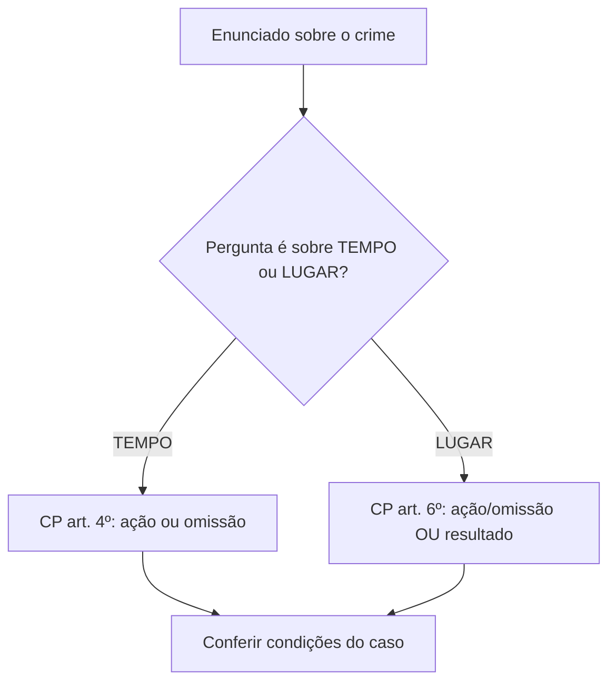

# Semana 02 — Complemento verificado de Direito Constitucional e Direito Penal

**Cargo:** Oficial de Justiça do TJSP. **Situação:** complemento didático com conferência pontual da CF e do CP em fontes oficiais, **não** homologação jurídica de toda a Semana 02. **Data de referência:** 25/10/2026.

## Objetivo e método

Ao final do estudo, responda sem consulta: (1) quando pode haver reunião pública sem autorização? (2) uma lei penal mais benéfica vale para fato antigo? (3) qual o momento e qual o lugar de um crime segundo o Código Penal? Ao errar, retorne ao dispositivo inteiro, inclusive parágrafos.

**Leitura obrigatória do edital na semana:** CF, arts. 5º–11; CP, arts. 1º–12. Aqui explicamos em profundidade **parte** desses artigos; outros estão listados para leitura integral na seção final.

## 1. Direito de reunião — CF, art. 5º, XVI

A Constituição tutela o direito de reunião pacífica, sem armas, em locais abertos ao público. O exercício **independe de autorização**, mas pressupõe **prévio aviso à autoridade competente** e não pode frustrar outra reunião anteriormente convocada para o mesmo local.

**Exemplo:** um grupo planeja uma manifestação pacífica em praça pública e avisa previamente o órgão competente. Um servidor não pode tratar a reunião como dependente de autorização discricionária só por não concordar com o tema. O enunciado mudaria se o grupo pretendesse impedir outra reunião antes convocada naquele lugar.

**Armadilha:** *aviso* é diferente de *autorização*. Duas alternativas podem parecer jurídicas e usar palavras parecidas, mas a troca altera a regra constitucional.

**Árvore de decisão para a questão:** pacífica? sem armas? local aberto ao público? aviso prévio? impede reunião anterior? Releia as condições e conclua.

## 2. Inviolabilidade do domicílio — CF, art. 5º, XI

A casa é asilo inviolável. Como regra, ingressar depende de consentimento do morador. A Constituição enumera exceções: flagrante delito, desastre, prestar socorro e **durante o dia, por determinação judicial**. A restrição temporal que incide sobre a determinação judicial não pode ser removida da alternativa.

**Exemplo:** ordem judicial para entrada em residência não deve ser lida como uma permissão genérica para qualquer horário. Leia o dispositivo completo; casos específicos dependem dos demais pressupostos normativos aplicáveis.

**Como a VUNESP pode dificultar:** trocar uma exceção por outra, retirar a expressão "durante o dia" ou apresentar consentimento e ordem judicial como a mesma hipótese.

## 3. Legalidade/anterioridade penal — CP, art. 1º

A tipificação criminal exige lei anterior que defina o fato como crime, e a pena depende de cominação legal prévia. **Não confundir**: isso não impede que uma lei posterior mais favorável ao agente alcance fatos anteriores; essa exceção favorável é o tema do art. 2º.

**Exemplo:** um comportamento visto como socialmente reprovável não se transforma em crime por simples decisão administrativa. Para punir criminalmente, é necessário tipo penal previsto em lei válida.

## 4. Lei penal posterior — CP, art. 2º

O caput disciplina a chamada *abolitio criminis*: a lei nova deixa de tratar o fato como crime; cessam a execução e os efeitos penais da sentença condenatória. O parágrafo único trata de lei posterior **de qualquer modo mais favorável**, aplicável aos fatos anteriores, ainda que exista sentença condenatória transitada em julgado.

**Exemplo A:** lei nova descriminaliza determinada conduta: leia primeiro o caput do art. 2º.

**Exemplo B:** a conduta continua crime, mas a lei nova favorece o acusado: leia o parágrafo único. Não troque essa hipótese pelo caput.

**Pegadinha:** afirmar que o trânsito em julgado impede, por si só, a aplicação de lei penal posterior mais benéfica contradiz expressamente o parágrafo único.

## 5. Lei excepcional ou temporária — CP, art. 3º

A lei editada para valer por período ou circunstância excepcional continua alcançando fatos praticados durante sua vigência, mesmo depois de terminado seu período ou cessadas as condições excepcionais. Esse é um caso de ultra-atividade expressamente previsto.

**Exemplo:** um fato cometido sob lei penal temporária não deixa automaticamente de estar sujeito a ela apenas porque o prazo de vigência terminou. A situação deve ser examinada nos limites do art. 3º.

## 6. Momento da conduta x local do crime — CP, arts. 4º e 6º

- **Tempo do crime (art. 4º):** momento da ação ou omissão, ainda que o resultado ocorra depois. Chama-se **teoria da atividade**.
- **Lugar do crime (art. 6º):** local da ação ou omissão, em todo ou parte, **e também** onde o resultado se produziu ou deveria produzir-se. Chama-se **teoria da ubiquidade**.

**Caso:** alguém pratica a conduta no município A e o resultado ocorre no município B. A questão sobre **tempo** não se resolve pelo dia do resultado: olhe o momento da ação/omissão. Já a pergunta sobre **lugar** considera tanto a conduta quanto o resultado, conforme art. 6º.

### Fluxo de decisão

## 7. Territorialidade — CP, art. 5º

A lei brasileira rege, como regra, os crimes cometidos no território nacional, sem prejuízo das convenções, tratados e regras de direito internacional. Os §§ 1º e 2º tratam de aeronaves e embarcações, distinguindo natureza pública/a serviço do governo das privadas ou mercantes e situações de posição territorial. Memorizar apenas “navio brasileiro é território nacional” é insuficiente e potencialmente enganoso: leia os dois parágrafos.

## 8. Como estudar os demais dispositivos do bloco (CP, arts. 7º–12)

Não os considere concluídos com este resumo. Faça uma ficha de cada artigo na lei seca:

| Dispositivo | Pergunta para leitura literal |
|---|---|
| CP 7º | Quais hipóteses de extraterritorialidade? Condições e exceções? |
| CP 8º | Como se considera pena cumprida no estrangeiro? |
| CP 9º | Qual o alcance da eficácia da sentença estrangeira? |
| CP 10 | Como o prazo penal é contado? |
| CP 11 | O que fazer com frações em certas penas? |
| CP 12 | Quando regras gerais do CP se aplicam a leis especiais? |
| CF 5º–11 | Separar incisos constitucionais por proteção, limitação, exceção e garantia |

## 9. Treino discursivo de encerramento

**Caso 1:** no município A uma conduta ocorre em 10/11, e o resultado em B surge em 15/11. Distinga **tempo** e **lugar** do crime com fundamento nos arts. 4º e 6º do CP, sem afirmar a competência jurisdicional do caso.

**Caso 2:** explique a diferença entre lei descriminalizadora, lei penal posterior mais favorável e lei penal temporária. Indique, respectivamente, CP arts. 2º caput, 2º parágrafo único e 3º; evite tratar as três hipóteses como intercambiáveis.

**Rubrica (20 pts cada):** identificar artigos e tese central (8), aplicar ao caso (6), distinguir exceção/hipótese próxima (4), escrita objetiva (2). Modelo de resposta não substitui o texto oficial.

## Fontes oficiais consultadas

- [Constituição Federal, art. 5º](https://www.planalto.gov.br/ccivil_03/constituicao/constituicaocompilado.htm).
- [Código Penal, arts. 1º–12](https://www.planalto.gov.br/ccivil_03/decreto-lei/del2848compilado.htm).
- Edital TJSP 01/2026, Anexo VIII, p. 60: CP 1º–12 e CF 1º–16, entre outros.

**Status:** parte do conteúdo desta semana revisada contra fontes oficiais em 25/10/2026. Leitura dos dispositivos remanescentes e parecer jurídico completo ainda pendentes.
