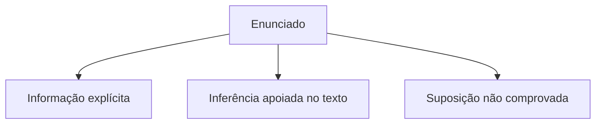

# Livro-texto — Semana 01 | Versão 2.0

## Fundamentos constitucionais, interpretação de textos e primeiros atos do oficial de justiça

**TJSP — Oficial de Justiça | Concurso 2026/2027 | VUNESP**  
**Semana 1 · 26/10/2026 a 01/11/2026 · Edição didática 2.0**

*Uma introdução explicada do zero, com diagramas, exemplos e treino progressivo.*

> **Como usar este volume.** Primeiro leia os exemplos sem consultar o gabarito; em seguida abra os artigos legais indicados; só então resolva as questões. Esta apostila explica, mas não substitui o texto oficial. Todos os exercícios deste volume são inéditos e autorais, inspirados no formato de múltipla escolha da VUNESP; não são questões oficiais reproduzidas.

\newpage

# Antes de começar

## O que você vai saber ao final desta semana

Ao terminar o livro, você deverá conseguir: (1) distinguir fundamentos, Poderes, objetivos e princípios de relações internacionais nos arts. 1º a 4º da Constituição; (2) separar uma informação escrita no texto de uma conclusão sustentada e de um palpite; (3) explicar o que é um auxiliar da Justiça e as incumbências mais cobradas do oficial de justiça; (4) diferenciar citação de intimação e identificar as exceções previstas no CPC; e (5) escrever uma resposta jurídica curta com regra, aplicação e conclusão.

### Como a Semana 1 se liga ao edital

O Anexo VIII do Edital 01/2026 prevê 15 questões de Português, 40 de Conhecimentos Específicos e 15 de Conhecimentos Gerais. A objetiva tem 70 questões de igual valor. Para ser habilitado, o candidato precisa de **pelo menos 50% dos acertos em Português e em Conhecimentos Específicos**, além de nota final igual ou superior a 5/10 no conjunto. O bloco de Conhecimentos Gerais é somente classificatório. Há também **duas questões discursivas eliminatórias**, cobrando Conhecimentos Específicos.

O objetivo deste volume é começar pelos fundamentos: **Constituição Federal, arts. 1º a 4º; CPC, arts. 149 a 155, 238 a 239 e 269 a 270; Português, interpretação, informação explícita, inferência e coesão**. Outros artigos do edital serão estudados ao longo das semanas seguintes; eles não estão todos explicados neste volume.

## Roteiro flexível: sete sessões

| Sessão | Leitura central | Produção concreta | Tempo sugerido |
|:--|:--|:--|:--|
| 1 | Como estudar + CF art. 1º | Quadro dos cinco fundamentos | 45–60 min |
| 2 | CF arts. 2º a 4º | Mapa dos 4 artigos | 60–90 min |
| 3 | Português: explícito, inferência, hipótese | Resolver texto guiado | 60 min |
| 4 | Português: coesão, ponto de vista, gramática no contexto | Reescrever três frases | 60–75 min |
| 5 | CPC arts. 149 a 155 | Quadro das funções do oficial | 75–90 min |
| 6 | CPC arts. 238–239; 269–270 | Fluxo de citação × intimação | 75–90 min |
| 7 | Exercícios, discursivas e revisão | Registrar erros e dúvidas | 90–120 min |

Você pode distribuir as sessões pelos dias de plantão e folga. O objetivo é cumprir as atividades, não acompanhar um relógio rígido. Em dias cansativos, faça uma leitura de 20 minutos e avance no próximo período livre.

## Quatro gestos que se repetem em todo o curso

**Entender.** Leia a explicação e diga o conceito com palavras próprias.  
**Conferir.** Abra a lei oficial e confirme o verbo, a exceção, o prazo e o responsável pelo ato.  
**Aplicar.** Resolva um caso sem olhar a resposta.  
**Revisar.** Retorne ao erro no dia seguinte, sete dias depois e cerca de três semanas depois.

\newpage

# Aula 1 — O que é uma norma e como ler um artigo

## O Direito começa em uma pergunta concreta

Imagine que você recebe esta instrução fictícia: “Comunique a parte sobre a decisão e registre o resultado”. Antes de agir, é preciso descobrir quem deve ser comunicado, o que o texto exige e como o resultado deve ser registrado. A legislação fornece critérios para responder. Uma **norma jurídica** estabelece condutas, competências, condições ou efeitos que se aplicam às situações previstas em seu texto.

O **artigo** é uma unidade do texto legal. Pode ser dividido em *caput* (parte inicial), parágrafos, incisos e alíneas. Essas divisões não são decoração: a banca pode trocar uma condição ou um sujeito e tornar uma alternativa errada. Por exemplo, o art. 154, VI, do CPC prevê que o oficial **certifique em mandado** uma proposta de autocomposição apresentada no contexto ali descrito. A comunicação posterior à outra parte, nos termos do parágrafo único, é ordenada pelo juiz. Trocar os sujeitos altera a regra.

### Vocabulário de sobrevivência

- **Caput:** texto inicial do artigo, antes de eventuais desdobramentos.
- **Inciso:** item enumerado, em geral indicado por algarismo romano.
- **Parágrafo:** subdivisão marcada por §, ou “parágrafo único”.
- **Condição:** requisito sem o qual a regra não incide da mesma maneira.
- **Exceção:** situação em que a norma ressalva o resultado geral.
- **Certificar:** registrar formalmente nos autos ou no mandado o que ocorreu, nos termos aplicáveis.
- **Mandado:** documento que veicula uma determinação judicial a ser cumprida; não é sinônimo de decisão judicial.

## Método de leitura em cinco perguntas

**1. Quem?** Identifique a pessoa ou órgão responsável. **2. O quê?** Localize o verbo da norma. **3. Quando?** Observe prazo e momento processual. **4. Sob quais condições?** Procure expressões como “quando”, “desde que”, “salvo”, “ressalvadas”. **5. Qual o efeito?** Veja o que acontece se a condição estiver presente ou ausente.

**Exemplo guiado (CPC, art. 239, § 1º).** Quem comparece? O réu ou o executado. O que faz? Comparece espontaneamente. Qual a consequência expressamente prevista? Suprir a falta ou a nulidade da citação. O que muda no tempo? A data desse comparecimento serve de referência para o prazo de defesa indicado no dispositivo. Sem esse passo de leitura, alguém poderia decorar equivocadamente que toda falha de citação anula automaticamente todo o processo.

> **Olho da banca.** Desconfie de palavras absolutas como “sempre”, “nunca”, “exclusivamente” e “em qualquer hipótese”. Elas podem estar corretas, mas muitas alternativas ficam erradas quando excluem uma exceção expressa na lei.

### Exercício-relâmpago

“Certificar em mandado a proposta de autocomposição”. Identifique: o verbo, quem deve realizar o ato e o documento em que o resultado é registrado. Depois confira o art. 154, VI, no texto oficial do CPC.

\newpage

# Aula 2 — Constituição Federal: arts. 1º a 4º

## A ideia central dos quatro artigos

Os quatro artigos iniciais não formam uma lista única. Cada um responde a uma pergunta diferente. **Art. 1º: quais são os fundamentos do Estado brasileiro? Art. 2º: como se organizam os Poderes da União? Art. 3º: quais objetivos fundamentais o país deve perseguir? Art. 4º: por quais princípios o Brasil se orienta nas relações internacionais?**

_Ilustração detalhada disponível no PDF original da Semana 01, na pasta Google Drive._

## 2.1 Art. 1º — Fundamentos e soberania popular

O artigo descreve o Brasil como **República Federativa**, formada pela união indissolúvel dos Estados, Municípios e Distrito Federal, constituída em **Estado Democrático de Direito**. Em linguagem simples, a atuação estatal se submete à ordem jurídica, e a legitimidade política se relaciona à vontade popular nos termos constitucionais.

Seus **cinco fundamentos** são: **soberania; cidadania; dignidade da pessoa humana; valores sociais do trabalho e da livre iniciativa; pluralismo político**. Soberania se refere à independência do Estado nas esferas em que exerce suas competências. Cidadania envolve a posição das pessoas como participantes da vida política e portadoras de direitos e deveres. Dignidade humana exige respeito à pessoa como sujeito de direitos. Os valores sociais do trabalho e da livre iniciativa são tratados conjuntamente no mesmo inciso; a banca pode separar apenas um deles e alterar a formulação. Pluralismo político admite a diversidade de ideias e posições políticas na ordem democrática.

O **parágrafo único** diz que o poder emana do povo e é exercido diretamente ou por representantes eleitos, nos termos da Constituição. Assim, a frase “todo poder emana do Presidente da República” está errada: confunde ocupante de um cargo com a fonte constitucional do poder.

**Situação de prova.** A alternativa “reduzir as desigualdades regionais é fundamento da República” parece positiva, mas está incorreta: essa expressão pertence ao **art. 3º, III**, como objetivo fundamental. A categoria da ideia importa tanto quanto o seu conteúdo.

**Dica de memorização:** em vez de decorar letras sem compreensão, forme uma frase: “O Brasil é soberano, reconhece cidadãos e a dignidade da pessoa, valoriza trabalho/iniciativa e aceita pluralidade política”. Depois confira as palavras da lei.

## 2.2 Art. 2º — Poderes independentes e harmônicos

Os Poderes da União são **Legislativo, Executivo e Judiciário**. O texto constitucional fala em **independência e harmonia**. Independência não significa isolamento nem ausência de mecanismos de controle; harmonia não significa hierarquia geral de um Poder sobre os demais.

**Exemplo.** Uma questão afirma: “Como o Judiciário integra o Estado, ele se subordina administrativamente ao Poder Executivo em todas as suas decisões.” Está errada a ideia de subordinação entre os Poderes. A banca costuma testar as expressões literais “independentes” e “harmônicos”.

**Atenção ao cargo.** O oficial de justiça integra a estrutura do Poder Judiciário como servidor, mas isso não o transforma em juiz. A função, as competências e os limites de cada agente são distintos. A ordem judicial não autoriza uma ação que ignore os limites legais aplicáveis.

## 2.3 Art. 3º — Objetivos fundamentais: rumo a alcançar

O art. 3º estabelece quatro objetivos. São orientações constitucionais de transformação e promoção do bem coletivo, não os “fundamentos” listados no art. 1º:

1. Construir uma sociedade **livre, justa e solidária**.
2. Garantir o **desenvolvimento nacional**.
3. **Erradicar a pobreza e a marginalização** e **reduzir as desigualdades sociais e regionais**.
4. **Promover o bem de todos**, sem preconceitos de origem, raça, sexo, cor, idade e outras formas de discriminação.

**Pegadinha.** A afirmativa “reduzir desigualdades exclusivamente econômicas” restringe a formulação do art. 3º, III, que fala em desigualdades **sociais e regionais**. Uma palavra muda o sentido.

## 2.4 Art. 4º — Relações internacionais

O art. 4º indica os princípios que orientam o Brasil em suas relações com outros países. São dez itens: **independência nacional, prevalência dos direitos humanos, autodeterminação dos povos, não intervenção, igualdade entre os Estados, defesa da paz, solução pacífica dos conflitos, repúdio ao terrorismo e ao racismo, cooperação entre os povos para o progresso da humanidade e concessão de asilo político**.

Perceba o eixo comum: respeito entre Estados e povos, proteção de pessoas, solução pacífica de conflitos e cooperação. Não confunda **soberania**, fundamento no art. 1º, com **independência nacional**, princípio de relações internacionais no art. 4º. São ideias próximas que aparecem em classificações diferentes.

O **parágrafo único** prevê a busca da integração **econômica, política, social e cultural** dos povos da **América Latina**, visando à formação de uma comunidade latino-americana de nações. A banca pode substituir “América Latina” por “América do Sul” ou suprimir dimensões de integração: confira a literalidade.

### Quadro de reconhecimento rápido

| Se a questão mencionar… | Procure primeiro… |
|:--|:--|
| Dignidade da pessoa humana | Art. 1º — fundamento |
| Independentes e harmônicos | Art. 2º — Poderes |
| Combate à pobreza e desigualdade regional | Art. 3º — objetivo |
| Asilo político ou defesa da paz | Art. 4º — relações internacionais |
| Poder emanando do povo | Art. 1º, parágrafo único |
| Integração da América Latina | Art. 4º, parágrafo único |

**Resumo em uma frase:** o art. 1º apresenta as bases; o 2º organiza os Poderes; o 3º define os objetivos; e o 4º orienta a atuação internacional.

### Miniquiz sem consulta

Classifique como artigo 1º, 2º, 3º ou 4º: (a) pluralismo político; (b) promover o bem de todos; (c) solução pacífica dos conflitos; (d) independência e harmonia entre Poderes; (e) valores sociais do trabalho e da livre iniciativa; (f) não intervenção. Revise a redação integral do artigo ao conferir.

\newpage

# Aula 3 — Português: interpretar é provar com o texto

## O erro de leitura mais comum

Um texto oferece dados. A pergunta solicita uma interpretação. Entre uma coisa e outra, a mente costuma completar lacunas com experiências pessoais. Na prova, esse hábito é perigoso: **uma conclusão pode ser plausível sem estar sustentada no texto**. Não basta pensar “isso geralmente acontece”; é necessário indicar o trecho que sustenta a resposta.

### Três níveis de afirmação

- **Explícita:** a informação está efetivamente escrita. Ex.: “A audiência foi transferida para quinta-feira”. É explícito que houve mudança para quinta.
- **Inferência válida:** a conclusão decorre de pistas efetivamente presentes. Ex.: “Embora tenha saído cedo, chegou após o início da audiência”. É possível concluir que houve atraso na chegada em relação ao início.
- **Hipótese sem prova:** uma interpretação acrescenta dado não informado. Ex.: “Chegou tarde porque o ônibus quebrou”. O motivo não está no texto.

Em provas de interpretação, a resposta correta deve ser **compatível com o conjunto do texto**. Uma alternativa pode repetir algumas palavras do enunciado e, mesmo assim, distorcer a relação entre elas.

## Texto original para leitura guiada

> **Serviço e informação.** A comarca implantou um painel para acompanhar diligências pendentes. Nas primeiras semanas, os servidores registraram mais ocorrências do que antes. O aumento, porém, não significou necessariamente mais problemas nas ruas: segundo a coordenação, o novo painel passou a reunir dados que antes estavam espalhados em anotações e planilhas. Após uma etapa de orientação, caiu o número de registros incompletos. A equipe decidiu manter o sistema e revisar mensalmente as categorias utilizadas. A medida não eliminou todas as divergências, mas tornou mais fácil localizar informações e explicar atrasos aos interessados.

### Leitura comentada, passo a passo

**Pergunta 1 — O que aumentou?** Os registros de ocorrências, segundo o texto. Não sabemos se aumentou o número real de problemas, e o texto até alerta contra essa conclusão. **Pergunta 2 — Por que o aumento pode ser aparente?** Porque o painel consolidou dados que antes estavam dispersos. **Pergunta 3 — O que melhorou após orientação?** Diminuiu a quantidade de registros incompletos. **Pergunta 4 — O sistema resolveu tudo?** Não. O último período nega expressamente a eliminação de todas as divergências.

**Armadilha possível:** “A implantação eliminou os atrasos no cumprimento das diligências.” Parece otimista, mas o texto só diz que melhorou a localização das informações e a explicação dos atrasos. **Explicar atrasos** não equivale a **eliminá-los**.

## Tema, ideia central e finalidade

O **tema** é o assunto geral; aqui, o acompanhamento de diligências por painel. A **ideia central** é que a centralização e a melhoria de registros facilitaram a gestão, sem resolver todos os problemas. A **finalidade** é informar e esclarecer uma mudança de processo, sem necessariamente persuadir o leitor a comprar ou adotar um produto.

**Ponto de vista do autor** é a posição expressa ou sugerida no modo de organizar as informações. O texto apresenta uma avaliação equilibrada: há benefícios e limites. Alternativas absolutas (“sistema perfeito”, “fracasso total”) não refletem o conjunto.

## Conectivos e coesão: os pequenos termos que comandam o sentido

**“Porém” / “mas” / “entretanto”** indicam contraste. **“Porque” / “pois”**, conforme o contexto, introduzem explicação ou causa. **“Portanto” / “logo”** indicam conclusão. **“Embora”** introduz concessão: um fato é admitido sem impedir o resultado principal. Pronomes e expressões como “essa medida” retomam informações anteriores e evitam repetições.

**No nosso texto:** “O aumento, **porém**, não significou necessariamente mais problemas”. O termo impede que o leitor conclua diretamente que houve piora. Em “**A medida** não eliminou todas as divergências”, é preciso retomar o conjunto de decisões descritas, especialmente a adoção/manutenção da nova forma de acompanhamento, e não atribuir esse pronome a um objeto sem relação.

_Ilustração detalhada disponível no PDF original da Semana 01, na pasta Google Drive._

## Gramática aplicada à interpretação

Na primeira semana, o foco é entender o papel das palavras em textos, sem substituir o programa completo de gramática que aparecerá no curso. Em “**Os servidores registraram** mais ocorrências”, o verbo “registraram” exprime uma ação atribuída ao sujeito “os servidores”. Trocar por “foram registrados” muda a construção e pode alterar o foco informativo. Em “o painel **não** resolveu tudo”, a negação é decisiva. Em “**necessariamente** mais problemas”, o advérbio limita a força da afirmação. Em “registrou atrasos **e** revisou relatórios”, a conjunção articula ideias com adição.

**Pontuação também interpreta.** Compare: “Os servidores, que participaram da orientação, revisaram os dados” e “Os servidores que participaram da orientação revisaram os dados”. Na primeira construção, a oração entre vírgulas tem leitura explicativa; na segunda, tem leitura restritiva, identificando quais servidores foram referidos. A banca pode explorar essa diferença sem cobrar o nome técnico da oração.

**Vocabulário no contexto.** Não substitua automaticamente uma palavra pelo primeiro sinônimo do dicionário. “A equipe **manteve** o sistema” significa que decidiu continuar usando-o; não significa, no trecho, apenas que realizou manutenção técnica. A situação modifica o sentido mais adequado.

### Técnica de prova: sublinhar a prova da resposta

Para cada alternativa, pergunte: “onde o texto prova isso?”. Se a alternativa trouxer causa não informada, generalização indevida, inversão temporal ou expressão absoluta incompatível, elimine. Releia especialmente o início e o fim de cada parágrafo e as palavras de contraste.

\newpage

# Aula 4 — Quem faz o quê no processo: CPC, arts. 149 a 155

## O processo não acontece sozinho

O juiz decide, mas o procedimento exige várias atividades administrativas e técnicas. O CPC reúne diferentes profissionais como **auxiliares da Justiça**. O art. 149 menciona, entre outros, escrivão, chefe de secretaria, oficial de justiça, perito, depositário, administrador, intérprete, tradutor, mediador e conciliador. Cada papel tem competências próprias. A lista não deve ser lida como se todos desempenhassem o mesmo serviço.

O art. 150 trata da existência dos ofícios de justiça e remete suas atribuições às normas de organização judiciária. O art. 151 fixa a regra de que, em cada comarca, seção ou subseção judiciária, haverá no mínimo tantos oficiais de justiça quantos sejam os juízos. **Não se conclui daí que cada juiz trabalhe exclusivamente com um único oficial**: essa seria uma inferência que o texto não oferece.

## 4.1 Escrivão e chefe de secretaria: CPC, arts. 152 e 153

O art. 152 reúne incumbências de redação e tramitação de atos, efetivação de ordens judiciais e tarefas de secretaria, com detalhes que devem ser lidos no texto integral. O art. 153 trata da **preferência pela ordem cronológica de recebimento** para publicação e efetivação de pronunciamentos, **com exceções**, como atos urgentes reconhecidos pelo juiz e preferências legais. Atenção: “preferencialmente” não é sinônimo de “sem nenhuma exceção”.

## 4.2 O oficial de justiça: CPC, art. 154

Este é um dos dispositivos centrais da profissão. O artigo estabelece seis incumbências. Em linguagem simples:

1. Fazer pessoalmente citações, prisões, penhoras, arrestos e demais diligências próprias do ofício, **sempre que possível na presença de duas testemunhas**, e **certificar no mandado** o ocorrido, com lugar, dia e hora.
2. Executar as ordens do juiz ao qual estiver subordinado.
3. Entregar o mandado em cartório após o cumprimento.
4. Auxiliar o juiz na manutenção da ordem.
5. Efetuar avaliações, quando cabíveis.
6. Certificar, em mandado, a proposta de autocomposição apresentada por qualquer das partes durante ato de comunicação que lhe caiba.

**Como decorar com sentido:** o oficial **cumpre** uma ordem, **documenta** o ocorrido e **devolve** a informação ao processo. Mas não reduza o art. 154 a “entregar papéis”: há diligências materiais, avaliações e registros específicos.

O **parágrafo único do art. 154** determina que, certificada a proposta de autocomposição, o juiz **ordenará a intimação da parte contrária** para manifestação em **cinco dias**. O silêncio vale como **recusa**, e o andamento regular do processo não é prejudicado. A VUNESP pode inverter isso para “silêncio importa aceitação”, o que contraria o dispositivo.

_Ilustração detalhada disponível no PDF original da Semana 01, na pasta Google Drive._

## 4.3 O registro fiel e seus limites

Imagine que um mandado fictício foi cumprido parcialmente. Uma certidão confiável identifica **onde, quando e o que efetivamente aconteceu**, diferenciando observação direta de informação fornecida por terceiros. Escrever “ninguém estava na residência” quando na verdade um vizinho apenas relatou que não havia ninguém é uma descrição imprecisa da fonte da informação.

**Modelo didático, não formulário oficial:** “Certifico que compareci ao endereço indicado, em [data], às [hora], tendo constatado [fato observado]. Fui informado por [pessoa identificada, quando cabível] de que [declaração recebida]. Registrei o resultado conforme o mandado.” A redação final de qualquer certidão concreta precisa obedecer às regras aplicáveis e às circunstâncias reais; nunca use este exemplo como texto pronto para uma diligência.

## 4.4 Responsabilidade: CPC, art. 155

O art. 155 prevê responsabilidade **civil e regressiva** de escrivão, chefe de secretaria e oficial de justiça em hipóteses específicas: recusa sem justo motivo a cumprir no prazo os atos impostos pela lei ou pelo juiz; e prática de ato nulo com dolo ou culpa. Não significa que todo erro material, em qualquer circunstância, gere automaticamente a mesma consequência. O dispositivo indica pressupostos que precisam ser examinados.

### Comparação orientada

| Atribuição | Quem aparece diretamente no dispositivo estudado? | Referência |
|:--|:--|:--|
| Lista de auxiliares da Justiça | Diferentes agentes | CPC, art. 149 |
| Redigir mandados e atos do ofício | Escrivão/chefe de secretaria | CPC, art. 152, I |
| Cronologia preferencial de publicações | Escrivão/chefe de secretaria | CPC, art. 153 |
| Certificar diligência no mandado | Oficial de justiça | CPC, art. 154, I |
| Avaliações, quando for o caso | Oficial de justiça | CPC, art. 154, V |
| Responsabilidade civil e regressiva nas hipóteses legais | Agentes expressamente indicados | CPC, art. 155 |

> **Olho da banca.** Repare em cinco expressões do art. 154: “pessoalmente”, “sempre que possível”, “no mandado”, “quando for o caso” e “silêncio como recusa”. Elas mudam o alcance da obrigação.

\newpage

# Aula 5 — Citação, intimação e os efeitos do comparecimento

## 5.1 Citação: trazer alguém para integrar a relação processual

O **art. 238 do CPC** define citação como o ato de convocar **réu, executado ou interessado** para integrar a relação processual. Pense na pergunta “quem precisa ser chamado a participar formalmente do processo?”. Isso não significa que toda comunicação recebida por alguém seja citação.

O **parágrafo único** do art. 238 prevê a efetivação da citação em **até 45 dias a partir da propositura da ação**. Essa referência temporal faz parte do dispositivo e não deve ser confundida com o prazo de defesa do réu. Os prazos processuais aplicáveis e as modalidades de citação são tratados em outros artigos; por isso, evite extrapolar daqui regras não estudadas.

O **art. 239** estabelece a indispensabilidade da citação do réu ou executado para a validade do processo, **ressalvadas** as hipóteses de **indeferimento da petição inicial** ou de **improcedência liminar do pedido**. Assim, a frase “não existe hipótese alguma em que um processo possa ser decidido sem citação” é falsa em relação às exceções expressas do próprio artigo.

**Ponto decisivo: o comparecimento espontâneo.** O § 1º do art. 239 prevê que o comparecimento espontâneo do réu ou executado **supre a falta ou a nulidade de citação**. O prazo para apresentar contestação ou embargos à execução flui da data desse comparecimento, segundo o dispositivo. Essa regra evita confundir uma falha inicial com a impossibilidade absoluta de seguir o processo.

O § 2º prevê efeitos específicos quando a alegação de nulidade é rejeitada, distinguindo processo de conhecimento e processo de execução. Você deve ler o parágrafo inteiro na lei seca: esse detalhe costuma ser difícil de memorizar apenas com resumo.

## 5.2 Intimação: dar ciência de atos e termos do processo

O **art. 269 do CPC** define intimação como o ato de **dar ciência a alguém de atos e termos do processo**. A finalidade é diferente da citação: a pessoa é informada sobre um movimento ou decisão do procedimento. O artigo também contém regras sobre intimação promovida por advogados e comunicação dirigida ao órgão de Advocacia Pública nas hipóteses nele previstas.

O **art. 270** estabelece que as intimações se realizam, **sempre que possível, por meio eletrônico**, na forma da lei. A expressão “sempre que possível” importa. Não é correto transformá-la em “obrigatoriamente e sem exceção exclusivamente por meio eletrônico”. O parágrafo único remete, para Ministério Público, Defensoria Pública e Advocacia Pública, ao dispositivo indicado na lei.

_Ilustração detalhada disponível no PDF original da Semana 01, na pasta Google Drive._

## 5.3 Caso resolvido

Um réu não recebeu regularmente a citação, mas ingressou espontaneamente no processo por meio de manifestação. Uma alternativa afirma que o defeito não pode ser suprido em hipótese alguma. **Análise:** o art. 239, § 1º, determina que o comparecimento espontâneo supre a falta ou nulidade de citação. **Conclusão:** a alternativa é errada. O problema de prova consiste em reconhecer a exceção, não em imaginar fatos que não aparecem no enunciado.

Outra situação: uma parte já participa de determinado processo e deve receber ciência de uma decisão. A pergunta é sobre um ato de **intimação**, não sobre convocação inicial para integrar a relação processual. Em casos concretos, as regras de realização e os destinatários devem ser conferidos no CPC e nas normas aplicáveis.

### Compare os termos sem decorar frases soltas

| Elemento | Citação | Intimação |
|:--|:--|:--|
| Definição central | Convocar para integrar relação processual | Dar ciência de atos/termos |
| Artigo-base | CPC, art. 238 | CPC, art. 269 |
| Foco do estudo inicial | Validade e comparecimento espontâneo | Finalidade e meio preferencial |
| Erro clássico | Dizer que não há exceções no art. 239 | Dizer que só existe forma eletrônica |

**Atenção:** a tabela simplifica os conceitos para a primeira semana. Não substitui as modalidades, os destinatários e os procedimentos desenvolvidos nos arts. 240 a 259 e 271 a 275, que o edital também exige e serão aprofundados depois.

\newpage

# Aula 6 — Casos integrados: como pensar na prova

## Caso A — Classificar sem trocar rótulos

Uma questão propõe: “A dignidade da pessoa humana é objetivo fundamental e a redução das desigualdades sociais é fundamento da República”. Para analisar, marque duas palavras: **dignidade** e **redução de desigualdades**. Verifique a origem: dignidade aparece no **art. 1º, III**, entre os fundamentos; redução das desigualdades sociais e regionais aparece no **art. 3º, III**, entre os objetivos. A afirmação troca as categorias e, portanto, está errada.

## Caso B — A palavra que impede a conclusão

Leia: “O órgão recebeu mais solicitações após a criação de um canal digital; não foi possível determinar se a demanda real havia crescido”. A alternativa afirma: “A digitalização provocou aumento comprovado da demanda”. Há dois problemas: o texto não demonstra causalidade e, expressamente, afirma que o crescimento real não foi determinado. **Sem prova textual, não conclua**.

## Caso C — A certidão não é uma conversa informal

Um oficial registra oralmente o cumprimento de uma diligência e deixa de certificar o ocorrido. Compare com o art. 154, I, que exige **certificar no mandado** com lugar, dia e hora, nas condições legais. A alternativa “a comunicação oral substitui sempre o registro” não corresponde ao dispositivo.

## Caso D — Quem decide após uma proposta?

Durante ato de comunicação, uma das partes apresenta proposta de autocomposição. O oficial certifica em mandado. O parágrafo único do art. 154 atribui ao juiz a ordem de intimação da parte contrária, que se manifestará em cinco dias. Se a parte contrária nada disser, o silêncio é tratado como **recusa**, não aceitação automática. São quatro peças da mesma regra: **proposta → certificação → intimação ordenada pelo juiz → manifestação ou silêncio-recusa**.

## Como escrever uma questão discursiva: R-A-C

1. **Regra.** Diga qual dispositivo responde à pergunta, sem inventar artigo.
2. **Aplicação.** Use apenas os fatos oferecidos no caso.
3. **Conclusão.** Responda objetivamente ao que foi perguntado.

**Exemplo de 4 linhas:** “Pelo art. 239, § 1º, do CPC, o comparecimento espontâneo do réu ou executado supre a falta ou a nulidade da citação. No caso, o réu ingressou espontaneamente nos autos, embora não tenha sido citado regularmente. Por isso, o vício de citação pode ser suprido, fluindo o prazo de defesa da data do comparecimento conforme o dispositivo.”

**Evite estes vícios:** frases excessivamente genéricas (“a lei garante justiça”); citar artigo sem desenvolver; repetir a pergunta; presumir fatos; escrever um parágrafo longo que não responda ao problema.

\newpage

# Aula 7 — Quadro de revisão de bolso

## Constituição Federal

**Art. 1º = bases / fundamento:** soberania, cidadania, dignidade, valores sociais do trabalho e livre iniciativa, pluralismo. O poder emana do povo.  
**Art. 2º = organização:** Legislativo, Executivo, Judiciário; independentes e harmônicos.  
**Art. 3º = metas:** sociedade livre, justa e solidária; desenvolvimento; combater pobreza e desigualdades; promover o bem de todos.  
**Art. 4º = relações internacionais:** independência, direitos humanos, autodeterminação, não intervenção, igualdade entre Estados, paz, solução pacífica, repúdio ao terrorismo/racismo, cooperação, asilo político; integração latino-americana.

## Português

**Explícito:** está no texto. **Inferência:** decorre de pistas reais. **Hipótese:** exige informação que o texto não oferece. **Coesão:** conectivos e retomadas ligam ideias. **Tese:** posição central; **tema:** assunto geral. Ao resolver questões, procure uma frase que sustente cada resposta.

## Processo Civil

**Arts. 149–153:** auxiliares, organização dos ofícios e tarefas de secretaria. **Art. 154:** diligência, certificação, ordem do juiz, devolução de mandado, ordem, avaliação, proposta de autocomposição. **Art. 155:** hipóteses legais de responsabilidade civil e regressiva. **Art. 238:** definição da citação. **Art. 239:** importância da citação, exceções e comparecimento espontâneo. **Art. 269:** definição da intimação. **Art. 270:** meio eletrônico sempre que possível.

## O que precisa ser consultado em texto integral

- [ ] **Constituição Federal, arts. 1º a 4º**, com incisos e parágrafos.
- [ ] **CPC, arts. 149 a 155**, inclusive incisos do art. 154 e parágrafo único.
- [ ] **CPC, arts. 238 e 239**, inclusive parágrafos.
- [ ] **CPC, arts. 269 e 270**, inclusive parágrafos.
- [ ] **Edital 01/2026, Anexo VIII**, para saber os temas de Português.

## Fontes oficiais verificadas

**Constituição Federal — Planalto:** https://www.planalto.gov.br/ccivil_03/constituicao/constituicaocompilado.htm  
**Código de Processo Civil — Planalto:** https://www.planalto.gov.br/ccivil_03/_ato2015-2018/2015/lei/l13105compilada.htm  
**Edital TJSP nº 01/2026:** https://drive.google.com/file/d/1YJSOt6SDpONIJLY1ahDa9D4y8vkTGwlJ/view  
**Roteiro geral de lei seca no Drive:** https://drive.google.com/file/d/1cLOmFI8voDn53EGMGgzJa22ypkvYjUOe/view

**Nota editorial:** as explicações são didáticas e não substituem a literalidade da legislação. O edital determina estudo da legislação com alterações pertinentes; antes da prova, confirme eventuais retificações e mudanças nos portais oficiais. Verificação editorial: 23/10/2026.

\newpage

# Atividades — Primeiro, tente sozinho

As 30 questões a seguir são **autorais**, elaboradas a partir dos dispositivos estudados e do formato de cinco alternativas utilizado no concurso. Elas estão divididas em fácil, intermediário e desafiador, mas nenhuma foi retirada literalmente de provas anteriores. Marque uma única alternativa. **Não há respostas neste volume**; o gabarito comentado está em arquivo separado.

## Parte A — Constituição (questões 1 a 10)

**01 · Fácil.** De acordo com o art. 1º da Constituição, é fundamento da República Federativa do Brasil:  
A) a garantia do desenvolvimento nacional.  
B) a redução das desigualdades regionais.  
C) a dignidade da pessoa humana.  
D) a defesa da paz.  
E) a solução pacífica dos conflitos.

**02 · Fácil.** O art. 2º estabelece que os Poderes da União são:  
A) Legislativo, Executivo e Ministério Público.  
B) Legislativo, Executivo e Judiciário.  
C) Executivo, Judiciário e Defensoria Pública.  
D) Legislativo, Judiciário e Tribunal de Contas.  
E) Executivo, Judiciário e Procuradoria-Geral.

**03 · Intermediária.** Conforme o parágrafo único do art. 1º, o poder emana:  
A) dos magistrados, que o delegam à população.  
B) dos entes federativos, sem participação popular.  
C) do Congresso Nacional exclusivamente.  
D) do povo, que o exerce por representantes eleitos ou diretamente.  
E) dos representantes eleitos, sem qualquer forma de exercício direto.

**04 · Intermediária.** Constitui objetivo fundamental previsto no art. 3º:  
A) promover o bem de todos, sem as formas de preconceito mencionadas no dispositivo.  
B) conceder asilo político.  
C) preservar o pluralismo político como fundamento.  
D) assegurar a igualdade entre os Estados nas relações internacionais.  
E) garantir a separação entre os Poderes.

**05 · Intermediária.** Integra o art. 4º, relativo às relações internacionais:  
A) a livre iniciativa como único valor social.  
B) a redução das desigualdades sociais e regionais.  
C) a cidadania.  
D) a harmonia entre os Poderes.  
E) a concessão de asilo político.

**06 · Desafiadora.** A Constituição busca a integração dos povos da América Latina, segundo o art. 4º, parágrafo único, nas dimensões:  
A) econômica apenas.  
B) militar e econômica apenas.  
C) econômica, política, social e cultural.  
D) exclusivamente política e territorial.  
E) jurídica e religiosa apenas.

**07 · Desafiadora.** Assinale a correspondência correta:  
A) Soberania — objetivo do art. 3º.  
B) Defesa da paz — princípio do art. 4º.  
C) Pluralismo político — forma de organização dos Poderes do art. 2º.  
D) Combate à pobreza — princípio de política internacional do art. 4º.  
E) Cidadania — objetivo do art. 3º.

**08 · Intermediária.** Os Poderes da União são, segundo o texto constitucional:  
A) dependentes e subordinados ao Executivo.  
B) autônomos e incompatíveis entre si.  
C) hierarquicamente ordenados pelo Legislativo.  
D) independentes e harmônicos entre si.  
E) escolhidos diretamente pelo Poder Judiciário.

**09 · Desafiadora.** Qual alternativa apresenta somente fundamentos do art. 1º?  
A) Soberania, cidadania, pluralismo político.  
B) Soberania, defesa da paz, cidadania.  
C) Igualdade entre Estados, dignidade, asilo político.  
D) Desenvolvimento nacional, soberania, solidariedade.  
E) Direitos humanos, não intervenção, pluralismo político.

**10 · Desafiadora.** A redução das desigualdades sociais e regionais aparece na Constituição como:  
A) regra do art. 2º relativa aos Poderes.  
B) inciso do art. 4º sobre não intervenção.  
C) princípio do preâmbulo sem previsão no articulado.  
D) fundamento do art. 1º.  
E) objetivo fundamental do art. 3º.

## Parte B — Português (questões 11 a 18)

**Texto para as questões 11 a 14:** “A unidade criou um canal para receber pedidos. No primeiro mês, houve mais registros do que no período anterior. A coordenação advertiu, entretanto, que parte dos pedidos já existia e apenas passou a ser contabilizada. A equipe manteve o canal, embora reconhecesse que a ferramenta ainda exigia ajustes.”

**11 · Fácil.** O texto afirma explicitamente que:  
A) houve crescimento comprovado do número real de demandas.  
B) o canal foi desativado depois do primeiro mês.  
C) parte dos pedidos já existia e passou a ser contabilizada.  
D) a coordenação desconhecia os dados anteriores.  
E) a ferramenta não precisava de ajustes.

**12 · Intermediária.** A palavra “entretanto” introduz ideia de:  
A) contraste com a conclusão imediata que se poderia tirar do aumento de registros.  
B) soma de acontecimentos idênticos.  
C) explicação de uma causa já comprovada.  
D) finalidade da criação do canal.  
E) comparação entre duas cidades.

**13 · Intermediária.** É inferência sustentada pelo texto:  
A) todos os pedidos eram novos.  
B) os responsáveis abandonaram a iniciativa.  
C) o canal não registrou demanda alguma.  
D) o aumento de registros, isoladamente, não prova aumento equivalente de demandas novas.  
E) todas as falhas foram eliminadas no primeiro mês.

**14 · Desafiadora.** Em “embora reconhecesse que a ferramenta ainda exigia ajustes”, a conjunção “embora” exprime:  
A) uma explicação causal de desativação do canal.  
B) uma concessão que não impede a manutenção do canal.  
C) uma conclusão necessariamente lógica.  
D) uma condição que já se tornou impossível.  
E) uma enumeração de motivos.

**15 · Fácil.** Um texto informa: “A reunião foi transferida de terça para sexta-feira”. Qual afirmação é explícita?  
A) A reunião foi cancelada definitivamente.  
B) Houve greve na terça-feira.  
C) A reunião começará às 15h.  
D) A transferência ocorreu porque faltou energia.  
E) A reunião estava prevista para terça e foi remarcada para sexta.

**16 · Intermediária.** A opção que acrescenta uma causa NÃO sustentada por “O sistema ficou indisponível durante a manhã” é:  
A) A indisponibilidade ocorreu durante parte do dia.  
B) O sistema ficou indisponível.  
C) A falha ocorreu porque um cabo foi cortado.  
D) A manhã foi mencionada.  
E) O texto relata um período de indisponibilidade.

**17 · Desafiadora.** Compare: “Os técnicos, que participaram do treinamento, revisaram o procedimento” e “Os técnicos que participaram do treinamento revisaram o procedimento”. A diferença principal é:  
A) a primeira construção tende a explicar algo sobre o grupo mencionado; a segunda restringe quais técnicos são referidos.  
B) as duas construções são idênticas quanto à relação sintática.  
C) na primeira, a vírgula transforma o verbo em substantivo.  
D) na segunda, a oração deixa de ter verbo.  
E) a pontuação obriga a interpretação de que ninguém foi treinado.

**18 · Desafiadora.** No enunciado “Não foi possível comprovar que o aumento dos registros resultou de piora no serviço”, é correto afirmar que:  
A) a piora foi comprovada.  
B) todos os registros foram falsificados.  
C) o serviço certamente melhorou.  
D) o enunciado não autoriza afirmar como fato a causa sugerida.  
E) o aumento não aconteceu.

## Parte C — Processo Civil (questões 19 a 30)

**19 · Fácil.** Conforme o art. 149 do CPC, o oficial de justiça é:  
A) órgão do Poder Executivo.  
B) auxiliar da Justiça.  
C) membro do Ministério Público.  
D) árbitro obrigatório.  
E) representante da parte autora.

**20 · Intermediária.** O art. 153 do CPC determina atendimento à ordem cronológica para determinados atos:  
A) sem exceções e sempre em ordem absolutamente rígida.  
B) somente na hipótese de processos criminais.  
C) exclusivamente para o oficial de justiça.  
D) apenas se nenhuma parte tiver advogado.  
E) preferencialmente, observadas as exceções legais.

**21 · Fácil.** É incumbência expressa do oficial de justiça no art. 154 do CPC:  
A) proferir sentenças.  
B) elaborar leis estaduais.  
C) certificar no mandado o ocorrido nas diligências, com lugar, dia e hora.  
D) substituir o promotor em audiência.  
E) escolher livremente qual processo terá prioridade judicial.

**22 · Intermediária.** A presença de duas testemunhas nas diligências do art. 154, I, é prevista:  
A) sempre que possível.  
B) em todo ato, sem exceção concebível.  
C) apenas na presença do governador.  
D) só mediante autorização da parte autora.  
E) somente quando houver proposta de acordo.

**23 · Intermediária.** Certificada proposta de autocomposição nos termos do art. 154, VI, do CPC, o juiz ordenará intimação da parte contrária para manifestação em:  
A) 24 horas, e silêncio significa aceitação.  
B) 15 dias, e silêncio significa aceitação.  
C) 10 dias, e o processo fica suspenso automaticamente.  
D) 5 dias, considerando-se o silêncio como recusa.  
E) 30 dias, sem regra sobre silêncio.

**24 · Desafiadora.** O art. 155 do CPC prevê responsabilidade civil e regressiva de agentes expressamente indicados quando:  
A) qualquer terceiro discordar da diligência.  
B) praticarem ato nulo com dolo ou culpa.  
C) a parte tiver resultado desfavorável em sentença.  
D) o juiz usar decisão fundamentada.  
E) qualquer dúvida surgir no processo, independentemente de conduta.

**25 · Fácil.** Citação, conforme o art. 238 do CPC, é o ato de:  
A) publicar a sentença em imprensa.  
B) registrar a presença das testemunhas.  
C) calcular as despesas do processo.  
D) revisar uma decisão judicial.  
E) convocar réu, executado ou interessado para integrar a relação processual.

**26 · Intermediária.** Segundo o art. 239, § 1º, do CPC, o comparecimento espontâneo do réu ou executado:  
A) pode suprir a falta ou a nulidade da citação.  
B) jamais produz qualquer efeito.  
C) substitui automaticamente a sentença.  
D) é proibido após o ajuizamento.  
E) faz desaparecer o processo sem decisão judicial.

**27 · Desafiadora.** A regra do caput do art. 239 sobre indispensabilidade da citação ressalva as hipóteses de:  
A) férias forenses e mudança de advogado.  
B) recurso e embargos de declaração.  
C) indeferimento da petição inicial e improcedência liminar do pedido.  
D) audiência remota e perícia contábil.  
E) proposta de acordo e juntada de procuração.

**28 · Fácil.** Intimação, na definição do art. 269 do CPC, é:  
A) registro do trânsito em julgado exclusivamente.  
B) ato de nomeação de juiz.  
C) convocação de alguém para um concurso público.  
D) ato de dar ciência a alguém de atos e termos do processo.  
E) escolha de perito pelas partes.

**29 · Intermediária.** O art. 270 do CPC dispõe que as intimações se realizam:  
A) sempre de modo presencial, ainda que haja meio eletrônico.  
B) sempre que possível, por meio eletrônico, na forma da lei.  
C) somente por telefone particular.  
D) apenas pela imprensa impressa.  
E) exclusivamente por oficial de justiça, sem outras modalidades.

**30 · Desafiadora.** Na hipótese do art. 154, VI e parágrafo único, um oficial certifica proposta de autocomposição feita durante ato de comunicação. Assinale a sequência compatível com o CPC:  
A) Oficial aceita a proposta em nome da parte contrária e encerra o processo.  
B) Proposta é ignorada se não houver testemunha.  
C) Juiz extingue automaticamente o processo por silêncio.  
D) Prazo de 45 dias para a parte contrária aceitar por omissão.  
E) Oficial certifica; juiz ordena intimação; parte contrária tem cinco dias; silêncio é recusa.

\newpage

# Treino discursivo

**D1 · Constituição (até 12 linhas).** Uma candidata diz que “cidadania, erradicação da pobreza e defesa da paz são três fundamentos da República”. Identifique a categoria constitucional correta de cada expressão, com referência aos artigos correspondentes, e explique por que a afirmação inicial está incorreta.

**D2 · Processo Civil (até 15 linhas).** Durante ato de comunicação judicial, a parte apresenta proposta de autocomposição. Explique, com base no art. 154, VI e parágrafo único, o que incumbe ao oficial de justiça, o que deve ser determinado pelo juiz, qual prazo se aplica à manifestação da parte contrária e qual efeito tem o silêncio.

**D3 · Processo Civil (até 15 linhas).** O réu não foi citado regularmente, mas compareceu espontaneamente aos autos. Uma das partes sustenta que o processo é necessariamente inválido e não pode continuar. Analise a afirmação com base no art. 239 do CPC, incluindo a regra geral, as exceções do caput e o efeito do comparecimento espontâneo.

## Como se autoavaliar depois de responder

Use uma rubrica formativa de **0 a 10 pontos por resposta**: 4 pontos para identificação correta da regra, 3 para aplicação aos fatos, 2 para conclusão direta, 1 para clareza e organização. **Esta é uma rubrica de treinamento, não a grade oficial da banca**, que não foi fornecida neste volume. Compare suas respostas com os modelos do gabarito separado.

## Registro de erros — preencha depois da correção

| Questão | Errei por… (regra / leitura / pressa) | Fonte legal ou frase do texto | Revisar em |
|:--|:--|:--|:--|
| | | | D+1 / D+7 / D+21 |
| | | | D+1 / D+7 / D+21 |
| | | | D+1 / D+7 / D+21 |
| | | | D+1 / D+7 / D+21 |
| | | | D+1 / D+7 / D+21 |

**Fim do Livro 01.** Não avance para o gabarito até tentar as 30 questões e pelo menos uma discursiva. O próximo contato com o assunto deve começar pelos seus erros, não pela releitura passiva de todas as páginas.