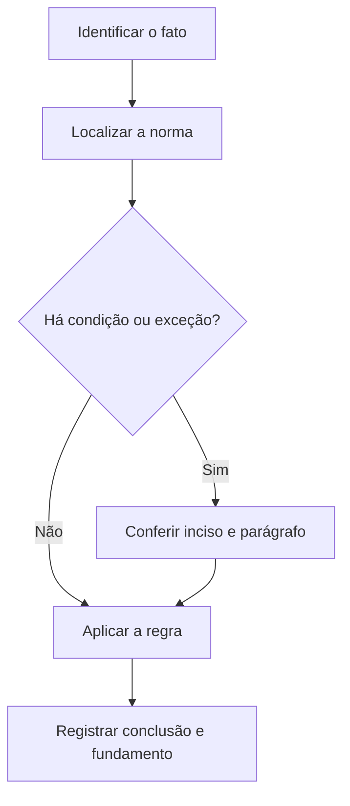

# Livro-texto — Semana 02 | Versão 2.0

**Cargo:** Oficial de Justiça — TJSP | **Banca:** VUNESP | **Período:** 02/11/2026 a 08/11/2026

## Direitos fundamentais e lei penal no tempo

> **Status editorial:** ampliação didática das fichas originais, com referências ao edital. Este volume é um material de estudo revisável, não parecer jurídico nem transcrição integral da lei. Use o roteiro oficial e verifique retificações posteriores.

## Ideia central — entenda antes de decorar

O art. 5º da Constituição protege direitos fundamentais e prevê garantias contra abusos; o Código Penal disciplina a incidência da lei penal no tempo e no espaço. A pergunta central é saber quando a autoridade pode agir e quais direitos limitam sua atuação.

## Mapa visual da semana

## Plano de sete sessões

| Sessão | Atividade | Produto de aprendizagem |
|---|---|---|
| 1 | Estudar **Direitos e garantias individuais** e ler **CF, art. 5º** | Esquema regra/condição/exceção em 5 linhas |
| 2 | Estudar **Direito de reunião** e ler **CF, art. 5º, XVI** | Esquema regra/condição/exceção em 5 linhas |
| 3 | Estudar **Direitos sociais** e ler **CF, art. 6º** | Esquema regra/condição/exceção em 5 linhas |
| 4 | Estudar **Anterioridade penal** e ler **CP, art. 1º** | Esquema regra/condição/exceção em 5 linhas |
| 5 | Estudar **Lei penal mais benéfica** e ler **CP, art. 2º** | Esquema regra/condição/exceção em 5 linhas |
| 6 | Estudar **Coesão referencial** e ler **Língua Portuguesa: coesão** | Esquema regra/condição/exceção em 5 linhas |
| 7 | Questões + uma discursiva + revisão dos erros | Registro D+1, D+7 e D+21 |

---

## Aulas com aplicação prática

### Aula 1 — Direitos e garantias individuais

**Texto para conferir:** CF, art. 5º.

**Entenda a regra.** A Constituição protege direitos fundamentais e estabelece limites à atuação estatal; as restrições devem ter fundamento jurídico. Leia os incisos exatamente como constam na Constituição. Não basta memorizar o nome do instituto: identifique o verbo empregado no artigo, o sujeito que deve agir e os efeitos da conduta.

**Situação concreta.** Uma autoridade pretende restringir a liberdade de uma pessoa apenas por conveniência administrativa. Identifique o grupo de garantias que precisa ser considerado. Antes de escolher a alternativa, pergunte: quem deve agir? há ordem judicial? há prazo ou formalidade? existe exceção?

**Armadilha frequente.** A afirmação a seguir foi construída deliberadamente para estar errada: *Direitos fundamentais podem ser suspensos de maneira geral por simples preferência da autoridade.* Confira no dispositivo indicado por que ela não corresponde à regra.

**Quadro de leitura da lei seca.**

| Passo | O que registrar |
|---|---|
| 1 — Sujeito | Quem pratica, requer, determina ou recebe o ato? |
| 2 — Hipótese | Em que situação a norma se aplica? |
| 3 — Forma | Existe local, prazo, procedimento ou requisito expresso? |
| 4 — Efeito | O que acontece com o cumprimento ou descumprimento? |
| 5 — Exceção | O artigo admite ressalva ou remete a outra norma? |

**Exercício guiado 1.** Reescreva a frase incorreta com o sujeito e a condição corretos. Depois explique o caso concreto em 4–6 linhas, citando **CF, art. 5º**. **Critério de correção:** acertar sujeito, requisito, efeito e artigo.

### Aula 2 — Direito de reunião

**Texto para conferir:** CF, art. 5º, XVI.

**Entenda a regra.** A reunião pacífica e sem armas em locais abertos ao público independe de autorização, observados aviso prévio e respeito a outra reunião anteriormente convocada para o local. Não basta memorizar o nome do instituto: identifique o verbo empregado no artigo, o sujeito que deve agir e os efeitos da conduta.

**Situação concreta.** Organizadores de uma manifestação pacífica discutem se precisam pedir autorização prévia ou cumprir a exigência constitucional de aviso. Antes de escolher a alternativa, pergunte: quem deve agir? há ordem judicial? há prazo ou formalidade? existe exceção?

**Armadilha frequente.** A afirmação a seguir foi construída deliberadamente para estar errada: *A Constituição exige autorização administrativa prévia para toda reunião pacífica.* Confira no dispositivo indicado por que ela não corresponde à regra.

**Quadro de leitura da lei seca.**

| Passo | O que registrar |
|---|---|
| 1 — Sujeito | Quem pratica, requer, determina ou recebe o ato? |
| 2 — Hipótese | Em que situação a norma se aplica? |
| 3 — Forma | Existe local, prazo, procedimento ou requisito expresso? |
| 4 — Efeito | O que acontece com o cumprimento ou descumprimento? |
| 5 — Exceção | O artigo admite ressalva ou remete a outra norma? |

**Exercício guiado 2.** Reescreva a frase incorreta com o sujeito e a condição corretos. Depois explique o caso concreto em 4–6 linhas, citando **CF, art. 5º, XVI**. **Critério de correção:** acertar sujeito, requisito, efeito e artigo.

### Aula 3 — Direitos sociais

**Texto para conferir:** CF, art. 6º.

**Entenda a regra.** O art. 6º apresenta direitos sociais, distintos das liberdades individuais, e integra o bloco constitucional exigido. Observe a lista e suas alterações. Não basta memorizar o nome do instituto: identifique o verbo empregado no artigo, o sujeito que deve agir e os efeitos da conduta.

**Situação concreta.** Uma questão apresenta educação, saúde e trabalho como exemplos de uma categoria constitucional. Antes de escolher a alternativa, pergunte: quem deve agir? há ordem judicial? há prazo ou formalidade? existe exceção?

**Armadilha frequente.** A afirmação a seguir foi construída deliberadamente para estar errada: *Saúde e educação são classificadas apenas como direitos políticos.* Confira no dispositivo indicado por que ela não corresponde à regra.

**Quadro de leitura da lei seca.**

| Passo | O que registrar |
|---|---|
| 1 — Sujeito | Quem pratica, requer, determina ou recebe o ato? |
| 2 — Hipótese | Em que situação a norma se aplica? |
| 3 — Forma | Existe local, prazo, procedimento ou requisito expresso? |
| 4 — Efeito | O que acontece com o cumprimento ou descumprimento? |
| 5 — Exceção | O artigo admite ressalva ou remete a outra norma? |

**Exercício guiado 3.** Reescreva a frase incorreta com o sujeito e a condição corretos. Depois explique o caso concreto em 4–6 linhas, citando **CF, art. 6º**. **Critério de correção:** acertar sujeito, requisito, efeito e artigo.

### Aula 4 — Anterioridade penal

**Texto para conferir:** CP, art. 1º.

**Entenda a regra.** Não há crime sem lei anterior que o defina, nem pena sem prévia cominação legal; trata-se de garantia de legalidade penal. Não basta memorizar o nome do instituto: identifique o verbo empregado no artigo, o sujeito que deve agir e os efeitos da conduta.

**Situação concreta.** Um comportamento era atípico quando ocorreu e só depois uma lei o definiu como crime. Antes de escolher a alternativa, pergunte: quem deve agir? há ordem judicial? há prazo ou formalidade? existe exceção?

**Armadilha frequente.** A afirmação a seguir foi construída deliberadamente para estar errada: *Uma norma posterior pode criar crime e retroagir livremente para punir fatos anteriores.* Confira no dispositivo indicado por que ela não corresponde à regra.

**Quadro de leitura da lei seca.**

| Passo | O que registrar |
|---|---|
| 1 — Sujeito | Quem pratica, requer, determina ou recebe o ato? |
| 2 — Hipótese | Em que situação a norma se aplica? |
| 3 — Forma | Existe local, prazo, procedimento ou requisito expresso? |
| 4 — Efeito | O que acontece com o cumprimento ou descumprimento? |
| 5 — Exceção | O artigo admite ressalva ou remete a outra norma? |

**Exercício guiado 4.** Reescreva a frase incorreta com o sujeito e a condição corretos. Depois explique o caso concreto em 4–6 linhas, citando **CP, art. 1º**. **Critério de correção:** acertar sujeito, requisito, efeito e artigo.

### Aula 5 — Lei penal mais benéfica

**Texto para conferir:** CP, art. 2º.

**Entenda a regra.** A lei penal posterior que favorece o agente retroage; a lei que deixa de considerar um fato crime afeta a punição conforme as regras do art. 2º. Não basta memorizar o nome do instituto: identifique o verbo empregado no artigo, o sujeito que deve agir e os efeitos da conduta.

**Situação concreta.** Depois de uma condenação, sobrevém lei que beneficia o condenado. Antes de escolher a alternativa, pergunte: quem deve agir? há ordem judicial? há prazo ou formalidade? existe exceção?

**Armadilha frequente.** A afirmação a seguir foi construída deliberadamente para estar errada: *A lei penal posterior mais favorável nunca se aplica a fatos anteriores.* Confira no dispositivo indicado por que ela não corresponde à regra.

**Quadro de leitura da lei seca.**

| Passo | O que registrar |
|---|---|
| 1 — Sujeito | Quem pratica, requer, determina ou recebe o ato? |
| 2 — Hipótese | Em que situação a norma se aplica? |
| 3 — Forma | Existe local, prazo, procedimento ou requisito expresso? |
| 4 — Efeito | O que acontece com o cumprimento ou descumprimento? |
| 5 — Exceção | O artigo admite ressalva ou remete a outra norma? |

**Exercício guiado 5.** Reescreva a frase incorreta com o sujeito e a condição corretos. Depois explique o caso concreto em 4–6 linhas, citando **CP, art. 2º**. **Critério de correção:** acertar sujeito, requisito, efeito e artigo.

### Aula 6 — Coesão referencial

**Texto para conferir:** Língua Portuguesa: coesão.

**Entenda a regra.** Expressões como esse, tal fato e ele retomam informação anterior; localizar o referente evita inferências equivocadas. Não basta memorizar o nome do instituto: identifique o verbo empregado no artigo, o sujeito que deve agir e os efeitos da conduta.

**Situação concreta.** No trecho: A intimação foi expedida ontem. Ela será cumprida amanhã, determine a que se refere ela. Antes de escolher a alternativa, pergunte: quem deve agir? há ordem judicial? há prazo ou formalidade? existe exceção?

**Armadilha frequente.** A afirmação a seguir foi construída deliberadamente para estar errada: *Todo pronome retoma obrigatoriamente o substantivo mais próximo, sem consideração do contexto.* Confira no dispositivo indicado por que ela não corresponde à regra.

**Quadro de leitura da lei seca.**

| Passo | O que registrar |
|---|---|
| 1 — Sujeito | Quem pratica, requer, determina ou recebe o ato? |
| 2 — Hipótese | Em que situação a norma se aplica? |
| 3 — Forma | Existe local, prazo, procedimento ou requisito expresso? |
| 4 — Efeito | O que acontece com o cumprimento ou descumprimento? |
| 5 — Exceção | O artigo admite ressalva ou remete a outra norma? |

**Exercício guiado 6.** Reescreva a frase incorreta com o sujeito e a condição corretos. Depois explique o caso concreto em 4–6 linhas, citando **Língua Portuguesa: coesão**. **Critério de correção:** acertar sujeito, requisito, efeito e artigo.

## Comparando alternativas: como a banca tenta induzir ao erro

1. **Troca de sujeito:** um dever do juiz é atribuído ao oficial, ou vice-versa.
2. **Absolutização:** expressões como “sempre”, “nunca” e “em qualquer hipótese” escondem exceções.
3. **Mistura de ramos:** regra de citação penal é aplicada ao processo civil sem autorização legal.
4. **Omissão de requisito:** a alternativa descreve o ato, mas esquece um pressuposto, uma comunicação ou uma certificação.
5. **Inversão temporal:** um procedimento posterior aparece como requisito anterior, ou o contrário.

## Questões analíticas da semana (autorais)

1. **Caso: Direitos e garantias individuais.** Uma autoridade pretende restringir a liberdade de uma pessoa apenas por conveniência administrativa. Identifique o grupo de garantias que precisa ser considerado. Explique a providência ou o conceito aplicável; identifique duas condições que você procuraria no texto legal e uma alternativa plausível, porém incorreta. Justifique com **CF, art. 5º**.

2. **Caso: Direito de reunião.** Organizadores de uma manifestação pacífica discutem se precisam pedir autorização prévia ou cumprir a exigência constitucional de aviso. Explique a providência ou o conceito aplicável; identifique duas condições que você procuraria no texto legal e uma alternativa plausível, porém incorreta. Justifique com **CF, art. 5º, XVI**.

3. **Caso: Direitos sociais.** Uma questão apresenta educação, saúde e trabalho como exemplos de uma categoria constitucional. Explique a providência ou o conceito aplicável; identifique duas condições que você procuraria no texto legal e uma alternativa plausível, porém incorreta. Justifique com **CF, art. 6º**.

4. **Caso: Anterioridade penal.** Um comportamento era atípico quando ocorreu e só depois uma lei o definiu como crime. Explique a providência ou o conceito aplicável; identifique duas condições que você procuraria no texto legal e uma alternativa plausível, porém incorreta. Justifique com **CP, art. 1º**.

5. **Caso: Lei penal mais benéfica.** Depois de uma condenação, sobrevém lei que beneficia o condenado. Explique a providência ou o conceito aplicável; identifique duas condições que você procuraria no texto legal e uma alternativa plausível, porém incorreta. Justifique com **CP, art. 2º**.

6. **Caso: Coesão referencial.** No trecho: A intimação foi expedida ontem. Ela será cumprida amanhã, determine a que se refere ela. Explique a providência ou o conceito aplicável; identifique duas condições que você procuraria no texto legal e uma alternativa plausível, porém incorreta. Justifique com **Língua Portuguesa: coesão**.

### Proposta discursiva

Com base nos temas **Direitos e garantias individuais** e **Lei penal mais benéfica**, descreva como um profissional deve identificar corretamente a norma aplicável a uma situação real, distinguindo competência, procedimento e documentação do ato. Cite os dispositivos do edital e construa uma conclusão em 10 a 15 linhas.

### Critério para autoavaliação (20 pontos)

| Aspecto | Pontos |
|---|---:|
| Identificação da norma e competência | 6 |
| Aplicação ao caso e condições legais | 7 |
| Exceções e documentação | 4 |
| Clareza, objetividade e escrita | 3 |

## Respostas esperadas aos exercícios analíticos

1. A resposta deve partir da regra: **A Constituição protege direitos fundamentais e estabelece limites à atuação estatal; as restrições devem ter fundamento jurídico. Leia os incisos exatamente como constam na Constituição.** No caso: Uma autoridade pretende restringir a liberdade de uma pessoa apenas por conveniência administrativa. Identifique o grupo de garantias que precisa ser considerado. A hipótese errada a ser rebatida é: “Direitos fundamentais podem ser suspensos de maneira geral por simples preferência da autoridade.”. O argumento definitivo deve apontar a redação completa de **CF, art. 5º**, inclusive remissões e exceções.

2. A resposta deve partir da regra: **A reunião pacífica e sem armas em locais abertos ao público independe de autorização, observados aviso prévio e respeito a outra reunião anteriormente convocada para o local.** No caso: Organizadores de uma manifestação pacífica discutem se precisam pedir autorização prévia ou cumprir a exigência constitucional de aviso. A hipótese errada a ser rebatida é: “A Constituição exige autorização administrativa prévia para toda reunião pacífica.”. O argumento definitivo deve apontar a redação completa de **CF, art. 5º, XVI**, inclusive remissões e exceções.

3. A resposta deve partir da regra: **O art. 6º apresenta direitos sociais, distintos das liberdades individuais, e integra o bloco constitucional exigido. Observe a lista e suas alterações.** No caso: Uma questão apresenta educação, saúde e trabalho como exemplos de uma categoria constitucional. A hipótese errada a ser rebatida é: “Saúde e educação são classificadas apenas como direitos políticos.”. O argumento definitivo deve apontar a redação completa de **CF, art. 6º**, inclusive remissões e exceções.

4. A resposta deve partir da regra: **Não há crime sem lei anterior que o defina, nem pena sem prévia cominação legal; trata-se de garantia de legalidade penal.** No caso: Um comportamento era atípico quando ocorreu e só depois uma lei o definiu como crime. A hipótese errada a ser rebatida é: “Uma norma posterior pode criar crime e retroagir livremente para punir fatos anteriores.”. O argumento definitivo deve apontar a redação completa de **CP, art. 1º**, inclusive remissões e exceções.

5. A resposta deve partir da regra: **A lei penal posterior que favorece o agente retroage; a lei que deixa de considerar um fato crime afeta a punição conforme as regras do art. 2º.** No caso: Depois de uma condenação, sobrevém lei que beneficia o condenado. A hipótese errada a ser rebatida é: “A lei penal posterior mais favorável nunca se aplica a fatos anteriores.”. O argumento definitivo deve apontar a redação completa de **CP, art. 2º**, inclusive remissões e exceções.

6. A resposta deve partir da regra: **Expressões como esse, tal fato e ele retomam informação anterior; localizar o referente evita inferências equivocadas.** No caso: No trecho: A intimação foi expedida ontem. Ela será cumprida amanhã, determine a que se refere ela. A hipótese errada a ser rebatida é: “Todo pronome retoma obrigatoriamente o substantivo mais próximo, sem consideração do contexto.”. O argumento definitivo deve apontar a redação completa de **Língua Portuguesa: coesão**, inclusive remissões e exceções.

## Checklist de conclusão

- [ ] Li o capítulo, incluindo os exemplos.
- [ ] Conferi o texto completo de todos os artigos indicados nesta semana.
- [ ] Resolvi as seis questões analíticas sem consulta.
- [ ] Escrevi ao menos uma discursiva e revisei os erros.
- [ ] Registrei o que deve retornar nas revisões D+1, D+7 e D+21.

**Fonte primária:** [Edital 01/2026, Anexo VIII](https://drive.google.com/file/d/1YJSOt6SDpONIJLY1ahDa9D4y8vkTGwlJ/view) e [Roteiro de legislação por semana](../../legislacao/roteiro_corrigido.md).

**Nota:** As respostas comentadas são guias metodológicos, não substituem a consulta dos dispositivos integrais, e os exercícios autorais não são da VUNESP.
