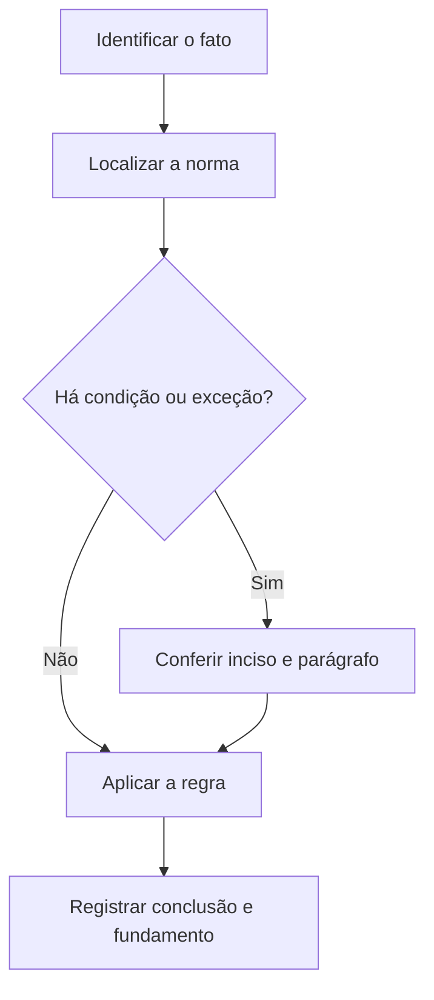

# Livro-texto — Semana 03 | Versão 2.0

**Cargo:** Oficial de Justiça — TJSP | **Banca:** VUNESP | **Período:** 09/11/2026 a 15/11/2026

## Organização política, ação penal e porcentagens

> **Status editorial:** ampliação didática das fichas originais, com referências ao edital. Este volume é um material de estudo revisável, não parecer jurídico nem transcrição integral da lei. Use o roteiro oficial e verifique retificações posteriores.

## Ideia central — entenda antes de decorar

Nacionalidade e direitos políticos não são sinônimos; a ação penal possui modalidades diferentes e efeitos no processo. Estude sempre quem é o titular do direito, quem pode propor a ação e a condição exigida.

## Mapa visual da semana

## Plano de sete sessões

| Sessão | Atividade | Produto de aprendizagem |
|---|---|---|
| 1 | Estudar **Nacionalidade** e ler **CF, art. 12** | Esquema regra/condição/exceção em 5 linhas |
| 2 | Estudar **Direitos políticos** e ler **CF, art. 14** | Esquema regra/condição/exceção em 5 linhas |
| 3 | Estudar **Organização político-administrativa** e ler **CF, art. 18** | Esquema regra/condição/exceção em 5 linhas |
| 4 | Estudar **Ação penal pública e privada** e ler **CP, art. 100** | Esquema regra/condição/exceção em 5 linhas |
| 5 | Estudar **Extinção da punibilidade** e ler **CP, art. 107** | Esquema regra/condição/exceção em 5 linhas |
| 6 | Estudar **Porcentagem e variação** e ler **Matemática: porcentagens** | Esquema regra/condição/exceção em 5 linhas |
| 7 | Questões + uma discursiva + revisão dos erros | Registro D+1, D+7 e D+21 |

---

## Aulas com aplicação prática

### Aula 1 — Nacionalidade

**Texto para conferir:** CF, art. 12.

**Entenda a regra.** Diferencie brasileiro nato, naturalizado e as hipóteses constitucionais correspondentes. Nem todo nascimento fora do Brasil leva ao mesmo enquadramento. Não basta memorizar o nome do instituto: identifique o verbo empregado no artigo, o sujeito que deve agir e os efeitos da conduta.

**Situação concreta.** Uma pessoa nasceu fora do país e precisa identificar os requisitos constitucionais relativos à nacionalidade. Antes de escolher a alternativa, pergunte: quem deve agir? há ordem judicial? há prazo ou formalidade? existe exceção?

**Armadilha frequente.** A afirmação a seguir foi construída deliberadamente para estar errada: *Brasileiro nato e naturalizado são categorias sem distinção constitucional.* Confira no dispositivo indicado por que ela não corresponde à regra.

**Quadro de leitura da lei seca.**

| Passo | O que registrar |
|---|---|
| 1 — Sujeito | Quem pratica, requer, determina ou recebe o ato? |
| 2 — Hipótese | Em que situação a norma se aplica? |
| 3 — Forma | Existe local, prazo, procedimento ou requisito expresso? |
| 4 — Efeito | O que acontece com o cumprimento ou descumprimento? |
| 5 — Exceção | O artigo admite ressalva ou remete a outra norma? |

**Exercício guiado 1.** Reescreva a frase incorreta com o sujeito e a condição corretos. Depois explique o caso concreto em 4–6 linhas, citando **CF, art. 12**. **Critério de correção:** acertar sujeito, requisito, efeito e artigo.

### Aula 2 — Direitos políticos

**Texto para conferir:** CF, art. 14.

**Entenda a regra.** A soberania popular é exercida pelo sufrágio universal, pelo voto direto e secreto, com valor igual para todos, e pelos mecanismos indicados na Constituição. Não basta memorizar o nome do instituto: identifique o verbo empregado no artigo, o sujeito que deve agir e os efeitos da conduta.

**Situação concreta.** Uma questão pergunta quais instrumentos materializam o exercício da soberania popular. Antes de escolher a alternativa, pergunte: quem deve agir? há ordem judicial? há prazo ou formalidade? existe exceção?

**Armadilha frequente.** A afirmação a seguir foi construída deliberadamente para estar errada: *Plebiscito e referendo são incompatíveis com a ordem constitucional brasileira.* Confira no dispositivo indicado por que ela não corresponde à regra.

**Quadro de leitura da lei seca.**

| Passo | O que registrar |
|---|---|
| 1 — Sujeito | Quem pratica, requer, determina ou recebe o ato? |
| 2 — Hipótese | Em que situação a norma se aplica? |
| 3 — Forma | Existe local, prazo, procedimento ou requisito expresso? |
| 4 — Efeito | O que acontece com o cumprimento ou descumprimento? |
| 5 — Exceção | O artigo admite ressalva ou remete a outra norma? |

**Exercício guiado 2.** Reescreva a frase incorreta com o sujeito e a condição corretos. Depois explique o caso concreto em 4–6 linhas, citando **CF, art. 14**. **Critério de correção:** acertar sujeito, requisito, efeito e artigo.

### Aula 3 — Organização político-administrativa

**Texto para conferir:** CF, art. 18.

**Entenda a regra.** A organização político-administrativa inclui União, estados, Distrito Federal e municípios, todos autônomos nos termos constitucionais. Não basta memorizar o nome do instituto: identifique o verbo empregado no artigo, o sujeito que deve agir e os efeitos da conduta.

**Situação concreta.** Um enunciado omite os municípios ao enumerar os entes federativos. Antes de escolher a alternativa, pergunte: quem deve agir? há ordem judicial? há prazo ou formalidade? existe exceção?

**Armadilha frequente.** A afirmação a seguir foi construída deliberadamente para estar errada: *Os municípios não integram a organização político-administrativa brasileira.* Confira no dispositivo indicado por que ela não corresponde à regra.

**Quadro de leitura da lei seca.**

| Passo | O que registrar |
|---|---|
| 1 — Sujeito | Quem pratica, requer, determina ou recebe o ato? |
| 2 — Hipótese | Em que situação a norma se aplica? |
| 3 — Forma | Existe local, prazo, procedimento ou requisito expresso? |
| 4 — Efeito | O que acontece com o cumprimento ou descumprimento? |
| 5 — Exceção | O artigo admite ressalva ou remete a outra norma? |

**Exercício guiado 3.** Reescreva a frase incorreta com o sujeito e a condição corretos. Depois explique o caso concreto em 4–6 linhas, citando **CF, art. 18**. **Critério de correção:** acertar sujeito, requisito, efeito e artigo.

### Aula 4 — Ação penal pública e privada

**Texto para conferir:** CP, art. 100.

**Entenda a regra.** A ação penal é pública como regra, salvo quando a lei expressamente a declara privativa do ofendido; atenção à iniciativa do Ministério Público e à queixa. Não basta memorizar o nome do instituto: identifique o verbo empregado no artigo, o sujeito que deve agir e os efeitos da conduta.

**Situação concreta.** Diante de fato criminoso, o candidato deve identificar se o titular da iniciativa processual é o Ministério Público ou o ofendido. Antes de escolher a alternativa, pergunte: quem deve agir? há ordem judicial? há prazo ou formalidade? existe exceção?

**Armadilha frequente.** A afirmação a seguir foi construída deliberadamente para estar errada: *Toda ação penal depende sempre de queixa apresentada pela vítima.* Confira no dispositivo indicado por que ela não corresponde à regra.

**Quadro de leitura da lei seca.**

| Passo | O que registrar |
|---|---|
| 1 — Sujeito | Quem pratica, requer, determina ou recebe o ato? |
| 2 — Hipótese | Em que situação a norma se aplica? |
| 3 — Forma | Existe local, prazo, procedimento ou requisito expresso? |
| 4 — Efeito | O que acontece com o cumprimento ou descumprimento? |
| 5 — Exceção | O artigo admite ressalva ou remete a outra norma? |

**Exercício guiado 4.** Reescreva a frase incorreta com o sujeito e a condição corretos. Depois explique o caso concreto em 4–6 linhas, citando **CP, art. 100**. **Critério de correção:** acertar sujeito, requisito, efeito e artigo.

### Aula 5 — Extinção da punibilidade

**Texto para conferir:** CP, art. 107.

**Entenda a regra.** O art. 107 enumera hipóteses de extinção da punibilidade, incluindo morte do agente, prescrição e outras situações previstas em lei. Não basta memorizar o nome do instituto: identifique o verbo empregado no artigo, o sujeito que deve agir e os efeitos da conduta.

**Situação concreta.** Depois de um fato penal, sobrevém uma circunstância que pode extinguir a punibilidade. Antes de escolher a alternativa, pergunte: quem deve agir? há ordem judicial? há prazo ou formalidade? existe exceção?

**Armadilha frequente.** A afirmação a seguir foi construída deliberadamente para estar errada: *A extinção da punibilidade só pode ocorrer antes do processo começar.* Confira no dispositivo indicado por que ela não corresponde à regra.

**Quadro de leitura da lei seca.**

| Passo | O que registrar |
|---|---|
| 1 — Sujeito | Quem pratica, requer, determina ou recebe o ato? |
| 2 — Hipótese | Em que situação a norma se aplica? |
| 3 — Forma | Existe local, prazo, procedimento ou requisito expresso? |
| 4 — Efeito | O que acontece com o cumprimento ou descumprimento? |
| 5 — Exceção | O artigo admite ressalva ou remete a outra norma? |

**Exercício guiado 5.** Reescreva a frase incorreta com o sujeito e a condição corretos. Depois explique o caso concreto em 4–6 linhas, citando **CP, art. 107**. **Critério de correção:** acertar sujeito, requisito, efeito e artigo.

### Aula 6 — Porcentagem e variação

**Texto para conferir:** Matemática: porcentagens.

**Entenda a regra.** Porcentagem é razão por 100; um acréscimo de p% multiplica o valor por 1+p/100. Reduções sucessivas não se somam automaticamente. Não basta memorizar o nome do instituto: identifique o verbo empregado no artigo, o sujeito que deve agir e os efeitos da conduta.

**Situação concreta.** Uma despesa de R$ 200 aumenta 10%: o novo valor é R$ 220. Antes de escolher a alternativa, pergunte: quem deve agir? há ordem judicial? há prazo ou formalidade? existe exceção?

**Armadilha frequente.** A afirmação a seguir foi construída deliberadamente para estar errada: *Aumentar 10% e depois reduzir 10% sempre retorna exatamente ao valor inicial.* Confira no dispositivo indicado por que ela não corresponde à regra.

**Quadro de leitura da lei seca.**

| Passo | O que registrar |
|---|---|
| 1 — Sujeito | Quem pratica, requer, determina ou recebe o ato? |
| 2 — Hipótese | Em que situação a norma se aplica? |
| 3 — Forma | Existe local, prazo, procedimento ou requisito expresso? |
| 4 — Efeito | O que acontece com o cumprimento ou descumprimento? |
| 5 — Exceção | O artigo admite ressalva ou remete a outra norma? |

**Exercício guiado 6.** Reescreva a frase incorreta com o sujeito e a condição corretos. Depois explique o caso concreto em 4–6 linhas, citando **Matemática: porcentagens**. **Critério de correção:** acertar sujeito, requisito, efeito e artigo.

## Comparando alternativas: como a banca tenta induzir ao erro

1. **Troca de sujeito:** um dever do juiz é atribuído ao oficial, ou vice-versa.
2. **Absolutização:** expressões como “sempre”, “nunca” e “em qualquer hipótese” escondem exceções.
3. **Mistura de ramos:** regra de citação penal é aplicada ao processo civil sem autorização legal.
4. **Omissão de requisito:** a alternativa descreve o ato, mas esquece um pressuposto, uma comunicação ou uma certificação.
5. **Inversão temporal:** um procedimento posterior aparece como requisito anterior, ou o contrário.

## Questões analíticas da semana (autorais)

1. **Caso: Nacionalidade.** Uma pessoa nasceu fora do país e precisa identificar os requisitos constitucionais relativos à nacionalidade. Explique a providência ou o conceito aplicável; identifique duas condições que você procuraria no texto legal e uma alternativa plausível, porém incorreta. Justifique com **CF, art. 12**.

2. **Caso: Direitos políticos.** Uma questão pergunta quais instrumentos materializam o exercício da soberania popular. Explique a providência ou o conceito aplicável; identifique duas condições que você procuraria no texto legal e uma alternativa plausível, porém incorreta. Justifique com **CF, art. 14**.

3. **Caso: Organização político-administrativa.** Um enunciado omite os municípios ao enumerar os entes federativos. Explique a providência ou o conceito aplicável; identifique duas condições que você procuraria no texto legal e uma alternativa plausível, porém incorreta. Justifique com **CF, art. 18**.

4. **Caso: Ação penal pública e privada.** Diante de fato criminoso, o candidato deve identificar se o titular da iniciativa processual é o Ministério Público ou o ofendido. Explique a providência ou o conceito aplicável; identifique duas condições que você procuraria no texto legal e uma alternativa plausível, porém incorreta. Justifique com **CP, art. 100**.

5. **Caso: Extinção da punibilidade.** Depois de um fato penal, sobrevém uma circunstância que pode extinguir a punibilidade. Explique a providência ou o conceito aplicável; identifique duas condições que você procuraria no texto legal e uma alternativa plausível, porém incorreta. Justifique com **CP, art. 107**.

6. **Caso: Porcentagem e variação.** Uma despesa de R$ 200 aumenta 10%: o novo valor é R$ 220. Explique a providência ou o conceito aplicável; identifique duas condições que você procuraria no texto legal e uma alternativa plausível, porém incorreta. Justifique com **Matemática: porcentagens**.

### Proposta discursiva

Com base nos temas **Nacionalidade** e **Extinção da punibilidade**, descreva como um profissional deve identificar corretamente a norma aplicável a uma situação real, distinguindo competência, procedimento e documentação do ato. Cite os dispositivos do edital e construa uma conclusão em 10 a 15 linhas.

### Critério para autoavaliação (20 pontos)

| Aspecto | Pontos |
|---|---:|
| Identificação da norma e competência | 6 |
| Aplicação ao caso e condições legais | 7 |
| Exceções e documentação | 4 |
| Clareza, objetividade e escrita | 3 |

## Respostas esperadas aos exercícios analíticos

1. A resposta deve partir da regra: **Diferencie brasileiro nato, naturalizado e as hipóteses constitucionais correspondentes. Nem todo nascimento fora do Brasil leva ao mesmo enquadramento.** No caso: Uma pessoa nasceu fora do país e precisa identificar os requisitos constitucionais relativos à nacionalidade. A hipótese errada a ser rebatida é: “Brasileiro nato e naturalizado são categorias sem distinção constitucional.”. O argumento definitivo deve apontar a redação completa de **CF, art. 12**, inclusive remissões e exceções.

2. A resposta deve partir da regra: **A soberania popular é exercida pelo sufrágio universal, pelo voto direto e secreto, com valor igual para todos, e pelos mecanismos indicados na Constituição.** No caso: Uma questão pergunta quais instrumentos materializam o exercício da soberania popular. A hipótese errada a ser rebatida é: “Plebiscito e referendo são incompatíveis com a ordem constitucional brasileira.”. O argumento definitivo deve apontar a redação completa de **CF, art. 14**, inclusive remissões e exceções.

3. A resposta deve partir da regra: **A organização político-administrativa inclui União, estados, Distrito Federal e municípios, todos autônomos nos termos constitucionais.** No caso: Um enunciado omite os municípios ao enumerar os entes federativos. A hipótese errada a ser rebatida é: “Os municípios não integram a organização político-administrativa brasileira.”. O argumento definitivo deve apontar a redação completa de **CF, art. 18**, inclusive remissões e exceções.

4. A resposta deve partir da regra: **A ação penal é pública como regra, salvo quando a lei expressamente a declara privativa do ofendido; atenção à iniciativa do Ministério Público e à queixa.** No caso: Diante de fato criminoso, o candidato deve identificar se o titular da iniciativa processual é o Ministério Público ou o ofendido. A hipótese errada a ser rebatida é: “Toda ação penal depende sempre de queixa apresentada pela vítima.”. O argumento definitivo deve apontar a redação completa de **CP, art. 100**, inclusive remissões e exceções.

5. A resposta deve partir da regra: **O art. 107 enumera hipóteses de extinção da punibilidade, incluindo morte do agente, prescrição e outras situações previstas em lei.** No caso: Depois de um fato penal, sobrevém uma circunstância que pode extinguir a punibilidade. A hipótese errada a ser rebatida é: “A extinção da punibilidade só pode ocorrer antes do processo começar.”. O argumento definitivo deve apontar a redação completa de **CP, art. 107**, inclusive remissões e exceções.

6. A resposta deve partir da regra: **Porcentagem é razão por 100; um acréscimo de p% multiplica o valor por 1+p/100. Reduções sucessivas não se somam automaticamente.** No caso: Uma despesa de R$ 200 aumenta 10%: o novo valor é R$ 220. A hipótese errada a ser rebatida é: “Aumentar 10% e depois reduzir 10% sempre retorna exatamente ao valor inicial.”. O argumento definitivo deve apontar a redação completa de **Matemática: porcentagens**, inclusive remissões e exceções.

## Checklist de conclusão

- [ ] Li o capítulo, incluindo os exemplos.
- [ ] Conferi o texto completo de todos os artigos indicados nesta semana.
- [ ] Resolvi as seis questões analíticas sem consulta.
- [ ] Escrevi ao menos uma discursiva e revisei os erros.
- [ ] Registrei o que deve retornar nas revisões D+1, D+7 e D+21.

**Fonte primária:** [Edital 01/2026, Anexo VIII](https://drive.google.com/file/d/1YJSOt6SDpONIJLY1ahDa9D4y8vkTGwlJ/view) e [Roteiro de legislação por semana](../../legislacao/roteiro_corrigido.md).

**Nota:** As respostas comentadas são guias metodológicos, não substituem a consulta dos dispositivos integrais, e os exercícios autorais não são da VUNESP.