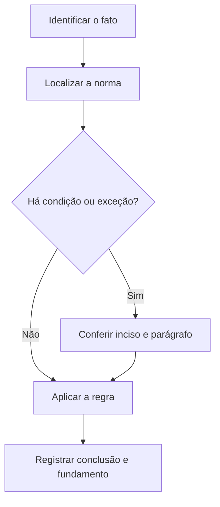

# Livro-texto — Semana 04 | Versão 2.0

**Cargo:** Oficial de Justiça — TJSP | **Banca:** VUNESP | **Período:** 16/11/2026 a 22/11/2026

## Administração pública, Poder Judiciário e crimes contra a pessoa

> **Status editorial:** ampliação didática das fichas originais, com referências ao edital. Este volume é um material de estudo revisável, não parecer jurídico nem transcrição integral da lei. Use o roteiro oficial e verifique retificações posteriores.

## Ideia central — entenda antes de decorar

As atribuições do Judiciário e dos servidores coexistem com limites constitucionais e regras penais. Ao estudar, diferencie a competência do órgão da responsabilidade individual do agente.

## Mapa visual da semana

## Plano de sete sessões

| Sessão | Atividade | Produto de aprendizagem |
|---|---|---|
| 1 | Estudar **Princípios da administração** e ler **CF, art. 37, caput** | Esquema regra/condição/exceção em 5 linhas |
| 2 | Estudar **Ingresso e concurso público** e ler **CF, art. 37, II e III** | Esquema regra/condição/exceção em 5 linhas |
| 3 | Estudar **Estabilidade do servidor** e ler **CF, art. 41** | Esquema regra/condição/exceção em 5 linhas |
| 4 | Estudar **Estrutura do Poder Judiciário** e ler **CF, arts. 92 a 99** | Esquema regra/condição/exceção em 5 linhas |
| 5 | Estudar **Lesão corporal** e ler **CP, art. 129** | Esquema regra/condição/exceção em 5 linhas |
| 6 | Estudar **Violação de domicílio** e ler **CP, art. 150** | Esquema regra/condição/exceção em 5 linhas |
| 7 | Questões + uma discursiva + revisão dos erros | Registro D+1, D+7 e D+21 |

---

## Aulas com aplicação prática

### Aula 1 — Princípios da administração

**Texto para conferir:** CF, art. 37, caput.

**Entenda a regra.** A administração pública direta e indireta observa legalidade, impessoalidade, moralidade, publicidade e eficiência. Aprenda exemplos concretos de cada princípio. Não basta memorizar o nome do instituto: identifique o verbo empregado no artigo, o sujeito que deve agir e os efeitos da conduta.

**Situação concreta.** Um gestor favorece amigo em ato administrativo sem critério impessoal. Antes de escolher a alternativa, pergunte: quem deve agir? há ordem judicial? há prazo ou formalidade? existe exceção?

**Armadilha frequente.** A afirmação a seguir foi construída deliberadamente para estar errada: *Impessoalidade é facultativa quando o gestor possui confiança pessoal no beneficiário.* Confira no dispositivo indicado por que ela não corresponde à regra.

**Quadro de leitura da lei seca.**

| Passo | O que registrar |
|---|---|
| 1 — Sujeito | Quem pratica, requer, determina ou recebe o ato? |
| 2 — Hipótese | Em que situação a norma se aplica? |
| 3 — Forma | Existe local, prazo, procedimento ou requisito expresso? |
| 4 — Efeito | O que acontece com o cumprimento ou descumprimento? |
| 5 — Exceção | O artigo admite ressalva ou remete a outra norma? |

**Exercício guiado 1.** Reescreva a frase incorreta com o sujeito e a condição corretos. Depois explique o caso concreto em 4–6 linhas, citando **CF, art. 37, caput**. **Critério de correção:** acertar sujeito, requisito, efeito e artigo.

### Aula 2 — Ingresso e concurso público

**Texto para conferir:** CF, art. 37, II e III.

**Entenda a regra.** Como regra, a investidura em cargo ou emprego público depende de concurso, ressalvadas hipóteses constitucionais. A validade é de até dois anos, prorrogável uma vez por igual período. Não basta memorizar o nome do instituto: identifique o verbo empregado no artigo, o sujeito que deve agir e os efeitos da conduta.

**Situação concreta.** Um edital prevê validade inicial superior ao máximo constitucional, sem hipótese especial. Antes de escolher a alternativa, pergunte: quem deve agir? há ordem judicial? há prazo ou formalidade? existe exceção?

**Armadilha frequente.** A afirmação a seguir foi construída deliberadamente para estar errada: *Um concurso pode ter validade inicial ilimitada por decisão do órgão.* Confira no dispositivo indicado por que ela não corresponde à regra.

**Quadro de leitura da lei seca.**

| Passo | O que registrar |
|---|---|
| 1 — Sujeito | Quem pratica, requer, determina ou recebe o ato? |
| 2 — Hipótese | Em que situação a norma se aplica? |
| 3 — Forma | Existe local, prazo, procedimento ou requisito expresso? |
| 4 — Efeito | O que acontece com o cumprimento ou descumprimento? |
| 5 — Exceção | O artigo admite ressalva ou remete a outra norma? |

**Exercício guiado 2.** Reescreva a frase incorreta com o sujeito e a condição corretos. Depois explique o caso concreto em 4–6 linhas, citando **CF, art. 37, II e III**. **Critério de correção:** acertar sujeito, requisito, efeito e artigo.

### Aula 3 — Estabilidade do servidor

**Texto para conferir:** CF, art. 41.

**Entenda a regra.** O servidor nomeado para cargo efetivo por concurso adquire estabilidade após três anos de efetivo exercício e avaliação especial de desempenho, nas condições constitucionais. Não basta memorizar o nome do instituto: identifique o verbo empregado no artigo, o sujeito que deve agir e os efeitos da conduta.

**Situação concreta.** Um servidor conclui dois anos de exercício e afirma que já possui estabilidade constitucional automática. Antes de escolher a alternativa, pergunte: quem deve agir? há ordem judicial? há prazo ou formalidade? existe exceção?

**Armadilha frequente.** A afirmação a seguir foi construída deliberadamente para estar errada: *Estabilidade é adquirida automaticamente na data da nomeação.* Confira no dispositivo indicado por que ela não corresponde à regra.

**Quadro de leitura da lei seca.**

| Passo | O que registrar |
|---|---|
| 1 — Sujeito | Quem pratica, requer, determina ou recebe o ato? |
| 2 — Hipótese | Em que situação a norma se aplica? |
| 3 — Forma | Existe local, prazo, procedimento ou requisito expresso? |
| 4 — Efeito | O que acontece com o cumprimento ou descumprimento? |
| 5 — Exceção | O artigo admite ressalva ou remete a outra norma? |

**Exercício guiado 3.** Reescreva a frase incorreta com o sujeito e a condição corretos. Depois explique o caso concreto em 4–6 linhas, citando **CF, art. 41**. **Critério de correção:** acertar sujeito, requisito, efeito e artigo.

### Aula 4 — Estrutura do Poder Judiciário

**Texto para conferir:** CF, arts. 92 a 99.

**Entenda a regra.** O art. 92 lista órgãos do Poder Judiciário; os artigos seguintes tratam de garantias, competências e autonomia. Não confunda o Ministério Público com órgão do Poder Judiciário. Não basta memorizar o nome do instituto: identifique o verbo empregado no artigo, o sujeito que deve agir e os efeitos da conduta.

**Situação concreta.** Uma alternativa enumera o Ministério Público como se fosse um tribunal. Antes de escolher a alternativa, pergunte: quem deve agir? há ordem judicial? há prazo ou formalidade? existe exceção?

**Armadilha frequente.** A afirmação a seguir foi construída deliberadamente para estar errada: *O Ministério Público integra a lista de órgãos do Poder Judiciário prevista no art. 92.* Confira no dispositivo indicado por que ela não corresponde à regra.

**Quadro de leitura da lei seca.**

| Passo | O que registrar |
|---|---|
| 1 — Sujeito | Quem pratica, requer, determina ou recebe o ato? |
| 2 — Hipótese | Em que situação a norma se aplica? |
| 3 — Forma | Existe local, prazo, procedimento ou requisito expresso? |
| 4 — Efeito | O que acontece com o cumprimento ou descumprimento? |
| 5 — Exceção | O artigo admite ressalva ou remete a outra norma? |

**Exercício guiado 4.** Reescreva a frase incorreta com o sujeito e a condição corretos. Depois explique o caso concreto em 4–6 linhas, citando **CF, arts. 92 a 99**. **Critério de correção:** acertar sujeito, requisito, efeito e artigo.

### Aula 5 — Lesão corporal

**Texto para conferir:** CP, art. 129.

**Entenda a regra.** O tipo do art. 129 refere-se à ofensa à integridade corporal ou à saúde de outrem, com formas e consequências que modificam o enquadramento. Não basta memorizar o nome do instituto: identifique o verbo empregado no artigo, o sujeito que deve agir e os efeitos da conduta.

**Situação concreta.** Em um caso de agressão com resultado lesivo, é necessário identificar o artigo penal correspondente. Antes de escolher a alternativa, pergunte: quem deve agir? há ordem judicial? há prazo ou formalidade? existe exceção?

**Armadilha frequente.** A afirmação a seguir foi construída deliberadamente para estar errada: *O art. 129 trata exclusivamente de crimes contra o patrimônio.* Confira no dispositivo indicado por que ela não corresponde à regra.

**Quadro de leitura da lei seca.**

| Passo | O que registrar |
|---|---|
| 1 — Sujeito | Quem pratica, requer, determina ou recebe o ato? |
| 2 — Hipótese | Em que situação a norma se aplica? |
| 3 — Forma | Existe local, prazo, procedimento ou requisito expresso? |
| 4 — Efeito | O que acontece com o cumprimento ou descumprimento? |
| 5 — Exceção | O artigo admite ressalva ou remete a outra norma? |

**Exercício guiado 5.** Reescreva a frase incorreta com o sujeito e a condição corretos. Depois explique o caso concreto em 4–6 linhas, citando **CP, art. 129**. **Critério de correção:** acertar sujeito, requisito, efeito e artigo.

### Aula 6 — Violação de domicílio

**Texto para conferir:** CP, art. 150.

**Entenda a regra.** O art. 150 tutela a inviolabilidade de casa, observadas suas definições e exceções legais. Diferencie ingresso consentido e ingresso indevido. Não basta memorizar o nome do instituto: identifique o verbo empregado no artigo, o sujeito que deve agir e os efeitos da conduta.

**Situação concreta.** Um agente entra clandestinamente em casa alheia fora das hipóteses legais. Antes de escolher a alternativa, pergunte: quem deve agir? há ordem judicial? há prazo ou formalidade? existe exceção?

**Armadilha frequente.** A afirmação a seguir foi construída deliberadamente para estar errada: *Qualquer pessoa pode entrar em casa alheia sem consentimento a qualquer hora.* Confira no dispositivo indicado por que ela não corresponde à regra.

**Quadro de leitura da lei seca.**

| Passo | O que registrar |
|---|---|
| 1 — Sujeito | Quem pratica, requer, determina ou recebe o ato? |
| 2 — Hipótese | Em que situação a norma se aplica? |
| 3 — Forma | Existe local, prazo, procedimento ou requisito expresso? |
| 4 — Efeito | O que acontece com o cumprimento ou descumprimento? |
| 5 — Exceção | O artigo admite ressalva ou remete a outra norma? |

**Exercício guiado 6.** Reescreva a frase incorreta com o sujeito e a condição corretos. Depois explique o caso concreto em 4–6 linhas, citando **CP, art. 150**. **Critério de correção:** acertar sujeito, requisito, efeito e artigo.

## Comparando alternativas: como a banca tenta induzir ao erro

1. **Troca de sujeito:** um dever do juiz é atribuído ao oficial, ou vice-versa.
2. **Absolutização:** expressões como “sempre”, “nunca” e “em qualquer hipótese” escondem exceções.
3. **Mistura de ramos:** regra de citação penal é aplicada ao processo civil sem autorização legal.
4. **Omissão de requisito:** a alternativa descreve o ato, mas esquece um pressuposto, uma comunicação ou uma certificação.
5. **Inversão temporal:** um procedimento posterior aparece como requisito anterior, ou o contrário.

## Questões analíticas da semana (autorais)

1. **Caso: Princípios da administração.** Um gestor favorece amigo em ato administrativo sem critério impessoal. Explique a providência ou o conceito aplicável; identifique duas condições que você procuraria no texto legal e uma alternativa plausível, porém incorreta. Justifique com **CF, art. 37, caput**.

2. **Caso: Ingresso e concurso público.** Um edital prevê validade inicial superior ao máximo constitucional, sem hipótese especial. Explique a providência ou o conceito aplicável; identifique duas condições que você procuraria no texto legal e uma alternativa plausível, porém incorreta. Justifique com **CF, art. 37, II e III**.

3. **Caso: Estabilidade do servidor.** Um servidor conclui dois anos de exercício e afirma que já possui estabilidade constitucional automática. Explique a providência ou o conceito aplicável; identifique duas condições que você procuraria no texto legal e uma alternativa plausível, porém incorreta. Justifique com **CF, art. 41**.

4. **Caso: Estrutura do Poder Judiciário.** Uma alternativa enumera o Ministério Público como se fosse um tribunal. Explique a providência ou o conceito aplicável; identifique duas condições que você procuraria no texto legal e uma alternativa plausível, porém incorreta. Justifique com **CF, arts. 92 a 99**.

5. **Caso: Lesão corporal.** Em um caso de agressão com resultado lesivo, é necessário identificar o artigo penal correspondente. Explique a providência ou o conceito aplicável; identifique duas condições que você procuraria no texto legal e uma alternativa plausível, porém incorreta. Justifique com **CP, art. 129**.

6. **Caso: Violação de domicílio.** Um agente entra clandestinamente em casa alheia fora das hipóteses legais. Explique a providência ou o conceito aplicável; identifique duas condições que você procuraria no texto legal e uma alternativa plausível, porém incorreta. Justifique com **CP, art. 150**.

### Proposta discursiva

Com base nos temas **Princípios da administração** e **Lesão corporal**, descreva como um profissional deve identificar corretamente a norma aplicável a uma situação real, distinguindo competência, procedimento e documentação do ato. Cite os dispositivos do edital e construa uma conclusão em 10 a 15 linhas.

### Critério para autoavaliação (20 pontos)

| Aspecto | Pontos |
|---|---:|
| Identificação da norma e competência | 6 |
| Aplicação ao caso e condições legais | 7 |
| Exceções e documentação | 4 |
| Clareza, objetividade e escrita | 3 |

## Respostas esperadas aos exercícios analíticos

1. A resposta deve partir da regra: **A administração pública direta e indireta observa legalidade, impessoalidade, moralidade, publicidade e eficiência. Aprenda exemplos concretos de cada princípio.** No caso: Um gestor favorece amigo em ato administrativo sem critério impessoal. A hipótese errada a ser rebatida é: “Impessoalidade é facultativa quando o gestor possui confiança pessoal no beneficiário.”. O argumento definitivo deve apontar a redação completa de **CF, art. 37, caput**, inclusive remissões e exceções.

2. A resposta deve partir da regra: **Como regra, a investidura em cargo ou emprego público depende de concurso, ressalvadas hipóteses constitucionais. A validade é de até dois anos, prorrogável uma vez por igual período.** No caso: Um edital prevê validade inicial superior ao máximo constitucional, sem hipótese especial. A hipótese errada a ser rebatida é: “Um concurso pode ter validade inicial ilimitada por decisão do órgão.”. O argumento definitivo deve apontar a redação completa de **CF, art. 37, II e III**, inclusive remissões e exceções.

3. A resposta deve partir da regra: **O servidor nomeado para cargo efetivo por concurso adquire estabilidade após três anos de efetivo exercício e avaliação especial de desempenho, nas condições constitucionais.** No caso: Um servidor conclui dois anos de exercício e afirma que já possui estabilidade constitucional automática. A hipótese errada a ser rebatida é: “Estabilidade é adquirida automaticamente na data da nomeação.”. O argumento definitivo deve apontar a redação completa de **CF, art. 41**, inclusive remissões e exceções.

4. A resposta deve partir da regra: **O art. 92 lista órgãos do Poder Judiciário; os artigos seguintes tratam de garantias, competências e autonomia. Não confunda o Ministério Público com órgão do Poder Judiciário.** No caso: Uma alternativa enumera o Ministério Público como se fosse um tribunal. A hipótese errada a ser rebatida é: “O Ministério Público integra a lista de órgãos do Poder Judiciário prevista no art. 92.”. O argumento definitivo deve apontar a redação completa de **CF, arts. 92 a 99**, inclusive remissões e exceções.

5. A resposta deve partir da regra: **O tipo do art. 129 refere-se à ofensa à integridade corporal ou à saúde de outrem, com formas e consequências que modificam o enquadramento.** No caso: Em um caso de agressão com resultado lesivo, é necessário identificar o artigo penal correspondente. A hipótese errada a ser rebatida é: “O art. 129 trata exclusivamente de crimes contra o patrimônio.”. O argumento definitivo deve apontar a redação completa de **CP, art. 129**, inclusive remissões e exceções.

6. A resposta deve partir da regra: **O art. 150 tutela a inviolabilidade de casa, observadas suas definições e exceções legais. Diferencie ingresso consentido e ingresso indevido.** No caso: Um agente entra clandestinamente em casa alheia fora das hipóteses legais. A hipótese errada a ser rebatida é: “Qualquer pessoa pode entrar em casa alheia sem consentimento a qualquer hora.”. O argumento definitivo deve apontar a redação completa de **CP, art. 150**, inclusive remissões e exceções.

## Checklist de conclusão

- [ ] Li o capítulo, incluindo os exemplos.
- [ ] Conferi o texto completo de todos os artigos indicados nesta semana.
- [ ] Resolvi as seis questões analíticas sem consulta.
- [ ] Escrevi ao menos uma discursiva e revisei os erros.
- [ ] Registrei o que deve retornar nas revisões D+1, D+7 e D+21.

**Fonte primária:** [Edital 01/2026, Anexo VIII](https://drive.google.com/file/d/1YJSOt6SDpONIJLY1ahDa9D4y8vkTGwlJ/view) e [Roteiro de legislação por semana](../../legislacao/roteiro_corrigido.md).

**Nota:** As respostas comentadas são guias metodológicos, não substituem a consulta dos dispositivos integrais, e os exercícios autorais não são da VUNESP.
