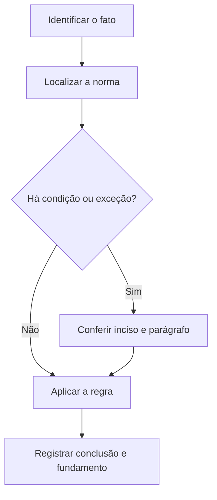

# Livro-texto — Semana 05 | Versão 2.0

**Cargo:** Oficial de Justiça — TJSP | **Banca:** VUNESP | **Período:** 23/11/2026 a 29/11/2026

## Falsidades documentais e crimes funcionais

> **Status editorial:** ampliação didática das fichas originais, com referências ao edital. Este volume é um material de estudo revisável, não parecer jurídico nem transcrição integral da lei. Use o roteiro oficial e verifique retificações posteriores.

## Ideia central — entenda antes de decorar

Nos crimes de falsidade e nos crimes funcionais, trocar o verbo do tipo penal costuma trocar a resposta. Identifique conduta, objeto material, sujeito e elemento subjetivo no dispositivo.

## Mapa visual da semana

## Plano de sete sessões

| Sessão | Atividade | Produto de aprendizagem |
|---|---|---|
| 1 | Estudar **Falsificação de documento público** e ler **CP, art. 297** | Esquema regra/condição/exceção em 5 linhas |
| 2 | Estudar **Falsidade ideológica** e ler **CP, art. 299** | Esquema regra/condição/exceção em 5 linhas |
| 3 | Estudar **Uso de documento falso** e ler **CP, art. 304** | Esquema regra/condição/exceção em 5 linhas |
| 4 | Estudar **Falsa identidade** e ler **CP, art. 307** | Esquema regra/condição/exceção em 5 linhas |
| 5 | Estudar **Peculato** e ler **CP, art. 312** | Esquema regra/condição/exceção em 5 linhas |
| 6 | Estudar **Concussão** e ler **CP, art. 316** | Esquema regra/condição/exceção em 5 linhas |
| 7 | Questões + uma discursiva + revisão dos erros | Registro D+1, D+7 e D+21 |

---

## Aulas com aplicação prática

### Aula 1 — Falsificação de documento público

**Texto para conferir:** CP, art. 297.

**Entenda a regra.** O tipo envolve falsificar, no todo ou em parte, documento público, ou alterar documento público verdadeiro, nos termos legais. Não basta memorizar o nome do instituto: identifique o verbo empregado no artigo, o sujeito que deve agir e os efeitos da conduta.

**Situação concreta.** Alguém altera materialmente documento público verdadeiro para apresentar informação falsa. Antes de escolher a alternativa, pergunte: quem deve agir? há ordem judicial? há prazo ou formalidade? existe exceção?

**Armadilha frequente.** A afirmação a seguir foi construída deliberadamente para estar errada: *Falsificar documento público é apenas mentir oralmente, sem qualquer documento.* Confira no dispositivo indicado por que ela não corresponde à regra.

**Quadro de leitura da lei seca.**

| Passo | O que registrar |
|---|---|
| 1 — Sujeito | Quem pratica, requer, determina ou recebe o ato? |
| 2 — Hipótese | Em que situação a norma se aplica? |
| 3 — Forma | Existe local, prazo, procedimento ou requisito expresso? |
| 4 — Efeito | O que acontece com o cumprimento ou descumprimento? |
| 5 — Exceção | O artigo admite ressalva ou remete a outra norma? |

**Exercício guiado 1.** Reescreva a frase incorreta com o sujeito e a condição corretos. Depois explique o caso concreto em 4–6 linhas, citando **CP, art. 297**. **Critério de correção:** acertar sujeito, requisito, efeito e artigo.

### Aula 2 — Falsidade ideológica

**Texto para conferir:** CP, art. 299.

**Entenda a regra.** O foco é inserir ou fazer inserir declaração falsa ou diversa da que devia constar em documento, com finalidade típica; não se confunde com falsificação material. Não basta memorizar o nome do instituto: identifique o verbo empregado no artigo, o sujeito que deve agir e os efeitos da conduta.

**Situação concreta.** Um documento autêntico recebe uma informação ideologicamente falsa em condição típica. Antes de escolher a alternativa, pergunte: quem deve agir? há ordem judicial? há prazo ou formalidade? existe exceção?

**Armadilha frequente.** A afirmação a seguir foi construída deliberadamente para estar errada: *Falsidade ideológica exige necessariamente imitação física de assinatura.* Confira no dispositivo indicado por que ela não corresponde à regra.

**Quadro de leitura da lei seca.**

| Passo | O que registrar |
|---|---|
| 1 — Sujeito | Quem pratica, requer, determina ou recebe o ato? |
| 2 — Hipótese | Em que situação a norma se aplica? |
| 3 — Forma | Existe local, prazo, procedimento ou requisito expresso? |
| 4 — Efeito | O que acontece com o cumprimento ou descumprimento? |
| 5 — Exceção | O artigo admite ressalva ou remete a outra norma? |

**Exercício guiado 2.** Reescreva a frase incorreta com o sujeito e a condição corretos. Depois explique o caso concreto em 4–6 linhas, citando **CP, art. 299**. **Critério de correção:** acertar sujeito, requisito, efeito e artigo.

### Aula 3 — Uso de documento falso

**Texto para conferir:** CP, art. 304.

**Entenda a regra.** O dispositivo pune fazer uso de papéis falsificados ou alterados indicados nos artigos precedentes, conforme requisitos legais. Não basta memorizar o nome do instituto: identifique o verbo empregado no artigo, o sujeito que deve agir e os efeitos da conduta.

**Situação concreta.** Uma pessoa utiliza conscientemente documento falso para obter uma vantagem. Antes de escolher a alternativa, pergunte: quem deve agir? há ordem judicial? há prazo ou formalidade? existe exceção?

**Armadilha frequente.** A afirmação a seguir foi construída deliberadamente para estar errada: *O uso de documento falso nunca constitui crime independente da fabricação do documento.* Confira no dispositivo indicado por que ela não corresponde à regra.

**Quadro de leitura da lei seca.**

| Passo | O que registrar |
|---|---|
| 1 — Sujeito | Quem pratica, requer, determina ou recebe o ato? |
| 2 — Hipótese | Em que situação a norma se aplica? |
| 3 — Forma | Existe local, prazo, procedimento ou requisito expresso? |
| 4 — Efeito | O que acontece com o cumprimento ou descumprimento? |
| 5 — Exceção | O artigo admite ressalva ou remete a outra norma? |

**Exercício guiado 3.** Reescreva a frase incorreta com o sujeito e a condição corretos. Depois explique o caso concreto em 4–6 linhas, citando **CP, art. 304**. **Critério de correção:** acertar sujeito, requisito, efeito e artigo.

### Aula 4 — Falsa identidade

**Texto para conferir:** CP, art. 307.

**Entenda a regra.** Atribuir-se ou atribuir a terceiro falsa identidade para obter vantagem ou causar dano, nas condições da lei, não equivale simplesmente a um apelido informal. Não basta memorizar o nome do instituto: identifique o verbo empregado no artigo, o sujeito que deve agir e os efeitos da conduta.

**Situação concreta.** Um indivíduo assume identidade alheia para obter vantagem durante uma diligência. Antes de escolher a alternativa, pergunte: quem deve agir? há ordem judicial? há prazo ou formalidade? existe exceção?

**Armadilha frequente.** A afirmação a seguir foi construída deliberadamente para estar errada: *Informar falsa identidade para causar dano é sempre conduta penal irrelevante.* Confira no dispositivo indicado por que ela não corresponde à regra.

**Quadro de leitura da lei seca.**

| Passo | O que registrar |
|---|---|
| 1 — Sujeito | Quem pratica, requer, determina ou recebe o ato? |
| 2 — Hipótese | Em que situação a norma se aplica? |
| 3 — Forma | Existe local, prazo, procedimento ou requisito expresso? |
| 4 — Efeito | O que acontece com o cumprimento ou descumprimento? |
| 5 — Exceção | O artigo admite ressalva ou remete a outra norma? |

**Exercício guiado 4.** Reescreva a frase incorreta com o sujeito e a condição corretos. Depois explique o caso concreto em 4–6 linhas, citando **CP, art. 307**. **Critério de correção:** acertar sujeito, requisito, efeito e artigo.

### Aula 5 — Peculato

**Texto para conferir:** CP, art. 312.

**Entenda a regra.** Em sua forma típica, o funcionário público apropria-se de dinheiro, valor ou outro bem móvel de que tem posse em razão do cargo, ou o desvia, nas condições legais. Não basta memorizar o nome do instituto: identifique o verbo empregado no artigo, o sujeito que deve agir e os efeitos da conduta.

**Situação concreta.** Um agente usa bem sob sua guarda funcional como se fosse próprio. Antes de escolher a alternativa, pergunte: quem deve agir? há ordem judicial? há prazo ou formalidade? existe exceção?

**Armadilha frequente.** A afirmação a seguir foi construída deliberadamente para estar errada: *Peculato exige necessariamente que o autor não tenha vínculo funcional com a administração.* Confira no dispositivo indicado por que ela não corresponde à regra.

**Quadro de leitura da lei seca.**

| Passo | O que registrar |
|---|---|
| 1 — Sujeito | Quem pratica, requer, determina ou recebe o ato? |
| 2 — Hipótese | Em que situação a norma se aplica? |
| 3 — Forma | Existe local, prazo, procedimento ou requisito expresso? |
| 4 — Efeito | O que acontece com o cumprimento ou descumprimento? |
| 5 — Exceção | O artigo admite ressalva ou remete a outra norma? |

**Exercício guiado 5.** Reescreva a frase incorreta com o sujeito e a condição corretos. Depois explique o caso concreto em 4–6 linhas, citando **CP, art. 312**. **Critério de correção:** acertar sujeito, requisito, efeito e artigo.

### Aula 6 — Concussão

**Texto para conferir:** CP, art. 316.

**Entenda a regra.** O verbo característico é exigir vantagem indevida em razão da função, ainda que fora dela ou antes de assumi-la, conforme tipo legal. Não basta memorizar o nome do instituto: identifique o verbo empregado no artigo, o sujeito que deve agir e os efeitos da conduta.

**Situação concreta.** Um agente exige pagamento indevido para executar tarefa ligada à sua função. Antes de escolher a alternativa, pergunte: quem deve agir? há ordem judicial? há prazo ou formalidade? existe exceção?

**Armadilha frequente.** A afirmação a seguir foi construída deliberadamente para estar errada: *Concussão e corrupção passiva têm sempre o mesmo verbo nuclear.* Confira no dispositivo indicado por que ela não corresponde à regra.

**Quadro de leitura da lei seca.**

| Passo | O que registrar |
|---|---|
| 1 — Sujeito | Quem pratica, requer, determina ou recebe o ato? |
| 2 — Hipótese | Em que situação a norma se aplica? |
| 3 — Forma | Existe local, prazo, procedimento ou requisito expresso? |
| 4 — Efeito | O que acontece com o cumprimento ou descumprimento? |
| 5 — Exceção | O artigo admite ressalva ou remete a outra norma? |

**Exercício guiado 6.** Reescreva a frase incorreta com o sujeito e a condição corretos. Depois explique o caso concreto em 4–6 linhas, citando **CP, art. 316**. **Critério de correção:** acertar sujeito, requisito, efeito e artigo.

## Comparando alternativas: como a banca tenta induzir ao erro

1. **Troca de sujeito:** um dever do juiz é atribuído ao oficial, ou vice-versa.
2. **Absolutização:** expressões como “sempre”, “nunca” e “em qualquer hipótese” escondem exceções.
3. **Mistura de ramos:** regra de citação penal é aplicada ao processo civil sem autorização legal.
4. **Omissão de requisito:** a alternativa descreve o ato, mas esquece um pressuposto, uma comunicação ou uma certificação.
5. **Inversão temporal:** um procedimento posterior aparece como requisito anterior, ou o contrário.

## Questões analíticas da semana (autorais)

1. **Caso: Falsificação de documento público.** Alguém altera materialmente documento público verdadeiro para apresentar informação falsa. Explique a providência ou o conceito aplicável; identifique duas condições que você procuraria no texto legal e uma alternativa plausível, porém incorreta. Justifique com **CP, art. 297**.

2. **Caso: Falsidade ideológica.** Um documento autêntico recebe uma informação ideologicamente falsa em condição típica. Explique a providência ou o conceito aplicável; identifique duas condições que você procuraria no texto legal e uma alternativa plausível, porém incorreta. Justifique com **CP, art. 299**.

3. **Caso: Uso de documento falso.** Uma pessoa utiliza conscientemente documento falso para obter uma vantagem. Explique a providência ou o conceito aplicável; identifique duas condições que você procuraria no texto legal e uma alternativa plausível, porém incorreta. Justifique com **CP, art. 304**.

4. **Caso: Falsa identidade.** Um indivíduo assume identidade alheia para obter vantagem durante uma diligência. Explique a providência ou o conceito aplicável; identifique duas condições que você procuraria no texto legal e uma alternativa plausível, porém incorreta. Justifique com **CP, art. 307**.

5. **Caso: Peculato.** Um agente usa bem sob sua guarda funcional como se fosse próprio. Explique a providência ou o conceito aplicável; identifique duas condições que você procuraria no texto legal e uma alternativa plausível, porém incorreta. Justifique com **CP, art. 312**.

6. **Caso: Concussão.** Um agente exige pagamento indevido para executar tarefa ligada à sua função. Explique a providência ou o conceito aplicável; identifique duas condições que você procuraria no texto legal e uma alternativa plausível, porém incorreta. Justifique com **CP, art. 316**.

### Proposta discursiva

Com base nos temas **Falsificação de documento público** e **Peculato**, descreva como um profissional deve identificar corretamente a norma aplicável a uma situação real, distinguindo competência, procedimento e documentação do ato. Cite os dispositivos do edital e construa uma conclusão em 10 a 15 linhas.

### Critério para autoavaliação (20 pontos)

| Aspecto | Pontos |
|---|---:|
| Identificação da norma e competência | 6 |
| Aplicação ao caso e condições legais | 7 |
| Exceções e documentação | 4 |
| Clareza, objetividade e escrita | 3 |

## Respostas esperadas aos exercícios analíticos

1. A resposta deve partir da regra: **O tipo envolve falsificar, no todo ou em parte, documento público, ou alterar documento público verdadeiro, nos termos legais.** No caso: Alguém altera materialmente documento público verdadeiro para apresentar informação falsa. A hipótese errada a ser rebatida é: “Falsificar documento público é apenas mentir oralmente, sem qualquer documento.”. O argumento definitivo deve apontar a redação completa de **CP, art. 297**, inclusive remissões e exceções.

2. A resposta deve partir da regra: **O foco é inserir ou fazer inserir declaração falsa ou diversa da que devia constar em documento, com finalidade típica; não se confunde com falsificação material.** No caso: Um documento autêntico recebe uma informação ideologicamente falsa em condição típica. A hipótese errada a ser rebatida é: “Falsidade ideológica exige necessariamente imitação física de assinatura.”. O argumento definitivo deve apontar a redação completa de **CP, art. 299**, inclusive remissões e exceções.

3. A resposta deve partir da regra: **O dispositivo pune fazer uso de papéis falsificados ou alterados indicados nos artigos precedentes, conforme requisitos legais.** No caso: Uma pessoa utiliza conscientemente documento falso para obter uma vantagem. A hipótese errada a ser rebatida é: “O uso de documento falso nunca constitui crime independente da fabricação do documento.”. O argumento definitivo deve apontar a redação completa de **CP, art. 304**, inclusive remissões e exceções.

4. A resposta deve partir da regra: **Atribuir-se ou atribuir a terceiro falsa identidade para obter vantagem ou causar dano, nas condições da lei, não equivale simplesmente a um apelido informal.** No caso: Um indivíduo assume identidade alheia para obter vantagem durante uma diligência. A hipótese errada a ser rebatida é: “Informar falsa identidade para causar dano é sempre conduta penal irrelevante.”. O argumento definitivo deve apontar a redação completa de **CP, art. 307**, inclusive remissões e exceções.

5. A resposta deve partir da regra: **Em sua forma típica, o funcionário público apropria-se de dinheiro, valor ou outro bem móvel de que tem posse em razão do cargo, ou o desvia, nas condições legais.** No caso: Um agente usa bem sob sua guarda funcional como se fosse próprio. A hipótese errada a ser rebatida é: “Peculato exige necessariamente que o autor não tenha vínculo funcional com a administração.”. O argumento definitivo deve apontar a redação completa de **CP, art. 312**, inclusive remissões e exceções.

6. A resposta deve partir da regra: **O verbo característico é exigir vantagem indevida em razão da função, ainda que fora dela ou antes de assumi-la, conforme tipo legal.** No caso: Um agente exige pagamento indevido para executar tarefa ligada à sua função. A hipótese errada a ser rebatida é: “Concussão e corrupção passiva têm sempre o mesmo verbo nuclear.”. O argumento definitivo deve apontar a redação completa de **CP, art. 316**, inclusive remissões e exceções.

## Checklist de conclusão

- [ ] Li o capítulo, incluindo os exemplos.
- [ ] Conferi o texto completo de todos os artigos indicados nesta semana.
- [ ] Resolvi as seis questões analíticas sem consulta.
- [ ] Escrevi ao menos uma discursiva e revisei os erros.
- [ ] Registrei o que deve retornar nas revisões D+1, D+7 e D+21.

**Fonte primária:** [Edital 01/2026, Anexo VIII](https://drive.google.com/file/d/1YJSOt6SDpONIJLY1ahDa9D4y8vkTGwlJ/view) e [Roteiro de legislação por semana](../../legislacao/roteiro_corrigido.md).

**Nota:** As respostas comentadas são guias metodológicos, não substituem a consulta dos dispositivos integrais, e os exercícios autorais não são da VUNESP.
