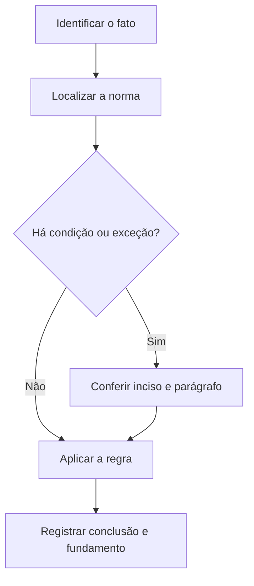

# Livro-texto — Semana 06 | Versão 2.0

**Cargo:** Oficial de Justiça — TJSP | **Banca:** VUNESP | **Período:** 30/11/2026 a 06/12/2026

## Crimes contra a administração e deveres de servidor

> **Status editorial:** ampliação didática das fichas originais, com referências ao edital. Este volume é um material de estudo revisável, não parecer jurídico nem transcrição integral da lei. Use o roteiro oficial e verifique retificações posteriores.

## Ideia central — entenda antes de decorar

Ao executar uma ordem judicial, o servidor é obrigado a cumprir deveres funcionais e não pode transformar uma escolha pessoal em regra institucional. Compare dever, proibição e responsabilidade.

## Mapa visual da semana

## Plano de sete sessões

| Sessão | Atividade | Produto de aprendizagem |
|---|---|---|
| 1 | Estudar **Prevaricação** e ler **CP, art. 319** | Esquema regra/condição/exceção em 5 linhas |
| 2 | Estudar **Corrupção passiva** e ler **CP, art. 317** | Esquema regra/condição/exceção em 5 linhas |
| 3 | Estudar **Corrupção ativa** e ler **CP, art. 333** | Esquema regra/condição/exceção em 5 linhas |
| 4 | Estudar **Resistência** e ler **CP, art. 329** | Esquema regra/condição/exceção em 5 linhas |
| 5 | Estudar **Desobediência** e ler **CP, art. 330** | Esquema regra/condição/exceção em 5 linhas |
| 6 | Estudar **Deveres funcionais** e ler **Lei SP 10.261/68, arts. 241 a 243** | Esquema regra/condição/exceção em 5 linhas |
| 7 | Questões + uma discursiva + revisão dos erros | Registro D+1, D+7 e D+21 |

---

## Aulas com aplicação prática

### Aula 1 — Prevaricação

**Texto para conferir:** CP, art. 319.

**Entenda a regra.** Retardar ou deixar de praticar indevidamente ato de ofício, ou praticá-lo contra disposição expressa de lei, para satisfazer interesse ou sentimento pessoal, caracteriza a descrição legal. Não basta memorizar o nome do instituto: identifique o verbo empregado no artigo, o sujeito que deve agir e os efeitos da conduta.

**Situação concreta.** Um servidor deixa de praticar ato devido para favorecer interesse pessoal. Antes de escolher a alternativa, pergunte: quem deve agir? há ordem judicial? há prazo ou formalidade? existe exceção?

**Armadilha frequente.** A afirmação a seguir foi construída deliberadamente para estar errada: *Qualquer atraso administrativo, sem finalidade pessoal, é automaticamente prevaricação.* Confira no dispositivo indicado por que ela não corresponde à regra.

**Quadro de leitura da lei seca.**

| Passo | O que registrar |
|---|---|
| 1 — Sujeito | Quem pratica, requer, determina ou recebe o ato? |
| 2 — Hipótese | Em que situação a norma se aplica? |
| 3 — Forma | Existe local, prazo, procedimento ou requisito expresso? |
| 4 — Efeito | O que acontece com o cumprimento ou descumprimento? |
| 5 — Exceção | O artigo admite ressalva ou remete a outra norma? |

**Exercício guiado 1.** Reescreva a frase incorreta com o sujeito e a condição corretos. Depois explique o caso concreto em 4–6 linhas, citando **CP, art. 319**. **Critério de correção:** acertar sujeito, requisito, efeito e artigo.

### Aula 2 — Corrupção passiva

**Texto para conferir:** CP, art. 317.

**Entenda a regra.** Solicitar ou receber vantagem indevida, ou aceitar promessa dela, em razão da função, integra a conduta típica conforme seus requisitos. Não basta memorizar o nome do instituto: identifique o verbo empregado no artigo, o sujeito que deve agir e os efeitos da conduta.

**Situação concreta.** Um agente público solicita dinheiro para praticar ato ligado ao seu cargo. Antes de escolher a alternativa, pergunte: quem deve agir? há ordem judicial? há prazo ou formalidade? existe exceção?

**Armadilha frequente.** A afirmação a seguir foi construída deliberadamente para estar errada: *Corrupção passiva é crime que só pode ser praticado por particular sem função pública.* Confira no dispositivo indicado por que ela não corresponde à regra.

**Quadro de leitura da lei seca.**

| Passo | O que registrar |
|---|---|
| 1 — Sujeito | Quem pratica, requer, determina ou recebe o ato? |
| 2 — Hipótese | Em que situação a norma se aplica? |
| 3 — Forma | Existe local, prazo, procedimento ou requisito expresso? |
| 4 — Efeito | O que acontece com o cumprimento ou descumprimento? |
| 5 — Exceção | O artigo admite ressalva ou remete a outra norma? |

**Exercício guiado 2.** Reescreva a frase incorreta com o sujeito e a condição corretos. Depois explique o caso concreto em 4–6 linhas, citando **CP, art. 317**. **Critério de correção:** acertar sujeito, requisito, efeito e artigo.

### Aula 3 — Corrupção ativa

**Texto para conferir:** CP, art. 333.

**Entenda a regra.** Oferecer ou prometer vantagem indevida a funcionário público para determiná-lo a praticar, omitir ou retardar ato de ofício é o núcleo da previsão legal. Não basta memorizar o nome do instituto: identifique o verbo empregado no artigo, o sujeito que deve agir e os efeitos da conduta.

**Situação concreta.** Um particular oferece vantagem indevida a servidor em troca de um ato de ofício. Antes de escolher a alternativa, pergunte: quem deve agir? há ordem judicial? há prazo ou formalidade? existe exceção?

**Armadilha frequente.** A afirmação a seguir foi construída deliberadamente para estar errada: *O simples recebimento de salário legal pelo servidor caracteriza corrupção ativa.* Confira no dispositivo indicado por que ela não corresponde à regra.

**Quadro de leitura da lei seca.**

| Passo | O que registrar |
|---|---|
| 1 — Sujeito | Quem pratica, requer, determina ou recebe o ato? |
| 2 — Hipótese | Em que situação a norma se aplica? |
| 3 — Forma | Existe local, prazo, procedimento ou requisito expresso? |
| 4 — Efeito | O que acontece com o cumprimento ou descumprimento? |
| 5 — Exceção | O artigo admite ressalva ou remete a outra norma? |

**Exercício guiado 3.** Reescreva a frase incorreta com o sujeito e a condição corretos. Depois explique o caso concreto em 4–6 linhas, citando **CP, art. 333**. **Critério de correção:** acertar sujeito, requisito, efeito e artigo.

### Aula 4 — Resistência

**Texto para conferir:** CP, art. 329.

**Entenda a regra.** Opor-se à execução de ato legal mediante violência ou ameaça a funcionário competente para executá-lo, ou a quem o auxilia, descreve a figura básica. Não basta memorizar o nome do instituto: identifique o verbo empregado no artigo, o sujeito que deve agir e os efeitos da conduta.

**Situação concreta.** Uma pessoa tenta impedir execução de ordem legal empregando ameaça contra o agente. Antes de escolher a alternativa, pergunte: quem deve agir? há ordem judicial? há prazo ou formalidade? existe exceção?

**Armadilha frequente.** A afirmação a seguir foi construída deliberadamente para estar errada: *Qualquer crítica verbal, sem violência ou ameaça, é necessariamente resistência.* Confira no dispositivo indicado por que ela não corresponde à regra.

**Quadro de leitura da lei seca.**

| Passo | O que registrar |
|---|---|
| 1 — Sujeito | Quem pratica, requer, determina ou recebe o ato? |
| 2 — Hipótese | Em que situação a norma se aplica? |
| 3 — Forma | Existe local, prazo, procedimento ou requisito expresso? |
| 4 — Efeito | O que acontece com o cumprimento ou descumprimento? |
| 5 — Exceção | O artigo admite ressalva ou remete a outra norma? |

**Exercício guiado 4.** Reescreva a frase incorreta com o sujeito e a condição corretos. Depois explique o caso concreto em 4–6 linhas, citando **CP, art. 329**. **Critério de correção:** acertar sujeito, requisito, efeito e artigo.

### Aula 5 — Desobediência

**Texto para conferir:** CP, art. 330.

**Entenda a regra.** O tipo descreve desobedecer a ordem legal de funcionário público; deve-se verificar requisitos e situações específicas antes de concluir sobre incidência. Não basta memorizar o nome do instituto: identifique o verbo empregado no artigo, o sujeito que deve agir e os efeitos da conduta.

**Situação concreta.** Alguém se recusa a cumprir ordem legítima dada nas condições legais. Antes de escolher a alternativa, pergunte: quem deve agir? há ordem judicial? há prazo ou formalidade? existe exceção?

**Armadilha frequente.** A afirmação a seguir foi construída deliberadamente para estar errada: *Toda discordância com uma política pública é desobediência penal.* Confira no dispositivo indicado por que ela não corresponde à regra.

**Quadro de leitura da lei seca.**

| Passo | O que registrar |
|---|---|
| 1 — Sujeito | Quem pratica, requer, determina ou recebe o ato? |
| 2 — Hipótese | Em que situação a norma se aplica? |
| 3 — Forma | Existe local, prazo, procedimento ou requisito expresso? |
| 4 — Efeito | O que acontece com o cumprimento ou descumprimento? |
| 5 — Exceção | O artigo admite ressalva ou remete a outra norma? |

**Exercício guiado 5.** Reescreva a frase incorreta com o sujeito e a condição corretos. Depois explique o caso concreto em 4–6 linhas, citando **CP, art. 330**. **Critério de correção:** acertar sujeito, requisito, efeito e artigo.

### Aula 6 — Deveres funcionais

**Texto para conferir:** Lei SP 10.261/68, arts. 241 a 243.

**Entenda a regra.** O Estatuto paulista reúne deveres, proibições e regras de responsabilidade; no estudo, compare comportamentos exigidos e condutas vedadas. Não basta memorizar o nome do instituto: identifique o verbo empregado no artigo, o sujeito que deve agir e os efeitos da conduta.

**Situação concreta.** Um servidor desrespeita exigência expressa de zelo e cumprimento de ordens legais. Antes de escolher a alternativa, pergunte: quem deve agir? há ordem judicial? há prazo ou formalidade? existe exceção?

**Armadilha frequente.** A afirmação a seguir foi construída deliberadamente para estar errada: *As obrigações estatutárias são meras sugestões sem repercussão funcional.* Confira no dispositivo indicado por que ela não corresponde à regra.

**Quadro de leitura da lei seca.**

| Passo | O que registrar |
|---|---|
| 1 — Sujeito | Quem pratica, requer, determina ou recebe o ato? |
| 2 — Hipótese | Em que situação a norma se aplica? |
| 3 — Forma | Existe local, prazo, procedimento ou requisito expresso? |
| 4 — Efeito | O que acontece com o cumprimento ou descumprimento? |
| 5 — Exceção | O artigo admite ressalva ou remete a outra norma? |

**Exercício guiado 6.** Reescreva a frase incorreta com o sujeito e a condição corretos. Depois explique o caso concreto em 4–6 linhas, citando **Lei SP 10.261/68, arts. 241 a 243**. **Critério de correção:** acertar sujeito, requisito, efeito e artigo.

## Comparando alternativas: como a banca tenta induzir ao erro

1. **Troca de sujeito:** um dever do juiz é atribuído ao oficial, ou vice-versa.
2. **Absolutização:** expressões como “sempre”, “nunca” e “em qualquer hipótese” escondem exceções.
3. **Mistura de ramos:** regra de citação penal é aplicada ao processo civil sem autorização legal.
4. **Omissão de requisito:** a alternativa descreve o ato, mas esquece um pressuposto, uma comunicação ou uma certificação.
5. **Inversão temporal:** um procedimento posterior aparece como requisito anterior, ou o contrário.

## Questões analíticas da semana (autorais)

1. **Caso: Prevaricação.** Um servidor deixa de praticar ato devido para favorecer interesse pessoal. Explique a providência ou o conceito aplicável; identifique duas condições que você procuraria no texto legal e uma alternativa plausível, porém incorreta. Justifique com **CP, art. 319**.

2. **Caso: Corrupção passiva.** Um agente público solicita dinheiro para praticar ato ligado ao seu cargo. Explique a providência ou o conceito aplicável; identifique duas condições que você procuraria no texto legal e uma alternativa plausível, porém incorreta. Justifique com **CP, art. 317**.

3. **Caso: Corrupção ativa.** Um particular oferece vantagem indevida a servidor em troca de um ato de ofício. Explique a providência ou o conceito aplicável; identifique duas condições que você procuraria no texto legal e uma alternativa plausível, porém incorreta. Justifique com **CP, art. 333**.

4. **Caso: Resistência.** Uma pessoa tenta impedir execução de ordem legal empregando ameaça contra o agente. Explique a providência ou o conceito aplicável; identifique duas condições que você procuraria no texto legal e uma alternativa plausível, porém incorreta. Justifique com **CP, art. 329**.

5. **Caso: Desobediência.** Alguém se recusa a cumprir ordem legítima dada nas condições legais. Explique a providência ou o conceito aplicável; identifique duas condições que você procuraria no texto legal e uma alternativa plausível, porém incorreta. Justifique com **CP, art. 330**.

6. **Caso: Deveres funcionais.** Um servidor desrespeita exigência expressa de zelo e cumprimento de ordens legais. Explique a providência ou o conceito aplicável; identifique duas condições que você procuraria no texto legal e uma alternativa plausível, porém incorreta. Justifique com **Lei SP 10.261/68, arts. 241 a 243**.

### Proposta discursiva

Com base nos temas **Prevaricação** e **Desobediência**, descreva como um profissional deve identificar corretamente a norma aplicável a uma situação real, distinguindo competência, procedimento e documentação do ato. Cite os dispositivos do edital e construa uma conclusão em 10 a 15 linhas.

### Critério para autoavaliação (20 pontos)

| Aspecto | Pontos |
|---|---:|
| Identificação da norma e competência | 6 |
| Aplicação ao caso e condições legais | 7 |
| Exceções e documentação | 4 |
| Clareza, objetividade e escrita | 3 |

## Respostas esperadas aos exercícios analíticos

1. A resposta deve partir da regra: **Retardar ou deixar de praticar indevidamente ato de ofício, ou praticá-lo contra disposição expressa de lei, para satisfazer interesse ou sentimento pessoal, caracteriza a descrição legal.** No caso: Um servidor deixa de praticar ato devido para favorecer interesse pessoal. A hipótese errada a ser rebatida é: “Qualquer atraso administrativo, sem finalidade pessoal, é automaticamente prevaricação.”. O argumento definitivo deve apontar a redação completa de **CP, art. 319**, inclusive remissões e exceções.

2. A resposta deve partir da regra: **Solicitar ou receber vantagem indevida, ou aceitar promessa dela, em razão da função, integra a conduta típica conforme seus requisitos.** No caso: Um agente público solicita dinheiro para praticar ato ligado ao seu cargo. A hipótese errada a ser rebatida é: “Corrupção passiva é crime que só pode ser praticado por particular sem função pública.”. O argumento definitivo deve apontar a redação completa de **CP, art. 317**, inclusive remissões e exceções.

3. A resposta deve partir da regra: **Oferecer ou prometer vantagem indevida a funcionário público para determiná-lo a praticar, omitir ou retardar ato de ofício é o núcleo da previsão legal.** No caso: Um particular oferece vantagem indevida a servidor em troca de um ato de ofício. A hipótese errada a ser rebatida é: “O simples recebimento de salário legal pelo servidor caracteriza corrupção ativa.”. O argumento definitivo deve apontar a redação completa de **CP, art. 333**, inclusive remissões e exceções.

4. A resposta deve partir da regra: **Opor-se à execução de ato legal mediante violência ou ameaça a funcionário competente para executá-lo, ou a quem o auxilia, descreve a figura básica.** No caso: Uma pessoa tenta impedir execução de ordem legal empregando ameaça contra o agente. A hipótese errada a ser rebatida é: “Qualquer crítica verbal, sem violência ou ameaça, é necessariamente resistência.”. O argumento definitivo deve apontar a redação completa de **CP, art. 329**, inclusive remissões e exceções.

5. A resposta deve partir da regra: **O tipo descreve desobedecer a ordem legal de funcionário público; deve-se verificar requisitos e situações específicas antes de concluir sobre incidência.** No caso: Alguém se recusa a cumprir ordem legítima dada nas condições legais. A hipótese errada a ser rebatida é: “Toda discordância com uma política pública é desobediência penal.”. O argumento definitivo deve apontar a redação completa de **CP, art. 330**, inclusive remissões e exceções.

6. A resposta deve partir da regra: **O Estatuto paulista reúne deveres, proibições e regras de responsabilidade; no estudo, compare comportamentos exigidos e condutas vedadas.** No caso: Um servidor desrespeita exigência expressa de zelo e cumprimento de ordens legais. A hipótese errada a ser rebatida é: “As obrigações estatutárias são meras sugestões sem repercussão funcional.”. O argumento definitivo deve apontar a redação completa de **Lei SP 10.261/68, arts. 241 a 243**, inclusive remissões e exceções.

## Checklist de conclusão

- [ ] Li o capítulo, incluindo os exemplos.
- [ ] Conferi o texto completo de todos os artigos indicados nesta semana.
- [ ] Resolvi as seis questões analíticas sem consulta.
- [ ] Escrevi ao menos uma discursiva e revisei os erros.
- [ ] Registrei o que deve retornar nas revisões D+1, D+7 e D+21.

**Fonte primária:** [Edital 01/2026, Anexo VIII](https://drive.google.com/file/d/1YJSOt6SDpONIJLY1ahDa9D4y8vkTGwlJ/view) e [Roteiro de legislação por semana](../../legislacao/roteiro_corrigido.md).

**Nota:** As respostas comentadas são guias metodológicos, não substituem a consulta dos dispositivos integrais, e os exercícios autorais não são da VUNESP.