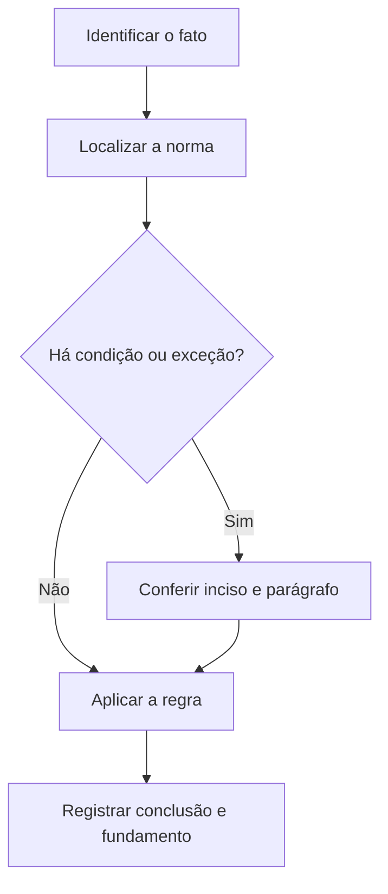

# Livro-texto — Semana 07 | Versão 2.0

**Cargo:** Oficial de Justiça — TJSP | **Banca:** VUNESP | **Período:** 07/12/2026 a 13/12/2026

## Ação penal, competência e bens no CPP

> **Status editorial:** ampliação didática das fichas originais, com referências ao edital. Este volume é um material de estudo revisável, não parecer jurídico nem transcrição integral da lei. Use o roteiro oficial e verifique retificações posteriores.

## Ideia central — entenda antes de decorar

Ação penal, competência e cautelares patrimoniais são problemas distintos. Em questões de prova, comece perguntando qual autoridade pratica o ato e em que fase ele ocorre.

## Mapa visual da semana

## Plano de sete sessões

| Sessão | Atividade | Produto de aprendizagem |
|---|---|---|
| 1 | Estudar **Ação penal pública** e ler **CPP, art. 24** | Esquema regra/condição/exceção em 5 linhas |
| 2 | Estudar **Ação penal privada** e ler **CPP, arts. 30 a 38** | Esquema regra/condição/exceção em 5 linhas |
| 3 | Estudar **Competência penal** e ler **CPP, arts. 69 a 74** | Esquema regra/condição/exceção em 5 linhas |
| 4 | Estudar **Suspeição e impedimento** e ler **CPP, art. 112** | Esquema regra/condição/exceção em 5 linhas |
| 5 | Estudar **Sequestro de bens** e ler **CPP, arts. 125 a 131** | Esquema regra/condição/exceção em 5 linhas |
| 6 | Estudar **Crase e regência** e ler **Português: crase** | Esquema regra/condição/exceção em 5 linhas |
| 7 | Questões + uma discursiva + revisão dos erros | Registro D+1, D+7 e D+21 |

---

## Aulas com aplicação prática

### Aula 1 — Ação penal pública

**Texto para conferir:** CPP, art. 24.

**Entenda a regra.** Nos crimes de ação pública, esta é promovida por denúncia do Ministério Público, dependendo, quando a lei exigir, de representação ou requisição. Não basta memorizar o nome do instituto: identifique o verbo empregado no artigo, o sujeito que deve agir e os efeitos da conduta.

**Situação concreta.** Uma infração de ação penal pública chega ao órgão responsável por oferecer denúncia. Antes de escolher a alternativa, pergunte: quem deve agir? há ordem judicial? há prazo ou formalidade? existe exceção?

**Armadilha frequente.** A afirmação a seguir foi construída deliberadamente para estar errada: *A denúncia por crime de ação pública é apresentada exclusivamente pelo ofendido.* Confira no dispositivo indicado por que ela não corresponde à regra.

**Quadro de leitura da lei seca.**

| Passo | O que registrar |
|---|---|
| 1 — Sujeito | Quem pratica, requer, determina ou recebe o ato? |
| 2 — Hipótese | Em que situação a norma se aplica? |
| 3 — Forma | Existe local, prazo, procedimento ou requisito expresso? |
| 4 — Efeito | O que acontece com o cumprimento ou descumprimento? |
| 5 — Exceção | O artigo admite ressalva ou remete a outra norma? |

**Exercício guiado 1.** Reescreva a frase incorreta com o sujeito e a condição corretos. Depois explique o caso concreto em 4–6 linhas, citando **CPP, art. 24**. **Critério de correção:** acertar sujeito, requisito, efeito e artigo.

### Aula 2 — Ação penal privada

**Texto para conferir:** CPP, arts. 30 a 38.

**Entenda a regra.** Nos casos previstos em lei, cabe queixa ao ofendido ou representante legal, observados legitimidade e decadência. Não basta memorizar o nome do instituto: identifique o verbo empregado no artigo, o sujeito que deve agir e os efeitos da conduta.

**Situação concreta.** Uma vítima de crime de ação penal privada avalia a iniciativa adequada para ajuizar a ação. Antes de escolher a alternativa, pergunte: quem deve agir? há ordem judicial? há prazo ou formalidade? existe exceção?

**Armadilha frequente.** A afirmação a seguir foi construída deliberadamente para estar errada: *A ação penal privada é sempre iniciada por denúncia do Ministério Público.* Confira no dispositivo indicado por que ela não corresponde à regra.

**Quadro de leitura da lei seca.**

| Passo | O que registrar |
|---|---|
| 1 — Sujeito | Quem pratica, requer, determina ou recebe o ato? |
| 2 — Hipótese | Em que situação a norma se aplica? |
| 3 — Forma | Existe local, prazo, procedimento ou requisito expresso? |
| 4 — Efeito | O que acontece com o cumprimento ou descumprimento? |
| 5 — Exceção | O artigo admite ressalva ou remete a outra norma? |

**Exercício guiado 2.** Reescreva a frase incorreta com o sujeito e a condição corretos. Depois explique o caso concreto em 4–6 linhas, citando **CPP, arts. 30 a 38**. **Critério de correção:** acertar sujeito, requisito, efeito e artigo.

### Aula 3 — Competência penal

**Texto para conferir:** CPP, arts. 69 a 74.

**Entenda a regra.** A competência jurisdicional pode ser determinada por lugar da infração e outras regras enumeradas; as exceções devem ser lidas no texto legal. Não basta memorizar o nome do instituto: identifique o verbo empregado no artigo, o sujeito que deve agir e os efeitos da conduta.

**Situação concreta.** Dois juízos discutem qual tem competência para processar fato penal. Antes de escolher a alternativa, pergunte: quem deve agir? há ordem judicial? há prazo ou formalidade? existe exceção?

**Armadilha frequente.** A afirmação a seguir foi construída deliberadamente para estar errada: *A competência criminal depende exclusivamente da escolha livre do acusado.* Confira no dispositivo indicado por que ela não corresponde à regra.

**Quadro de leitura da lei seca.**

| Passo | O que registrar |
|---|---|
| 1 — Sujeito | Quem pratica, requer, determina ou recebe o ato? |
| 2 — Hipótese | Em que situação a norma se aplica? |
| 3 — Forma | Existe local, prazo, procedimento ou requisito expresso? |
| 4 — Efeito | O que acontece com o cumprimento ou descumprimento? |
| 5 — Exceção | O artigo admite ressalva ou remete a outra norma? |

**Exercício guiado 3.** Reescreva a frase incorreta com o sujeito e a condição corretos. Depois explique o caso concreto em 4–6 linhas, citando **CPP, arts. 69 a 74**. **Critério de correção:** acertar sujeito, requisito, efeito e artigo.

### Aula 4 — Suspeição e impedimento

**Texto para conferir:** CPP, art. 112.

**Entenda a regra.** O art. 112 prevê forma de arguição para incompatibilidades ou impedimentos e suspeição de sujeitos processuais indicados no dispositivo. Não basta memorizar o nome do instituto: identifique o verbo empregado no artigo, o sujeito que deve agir e os efeitos da conduta.

**Situação concreta.** Uma defesa identifica circunstância que pode afetar imparcialidade de sujeito do processo penal. Antes de escolher a alternativa, pergunte: quem deve agir? há ordem judicial? há prazo ou formalidade? existe exceção?

**Armadilha frequente.** A afirmação a seguir foi construída deliberadamente para estar errada: *Circunstâncias de impedimento ou suspeição são sempre irrelevantes no processo penal.* Confira no dispositivo indicado por que ela não corresponde à regra.

**Quadro de leitura da lei seca.**

| Passo | O que registrar |
|---|---|
| 1 — Sujeito | Quem pratica, requer, determina ou recebe o ato? |
| 2 — Hipótese | Em que situação a norma se aplica? |
| 3 — Forma | Existe local, prazo, procedimento ou requisito expresso? |
| 4 — Efeito | O que acontece com o cumprimento ou descumprimento? |
| 5 — Exceção | O artigo admite ressalva ou remete a outra norma? |

**Exercício guiado 4.** Reescreva a frase incorreta com o sujeito e a condição corretos. Depois explique o caso concreto em 4–6 linhas, citando **CPP, art. 112**. **Critério de correção:** acertar sujeito, requisito, efeito e artigo.

### Aula 5 — Sequestro de bens

**Texto para conferir:** CPP, arts. 125 a 131.

**Entenda a regra.** As medidas assecuratórias de bens dependem de pressupostos legais e decisão competente; sequestro não é sinônimo de penhora cível. Não basta memorizar o nome do instituto: identifique o verbo empregado no artigo, o sujeito que deve agir e os efeitos da conduta.

**Situação concreta.** Investiga-se bem imóvel adquirido com proveitos de infração, e discute-se medida assecuratória. Antes de escolher a alternativa, pergunte: quem deve agir? há ordem judicial? há prazo ou formalidade? existe exceção?

**Armadilha frequente.** A afirmação a seguir foi construída deliberadamente para estar errada: *Sequestro de bens no CPP é exatamente o mesmo procedimento da penhora do CPC.* Confira no dispositivo indicado por que ela não corresponde à regra.

**Quadro de leitura da lei seca.**

| Passo | O que registrar |
|---|---|
| 1 — Sujeito | Quem pratica, requer, determina ou recebe o ato? |
| 2 — Hipótese | Em que situação a norma se aplica? |
| 3 — Forma | Existe local, prazo, procedimento ou requisito expresso? |
| 4 — Efeito | O que acontece com o cumprimento ou descumprimento? |
| 5 — Exceção | O artigo admite ressalva ou remete a outra norma? |

**Exercício guiado 5.** Reescreva a frase incorreta com o sujeito e a condição corretos. Depois explique o caso concreto em 4–6 linhas, citando **CPP, arts. 125 a 131**. **Critério de correção:** acertar sujeito, requisito, efeito e artigo.

### Aula 6 — Crase e regência

**Texto para conferir:** Português: crase.

**Entenda a regra.** O acento grave indica, em situações próprias, a fusão da preposição a com artigo ou demonstrativo iniciado por a. Verifique regência e possibilidade de artigo. Não basta memorizar o nome do instituto: identifique o verbo empregado no artigo, o sujeito que deve agir e os efeitos da conduta.

**Situação concreta.** Complete: o servidor dirigiu-se à secretaria, observando a regência e o artigo feminino. Antes de escolher a alternativa, pergunte: quem deve agir? há ordem judicial? há prazo ou formalidade? existe exceção?

**Armadilha frequente.** A afirmação a seguir foi construída deliberadamente para estar errada: *Toda ocorrência da letra a antes de palavra feminina exige crase.* Confira no dispositivo indicado por que ela não corresponde à regra.

**Quadro de leitura da lei seca.**

| Passo | O que registrar |
|---|---|
| 1 — Sujeito | Quem pratica, requer, determina ou recebe o ato? |
| 2 — Hipótese | Em que situação a norma se aplica? |
| 3 — Forma | Existe local, prazo, procedimento ou requisito expresso? |
| 4 — Efeito | O que acontece com o cumprimento ou descumprimento? |
| 5 — Exceção | O artigo admite ressalva ou remete a outra norma? |

**Exercício guiado 6.** Reescreva a frase incorreta com o sujeito e a condição corretos. Depois explique o caso concreto em 4–6 linhas, citando **Português: crase**. **Critério de correção:** acertar sujeito, requisito, efeito e artigo.

## Comparando alternativas: como a banca tenta induzir ao erro

1. **Troca de sujeito:** um dever do juiz é atribuído ao oficial, ou vice-versa.
2. **Absolutização:** expressões como “sempre”, “nunca” e “em qualquer hipótese” escondem exceções.
3. **Mistura de ramos:** regra de citação penal é aplicada ao processo civil sem autorização legal.
4. **Omissão de requisito:** a alternativa descreve o ato, mas esquece um pressuposto, uma comunicação ou uma certificação.
5. **Inversão temporal:** um procedimento posterior aparece como requisito anterior, ou o contrário.

## Questões analíticas da semana (autorais)

1. **Caso: Ação penal pública.** Uma infração de ação penal pública chega ao órgão responsável por oferecer denúncia. Explique a providência ou o conceito aplicável; identifique duas condições que você procuraria no texto legal e uma alternativa plausível, porém incorreta. Justifique com **CPP, art. 24**.

2. **Caso: Ação penal privada.** Uma vítima de crime de ação penal privada avalia a iniciativa adequada para ajuizar a ação. Explique a providência ou o conceito aplicável; identifique duas condições que você procuraria no texto legal e uma alternativa plausível, porém incorreta. Justifique com **CPP, arts. 30 a 38**.

3. **Caso: Competência penal.** Dois juízos discutem qual tem competência para processar fato penal. Explique a providência ou o conceito aplicável; identifique duas condições que você procuraria no texto legal e uma alternativa plausível, porém incorreta. Justifique com **CPP, arts. 69 a 74**.

4. **Caso: Suspeição e impedimento.** Uma defesa identifica circunstância que pode afetar imparcialidade de sujeito do processo penal. Explique a providência ou o conceito aplicável; identifique duas condições que você procuraria no texto legal e uma alternativa plausível, porém incorreta. Justifique com **CPP, art. 112**.

5. **Caso: Sequestro de bens.** Investiga-se bem imóvel adquirido com proveitos de infração, e discute-se medida assecuratória. Explique a providência ou o conceito aplicável; identifique duas condições que você procuraria no texto legal e uma alternativa plausível, porém incorreta. Justifique com **CPP, arts. 125 a 131**.

6. **Caso: Crase e regência.** Complete: o servidor dirigiu-se à secretaria, observando a regência e o artigo feminino. Explique a providência ou o conceito aplicável; identifique duas condições que você procuraria no texto legal e uma alternativa plausível, porém incorreta. Justifique com **Português: crase**.

### Proposta discursiva

Com base nos temas **Ação penal pública** e **Sequestro de bens**, descreva como um profissional deve identificar corretamente a norma aplicável a uma situação real, distinguindo competência, procedimento e documentação do ato. Cite os dispositivos do edital e construa uma conclusão em 10 a 15 linhas.

### Critério para autoavaliação (20 pontos)

| Aspecto | Pontos |
|---|---:|
| Identificação da norma e competência | 6 |
| Aplicação ao caso e condições legais | 7 |
| Exceções e documentação | 4 |
| Clareza, objetividade e escrita | 3 |

## Respostas esperadas aos exercícios analíticos

1. A resposta deve partir da regra: **Nos crimes de ação pública, esta é promovida por denúncia do Ministério Público, dependendo, quando a lei exigir, de representação ou requisição.** No caso: Uma infração de ação penal pública chega ao órgão responsável por oferecer denúncia. A hipótese errada a ser rebatida é: “A denúncia por crime de ação pública é apresentada exclusivamente pelo ofendido.”. O argumento definitivo deve apontar a redação completa de **CPP, art. 24**, inclusive remissões e exceções.

2. A resposta deve partir da regra: **Nos casos previstos em lei, cabe queixa ao ofendido ou representante legal, observados legitimidade e decadência.** No caso: Uma vítima de crime de ação penal privada avalia a iniciativa adequada para ajuizar a ação. A hipótese errada a ser rebatida é: “A ação penal privada é sempre iniciada por denúncia do Ministério Público.”. O argumento definitivo deve apontar a redação completa de **CPP, arts. 30 a 38**, inclusive remissões e exceções.

3. A resposta deve partir da regra: **A competência jurisdicional pode ser determinada por lugar da infração e outras regras enumeradas; as exceções devem ser lidas no texto legal.** No caso: Dois juízos discutem qual tem competência para processar fato penal. A hipótese errada a ser rebatida é: “A competência criminal depende exclusivamente da escolha livre do acusado.”. O argumento definitivo deve apontar a redação completa de **CPP, arts. 69 a 74**, inclusive remissões e exceções.

4. A resposta deve partir da regra: **O art. 112 prevê forma de arguição para incompatibilidades ou impedimentos e suspeição de sujeitos processuais indicados no dispositivo.** No caso: Uma defesa identifica circunstância que pode afetar imparcialidade de sujeito do processo penal. A hipótese errada a ser rebatida é: “Circunstâncias de impedimento ou suspeição são sempre irrelevantes no processo penal.”. O argumento definitivo deve apontar a redação completa de **CPP, art. 112**, inclusive remissões e exceções.

5. A resposta deve partir da regra: **As medidas assecuratórias de bens dependem de pressupostos legais e decisão competente; sequestro não é sinônimo de penhora cível.** No caso: Investiga-se bem imóvel adquirido com proveitos de infração, e discute-se medida assecuratória. A hipótese errada a ser rebatida é: “Sequestro de bens no CPP é exatamente o mesmo procedimento da penhora do CPC.”. O argumento definitivo deve apontar a redação completa de **CPP, arts. 125 a 131**, inclusive remissões e exceções.

6. A resposta deve partir da regra: **O acento grave indica, em situações próprias, a fusão da preposição a com artigo ou demonstrativo iniciado por a. Verifique regência e possibilidade de artigo.** No caso: Complete: o servidor dirigiu-se à secretaria, observando a regência e o artigo feminino. A hipótese errada a ser rebatida é: “Toda ocorrência da letra a antes de palavra feminina exige crase.”. O argumento definitivo deve apontar a redação completa de **Português: crase**, inclusive remissões e exceções.

## Checklist de conclusão

- [ ] Li o capítulo, incluindo os exemplos.
- [ ] Conferi o texto completo de todos os artigos indicados nesta semana.
- [ ] Resolvi as seis questões analíticas sem consulta.
- [ ] Escrevi ao menos uma discursiva e revisei os erros.
- [ ] Registrei o que deve retornar nas revisões D+1, D+7 e D+21.

**Fonte primária:** [Edital 01/2026, Anexo VIII](https://drive.google.com/file/d/1YJSOt6SDpONIJLY1ahDa9D4y8vkTGwlJ/view) e [Roteiro de legislação por semana](../../legislacao/roteiro_corrigido.md).

**Nota:** As respostas comentadas são guias metodológicos, não substituem a consulta dos dispositivos integrais, e os exercícios autorais não são da VUNESP.