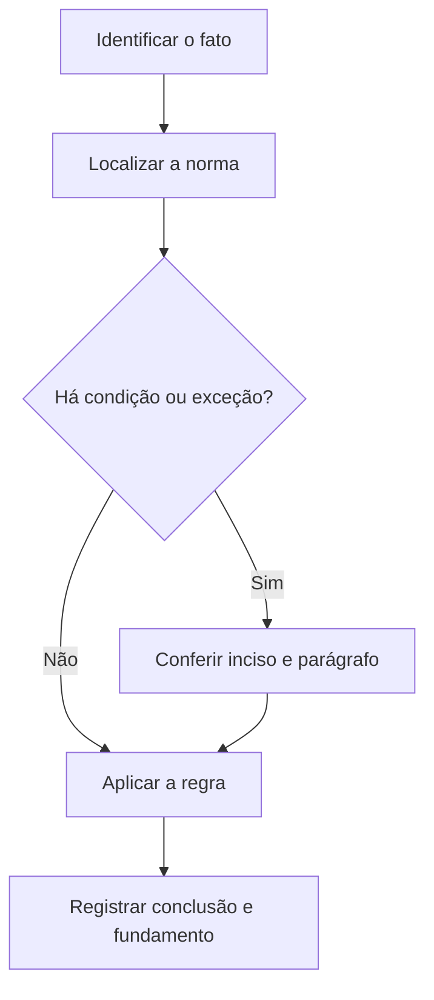

# Livro-texto — Semana 08 | Versão 2.0

**Cargo:** Oficial de Justiça — TJSP | **Banca:** VUNESP | **Período:** 14/12/2026 a 20/12/2026

## Provas, depoimentos e buscas no processo penal

> **Status editorial:** ampliação didática das fichas originais, com referências ao edital. Este volume é um material de estudo revisável, não parecer jurídico nem transcrição integral da lei. Use o roteiro oficial e verifique retificações posteriores.

## Ideia central — entenda antes de decorar

A produção de prova penal exige respeito às regras de admissibilidade e colheita. Buscas, depoimentos e interrogatórios têm requisitos diferentes; não transplante uma regra de um ato para outro.

## Mapa visual da semana

## Plano de sete sessões

| Sessão | Atividade | Produto de aprendizagem |
|---|---|---|
| 1 | Estudar **Produção de prova** e ler **CPP, art. 156** | Esquema regra/condição/exceção em 5 linhas |
| 2 | Estudar **Interrogatório do acusado** e ler **CPP, art. 185** | Esquema regra/condição/exceção em 5 linhas |
| 3 | Estudar **Capacidade para testemunhar** e ler **CPP, art. 202** | Esquema regra/condição/exceção em 5 linhas |
| 4 | Estudar **Compromisso e dever de dizer a verdade** e ler **CPP, arts. 203 e 204** | Esquema regra/condição/exceção em 5 linhas |
| 5 | Estudar **Busca domiciliar** e ler **CPP, arts. 240 e 245** | Esquema regra/condição/exceção em 5 linhas |
| 6 | Estudar **Arquivos e nuvem** e ler **Informática: OneDrive e Windows** | Esquema regra/condição/exceção em 5 linhas |
| 7 | Questões + uma discursiva + revisão dos erros | Registro D+1, D+7 e D+21 |

---

## Aulas com aplicação prática

### Aula 1 — Produção de prova

**Texto para conferir:** CPP, art. 156.

**Entenda a regra.** A prova da alegação incumbe a quem a fizer, com poderes instrutórios previstos em lei; diferencie iniciativa probatória e garantias processuais. Não basta memorizar o nome do instituto: identifique o verbo empregado no artigo, o sujeito que deve agir e os efeitos da conduta.

**Situação concreta.** Uma parte alega fato relevante ao processo penal e o juízo avalia produção de prova. Antes de escolher a alternativa, pergunte: quem deve agir? há ordem judicial? há prazo ou formalidade? existe exceção?

**Armadilha frequente.** A afirmação a seguir foi construída deliberadamente para estar errada: *O art. 156 autoriza condenar sem qualquer base probatória.* Confira no dispositivo indicado por que ela não corresponde à regra.

**Quadro de leitura da lei seca.**

| Passo | O que registrar |
|---|---|
| 1 — Sujeito | Quem pratica, requer, determina ou recebe o ato? |
| 2 — Hipótese | Em que situação a norma se aplica? |
| 3 — Forma | Existe local, prazo, procedimento ou requisito expresso? |
| 4 — Efeito | O que acontece com o cumprimento ou descumprimento? |
| 5 — Exceção | O artigo admite ressalva ou remete a outra norma? |

**Exercício guiado 1.** Reescreva a frase incorreta com o sujeito e a condição corretos. Depois explique o caso concreto em 4–6 linhas, citando **CPP, art. 156**. **Critério de correção:** acertar sujeito, requisito, efeito e artigo.

### Aula 2 — Interrogatório do acusado

**Texto para conferir:** CPP, art. 185.

**Entenda a regra.** O interrogatório segue garantias e formalidades previstas no CPP, inclusive assistência defensiva e regras próprias de realização. Não basta memorizar o nome do instituto: identifique o verbo empregado no artigo, o sujeito que deve agir e os efeitos da conduta.

**Situação concreta.** Uma audiência exige interrogatório de acusado, respeitando seus direitos processuais. Antes de escolher a alternativa, pergunte: quem deve agir? há ordem judicial? há prazo ou formalidade? existe exceção?

**Armadilha frequente.** A afirmação a seguir foi construída deliberadamente para estar errada: *O interrogatório é ato informal, sem necessidade de observar as garantias da defesa.* Confira no dispositivo indicado por que ela não corresponde à regra.

**Quadro de leitura da lei seca.**

| Passo | O que registrar |
|---|---|
| 1 — Sujeito | Quem pratica, requer, determina ou recebe o ato? |
| 2 — Hipótese | Em que situação a norma se aplica? |
| 3 — Forma | Existe local, prazo, procedimento ou requisito expresso? |
| 4 — Efeito | O que acontece com o cumprimento ou descumprimento? |
| 5 — Exceção | O artigo admite ressalva ou remete a outra norma? |

**Exercício guiado 2.** Reescreva a frase incorreta com o sujeito e a condição corretos. Depois explique o caso concreto em 4–6 linhas, citando **CPP, art. 185**. **Critério de correção:** acertar sujeito, requisito, efeito e artigo.

### Aula 3 — Capacidade para testemunhar

**Texto para conferir:** CPP, art. 202.

**Entenda a regra.** Toda pessoa poderá ser testemunha, respeitadas as particularidades e exceções legais do sistema de prova. Não basta memorizar o nome do instituto: identifique o verbo empregado no artigo, o sujeito que deve agir e os efeitos da conduta.

**Situação concreta.** Uma pessoa que presenciou fato é chamada a depor e se discute sua capacidade de testemunhar. Antes de escolher a alternativa, pergunte: quem deve agir? há ordem judicial? há prazo ou formalidade? existe exceção?

**Armadilha frequente.** A afirmação a seguir foi construída deliberadamente para estar errada: *O CPP proíbe que pessoas idosas prestem depoimento.* Confira no dispositivo indicado por que ela não corresponde à regra.

**Quadro de leitura da lei seca.**

| Passo | O que registrar |
|---|---|
| 1 — Sujeito | Quem pratica, requer, determina ou recebe o ato? |
| 2 — Hipótese | Em que situação a norma se aplica? |
| 3 — Forma | Existe local, prazo, procedimento ou requisito expresso? |
| 4 — Efeito | O que acontece com o cumprimento ou descumprimento? |
| 5 — Exceção | O artigo admite ressalva ou remete a outra norma? |

**Exercício guiado 3.** Reescreva a frase incorreta com o sujeito e a condição corretos. Depois explique o caso concreto em 4–6 linhas, citando **CPP, art. 202**. **Critério de correção:** acertar sujeito, requisito, efeito e artigo.

### Aula 4 — Compromisso e dever de dizer a verdade

**Texto para conferir:** CPP, arts. 203 e 204.

**Entenda a regra.** O compromisso da testemunha previsto no art. 203 exige dizer a verdade sobre o que souber e lhe for perguntado; o art. 204 trata da oralidade do depoimento e exceções. Não basta memorizar o nome do instituto: identifique o verbo empregado no artigo, o sujeito que deve agir e os efeitos da conduta.

**Situação concreta.** Uma testemunha presta depoimento e é advertida sobre o dever legal de dizer a verdade. Antes de escolher a alternativa, pergunte: quem deve agir? há ordem judicial? há prazo ou formalidade? existe exceção?

**Armadilha frequente.** A afirmação a seguir foi construída deliberadamente para estar errada: *O depoimento testemunhal é livre de qualquer dever de verdade ou disciplina legal.* Confira no dispositivo indicado por que ela não corresponde à regra.

**Quadro de leitura da lei seca.**

| Passo | O que registrar |
|---|---|
| 1 — Sujeito | Quem pratica, requer, determina ou recebe o ato? |
| 2 — Hipótese | Em que situação a norma se aplica? |
| 3 — Forma | Existe local, prazo, procedimento ou requisito expresso? |
| 4 — Efeito | O que acontece com o cumprimento ou descumprimento? |
| 5 — Exceção | O artigo admite ressalva ou remete a outra norma? |

**Exercício guiado 4.** Reescreva a frase incorreta com o sujeito e a condição corretos. Depois explique o caso concreto em 4–6 linhas, citando **CPP, arts. 203 e 204**. **Critério de correção:** acertar sujeito, requisito, efeito e artigo.

### Aula 5 — Busca domiciliar

**Texto para conferir:** CPP, arts. 240 e 245.

**Entenda a regra.** A busca domiciliar requer fundamentos e observância das condições legais; não confunda busca pessoal, domiciliar e mera entrada consentida. Não basta memorizar o nome do instituto: identifique o verbo empregado no artigo, o sujeito que deve agir e os efeitos da conduta.

**Situação concreta.** A polícia pretende buscar objetos em residência e precisa verificar o título legal do ato. Antes de escolher a alternativa, pergunte: quem deve agir? há ordem judicial? há prazo ou formalidade? existe exceção?

**Armadilha frequente.** A afirmação a seguir foi construída deliberadamente para estar errada: *A busca domiciliar pode ser realizada indiscriminadamente, em qualquer situação e horário.* Confira no dispositivo indicado por que ela não corresponde à regra.

**Quadro de leitura da lei seca.**

| Passo | O que registrar |
|---|---|
| 1 — Sujeito | Quem pratica, requer, determina ou recebe o ato? |
| 2 — Hipótese | Em que situação a norma se aplica? |
| 3 — Forma | Existe local, prazo, procedimento ou requisito expresso? |
| 4 — Efeito | O que acontece com o cumprimento ou descumprimento? |
| 5 — Exceção | O artigo admite ressalva ou remete a outra norma? |

**Exercício guiado 5.** Reescreva a frase incorreta com o sujeito e a condição corretos. Depois explique o caso concreto em 4–6 linhas, citando **CPP, arts. 240 e 245**. **Critério de correção:** acertar sujeito, requisito, efeito e artigo.

### Aula 6 — Arquivos e nuvem

**Texto para conferir:** Informática: OneDrive e Windows.

**Entenda a regra.** Um arquivo local e um arquivo compartilhado na nuvem têm armazenamento e permissões distintos. Sincronização não dispensa verificação de acesso. Não basta memorizar o nome do instituto: identifique o verbo empregado no artigo, o sujeito que deve agir e os efeitos da conduta.

**Situação concreta.** Um servidor altera arquivo em pasta compartilhada e precisa conferir sincronização e permissão. Antes de escolher a alternativa, pergunte: quem deve agir? há ordem judicial? há prazo ou formalidade? existe exceção?

**Armadilha frequente.** A afirmação a seguir foi construída deliberadamente para estar errada: *Compartilhar um link em nuvem garante acesso permanente a qualquer pessoa, independentemente de permissão.* Confira no dispositivo indicado por que ela não corresponde à regra.

**Quadro de leitura da lei seca.**

| Passo | O que registrar |
|---|---|
| 1 — Sujeito | Quem pratica, requer, determina ou recebe o ato? |
| 2 — Hipótese | Em que situação a norma se aplica? |
| 3 — Forma | Existe local, prazo, procedimento ou requisito expresso? |
| 4 — Efeito | O que acontece com o cumprimento ou descumprimento? |
| 5 — Exceção | O artigo admite ressalva ou remete a outra norma? |

**Exercício guiado 6.** Reescreva a frase incorreta com o sujeito e a condição corretos. Depois explique o caso concreto em 4–6 linhas, citando **Informática: OneDrive e Windows**. **Critério de correção:** acertar sujeito, requisito, efeito e artigo.

## Comparando alternativas: como a banca tenta induzir ao erro

1. **Troca de sujeito:** um dever do juiz é atribuído ao oficial, ou vice-versa.
2. **Absolutização:** expressões como “sempre”, “nunca” e “em qualquer hipótese” escondem exceções.
3. **Mistura de ramos:** regra de citação penal é aplicada ao processo civil sem autorização legal.
4. **Omissão de requisito:** a alternativa descreve o ato, mas esquece um pressuposto, uma comunicação ou uma certificação.
5. **Inversão temporal:** um procedimento posterior aparece como requisito anterior, ou o contrário.

## Questões analíticas da semana (autorais)

1. **Caso: Produção de prova.** Uma parte alega fato relevante ao processo penal e o juízo avalia produção de prova. Explique a providência ou o conceito aplicável; identifique duas condições que você procuraria no texto legal e uma alternativa plausível, porém incorreta. Justifique com **CPP, art. 156**.

2. **Caso: Interrogatório do acusado.** Uma audiência exige interrogatório de acusado, respeitando seus direitos processuais. Explique a providência ou o conceito aplicável; identifique duas condições que você procuraria no texto legal e uma alternativa plausível, porém incorreta. Justifique com **CPP, art. 185**.

3. **Caso: Capacidade para testemunhar.** Uma pessoa que presenciou fato é chamada a depor e se discute sua capacidade de testemunhar. Explique a providência ou o conceito aplicável; identifique duas condições que você procuraria no texto legal e uma alternativa plausível, porém incorreta. Justifique com **CPP, art. 202**.

4. **Caso: Compromisso e dever de dizer a verdade.** Uma testemunha presta depoimento e é advertida sobre o dever legal de dizer a verdade. Explique a providência ou o conceito aplicável; identifique duas condições que você procuraria no texto legal e uma alternativa plausível, porém incorreta. Justifique com **CPP, arts. 203 e 204**.

5. **Caso: Busca domiciliar.** A polícia pretende buscar objetos em residência e precisa verificar o título legal do ato. Explique a providência ou o conceito aplicável; identifique duas condições que você procuraria no texto legal e uma alternativa plausível, porém incorreta. Justifique com **CPP, arts. 240 e 245**.

6. **Caso: Arquivos e nuvem.** Um servidor altera arquivo em pasta compartilhada e precisa conferir sincronização e permissão. Explique a providência ou o conceito aplicável; identifique duas condições que você procuraria no texto legal e uma alternativa plausível, porém incorreta. Justifique com **Informática: OneDrive e Windows**.

### Proposta discursiva

Com base nos temas **Produção de prova** e **Busca domiciliar**, descreva como um profissional deve identificar corretamente a norma aplicável a uma situação real, distinguindo competência, procedimento e documentação do ato. Cite os dispositivos do edital e construa uma conclusão em 10 a 15 linhas.

### Critério para autoavaliação (20 pontos)

| Aspecto | Pontos |
|---|---:|
| Identificação da norma e competência | 6 |
| Aplicação ao caso e condições legais | 7 |
| Exceções e documentação | 4 |
| Clareza, objetividade e escrita | 3 |

## Respostas esperadas aos exercícios analíticos

1. A resposta deve partir da regra: **A prova da alegação incumbe a quem a fizer, com poderes instrutórios previstos em lei; diferencie iniciativa probatória e garantias processuais.** No caso: Uma parte alega fato relevante ao processo penal e o juízo avalia produção de prova. A hipótese errada a ser rebatida é: “O art. 156 autoriza condenar sem qualquer base probatória.”. O argumento definitivo deve apontar a redação completa de **CPP, art. 156**, inclusive remissões e exceções.

2. A resposta deve partir da regra: **O interrogatório segue garantias e formalidades previstas no CPP, inclusive assistência defensiva e regras próprias de realização.** No caso: Uma audiência exige interrogatório de acusado, respeitando seus direitos processuais. A hipótese errada a ser rebatida é: “O interrogatório é ato informal, sem necessidade de observar as garantias da defesa.”. O argumento definitivo deve apontar a redação completa de **CPP, art. 185**, inclusive remissões e exceções.

3. A resposta deve partir da regra: **Toda pessoa poderá ser testemunha, respeitadas as particularidades e exceções legais do sistema de prova.** No caso: Uma pessoa que presenciou fato é chamada a depor e se discute sua capacidade de testemunhar. A hipótese errada a ser rebatida é: “O CPP proíbe que pessoas idosas prestem depoimento.”. O argumento definitivo deve apontar a redação completa de **CPP, art. 202**, inclusive remissões e exceções.

4. A resposta deve partir da regra: **O compromisso da testemunha previsto no art. 203 exige dizer a verdade sobre o que souber e lhe for perguntado; o art. 204 trata da oralidade do depoimento e exceções.** No caso: Uma testemunha presta depoimento e é advertida sobre o dever legal de dizer a verdade. A hipótese errada a ser rebatida é: “O depoimento testemunhal é livre de qualquer dever de verdade ou disciplina legal.”. O argumento definitivo deve apontar a redação completa de **CPP, arts. 203 e 204**, inclusive remissões e exceções.

5. A resposta deve partir da regra: **A busca domiciliar requer fundamentos e observância das condições legais; não confunda busca pessoal, domiciliar e mera entrada consentida.** No caso: A polícia pretende buscar objetos em residência e precisa verificar o título legal do ato. A hipótese errada a ser rebatida é: “A busca domiciliar pode ser realizada indiscriminadamente, em qualquer situação e horário.”. O argumento definitivo deve apontar a redação completa de **CPP, arts. 240 e 245**, inclusive remissões e exceções.

6. A resposta deve partir da regra: **Um arquivo local e um arquivo compartilhado na nuvem têm armazenamento e permissões distintos. Sincronização não dispensa verificação de acesso.** No caso: Um servidor altera arquivo em pasta compartilhada e precisa conferir sincronização e permissão. A hipótese errada a ser rebatida é: “Compartilhar um link em nuvem garante acesso permanente a qualquer pessoa, independentemente de permissão.”. O argumento definitivo deve apontar a redação completa de **Informática: OneDrive e Windows**, inclusive remissões e exceções.

## Checklist de conclusão

- [ ] Li o capítulo, incluindo os exemplos.
- [ ] Conferi o texto completo de todos os artigos indicados nesta semana.
- [ ] Resolvi as seis questões analíticas sem consulta.
- [ ] Escrevi ao menos uma discursiva e revisei os erros.
- [ ] Registrei o que deve retornar nas revisões D+1, D+7 e D+21.

**Fonte primária:** [Edital 01/2026, Anexo VIII](https://drive.google.com/file/d/1YJSOt6SDpONIJLY1ahDa9D4y8vkTGwlJ/view) e [Roteiro de legislação por semana](../../legislacao/roteiro_corrigido.md).

**Nota:** As respostas comentadas são guias metodológicos, não substituem a consulta dos dispositivos integrais, e os exercícios autorais não são da VUNESP.