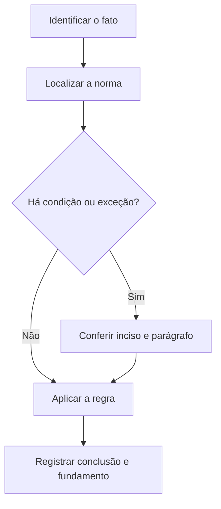

# Livro-texto — Semana 09 | Versão 2.0

**Cargo:** Oficial de Justiça — TJSP | **Banca:** VUNESP | **Período:** 21/12/2026 a 27/12/2026

## Prisões, citações penais e lógica

> **Status editorial:** ampliação didática das fichas originais, com referências ao edital. Este volume é um material de estudo revisável, não parecer jurídico nem transcrição integral da lei. Use o roteiro oficial e verifique retificações posteriores.

## Ideia central — entenda antes de decorar

Prisões e citações penais não têm regime idêntico às diligências civis. Distinga requisitos, destinatários, horário, fundamento e efeitos da ausência.

## Mapa visual da semana

## Plano de sete sessões

| Sessão | Atividade | Produto de aprendizagem |
|---|---|---|
| 1 | Estudar **Prisão em flagrante** e ler **CPP, arts. 301 a 303** | Esquema regra/condição/exceção em 5 linhas |
| 2 | Estudar **Hipóteses de flagrante** e ler **CPP, arts. 301 a 303** | Esquema regra/condição/exceção em 5 linhas |
| 3 | Estudar **Mandado de citação no processo penal** e ler **CPP, arts. 351 e 352** | Esquema regra/condição/exceção em 5 linhas |
| 4 | Estudar **Citação por precatória penal** e ler **CPP, arts. 353 e 354** | Esquema regra/condição/exceção em 5 linhas |
| 5 | Estudar **Citação penal com hora certa** e ler **CPP, art. 362** | Esquema regra/condição/exceção em 5 linhas |
| 6 | Estudar **Negação de condicional** e ler **Raciocínio lógico: proposições** | Esquema regra/condição/exceção em 5 linhas |
| 7 | Questões + uma discursiva + revisão dos erros | Registro D+1, D+7 e D+21 |

---

## Aulas com aplicação prática

### Aula 1 — Prisão em flagrante

**Texto para conferir:** CPP, arts. 301 a 303.

**Entenda a regra.** O CPP diferencia quem pode e quem deve prender em flagrante; analise as hipóteses de flagrância e os requisitos procedimentais. Não basta memorizar o nome do instituto: identifique o verbo empregado no artigo, o sujeito que deve agir e os efeitos da conduta.

**Situação concreta.** Um cidadão presencia crime em flagrante e pergunta se está autorizado a deter o agente. Antes de escolher a alternativa, pergunte: quem deve agir? há ordem judicial? há prazo ou formalidade? existe exceção?

**Armadilha frequente.** A afirmação a seguir foi construída deliberadamente para estar errada: *O CPP proíbe qualquer particular de efetuar prisão em flagrante.* Confira no dispositivo indicado por que ela não corresponde à regra.

**Quadro de leitura da lei seca.**

| Passo | O que registrar |
|---|---|
| 1 — Sujeito | Quem pratica, requer, determina ou recebe o ato? |
| 2 — Hipótese | Em que situação a norma se aplica? |
| 3 — Forma | Existe local, prazo, procedimento ou requisito expresso? |
| 4 — Efeito | O que acontece com o cumprimento ou descumprimento? |
| 5 — Exceção | O artigo admite ressalva ou remete a outra norma? |

**Exercício guiado 1.** Reescreva a frase incorreta com o sujeito e a condição corretos. Depois explique o caso concreto em 4–6 linhas, citando **CPP, arts. 301 a 303**. **Critério de correção:** acertar sujeito, requisito, efeito e artigo.

### Aula 2 — Hipóteses de flagrante

**Texto para conferir:** CPP, arts. 301 a 303.

**Entenda a regra.** O art. 302 distingue situações de flagrante delito; o art. 303 trata das infrações permanentes, nas condições da lei. Não acrescente como conteúdo principal artigos fora do edital. Não basta memorizar o nome do instituto: identifique o verbo empregado no artigo, o sujeito que deve agir e os efeitos da conduta.

**Situação concreta.** Um crime de natureza permanente continua ocorrendo e deve ser avaliado sob a regra de flagrância aplicável. Antes de escolher a alternativa, pergunte: quem deve agir? há ordem judicial? há prazo ou formalidade? existe exceção?

**Armadilha frequente.** A afirmação a seguir foi construída deliberadamente para estar errada: *Flagrante delito só é possível no exato segundo do início da infração, sem outras hipóteses legais.* Confira no dispositivo indicado por que ela não corresponde à regra.

**Quadro de leitura da lei seca.**

| Passo | O que registrar |
|---|---|
| 1 — Sujeito | Quem pratica, requer, determina ou recebe o ato? |
| 2 — Hipótese | Em que situação a norma se aplica? |
| 3 — Forma | Existe local, prazo, procedimento ou requisito expresso? |
| 4 — Efeito | O que acontece com o cumprimento ou descumprimento? |
| 5 — Exceção | O artigo admite ressalva ou remete a outra norma? |

**Exercício guiado 2.** Reescreva a frase incorreta com o sujeito e a condição corretos. Depois explique o caso concreto em 4–6 linhas, citando **CPP, arts. 301 a 303**. **Critério de correção:** acertar sujeito, requisito, efeito e artigo.

### Aula 3 — Mandado de citação no processo penal

**Texto para conferir:** CPP, arts. 351 e 352.

**Entenda a regra.** A citação inicial por mandado observa a competência territorial e os dados que devem constar do mandado. Não basta memorizar o nome do instituto: identifique o verbo empregado no artigo, o sujeito que deve agir e os efeitos da conduta.

**Situação concreta.** Um mandado de citação penal deve identificar juízo, destinatário e comparecimento. Antes de escolher a alternativa, pergunte: quem deve agir? há ordem judicial? há prazo ou formalidade? existe exceção?

**Armadilha frequente.** A afirmação a seguir foi construída deliberadamente para estar errada: *O mandado de citação penal não precisa indicar a finalidade da citação.* Confira no dispositivo indicado por que ela não corresponde à regra.

**Quadro de leitura da lei seca.**

| Passo | O que registrar |
|---|---|
| 1 — Sujeito | Quem pratica, requer, determina ou recebe o ato? |
| 2 — Hipótese | Em que situação a norma se aplica? |
| 3 — Forma | Existe local, prazo, procedimento ou requisito expresso? |
| 4 — Efeito | O que acontece com o cumprimento ou descumprimento? |
| 5 — Exceção | O artigo admite ressalva ou remete a outra norma? |

**Exercício guiado 3.** Reescreva a frase incorreta com o sujeito e a condição corretos. Depois explique o caso concreto em 4–6 linhas, citando **CPP, arts. 351 e 352**. **Critério de correção:** acertar sujeito, requisito, efeito e artigo.

### Aula 4 — Citação por precatória penal

**Texto para conferir:** CPP, arts. 353 e 354.

**Entenda a regra.** O CPP usa a precatória quando o réu se encontra fora do território da jurisdição do juiz processante, nas condições indicadas. Não basta memorizar o nome do instituto: identifique o verbo empregado no artigo, o sujeito que deve agir e os efeitos da conduta.

**Situação concreta.** O réu está em outra comarca; o juízo precisa realizar citação penal. Antes de escolher a alternativa, pergunte: quem deve agir? há ordem judicial? há prazo ou formalidade? existe exceção?

**Armadilha frequente.** A afirmação a seguir foi construída deliberadamente para estar errada: *A citação em comarca diversa torna desnecessária qualquer comunicação judicial.* Confira no dispositivo indicado por que ela não corresponde à regra.

**Quadro de leitura da lei seca.**

| Passo | O que registrar |
|---|---|
| 1 — Sujeito | Quem pratica, requer, determina ou recebe o ato? |
| 2 — Hipótese | Em que situação a norma se aplica? |
| 3 — Forma | Existe local, prazo, procedimento ou requisito expresso? |
| 4 — Efeito | O que acontece com o cumprimento ou descumprimento? |
| 5 — Exceção | O artigo admite ressalva ou remete a outra norma? |

**Exercício guiado 4.** Reescreva a frase incorreta com o sujeito e a condição corretos. Depois explique o caso concreto em 4–6 linhas, citando **CPP, arts. 353 e 354**. **Critério de correção:** acertar sujeito, requisito, efeito e artigo.

### Aula 5 — Citação penal com hora certa

**Texto para conferir:** CPP, art. 362.

**Entenda a regra.** No processo penal, verificada ocultação para não ser citado, o oficial certifica e a citação com hora certa observa a forma prevista no CPC. Não basta memorizar o nome do instituto: identifique o verbo empregado no artigo, o sujeito que deve agir e os efeitos da conduta.

**Situação concreta.** O oficial verifica que o acusado se oculta deliberadamente para evitar a citação. Antes de escolher a alternativa, pergunte: quem deve agir? há ordem judicial? há prazo ou formalidade? existe exceção?

**Armadilha frequente.** A afirmação a seguir foi construída deliberadamente para estar errada: *O oficial deve aplicar automaticamente a citação por edital sempre que houver suspeita de ocultação.* Confira no dispositivo indicado por que ela não corresponde à regra.

**Quadro de leitura da lei seca.**

| Passo | O que registrar |
|---|---|
| 1 — Sujeito | Quem pratica, requer, determina ou recebe o ato? |
| 2 — Hipótese | Em que situação a norma se aplica? |
| 3 — Forma | Existe local, prazo, procedimento ou requisito expresso? |
| 4 — Efeito | O que acontece com o cumprimento ou descumprimento? |
| 5 — Exceção | O artigo admite ressalva ou remete a outra norma? |

**Exercício guiado 5.** Reescreva a frase incorreta com o sujeito e a condição corretos. Depois explique o caso concreto em 4–6 linhas, citando **CPP, art. 362**. **Critério de correção:** acertar sujeito, requisito, efeito e artigo.

### Aula 6 — Negação de condicional

**Texto para conferir:** Raciocínio lógico: proposições.

**Entenda a regra.** A negação de se P então Q é P e não Q; uma condicional só é falsa quando a antecedente é verdadeira e a consequente falsa. Não basta memorizar o nome do instituto: identifique o verbo empregado no artigo, o sujeito que deve agir e os efeitos da conduta.

**Situação concreta.** Negue: Se o mandado chegou, então a diligência foi realizada. Antes de escolher a alternativa, pergunte: quem deve agir? há ordem judicial? há prazo ou formalidade? existe exceção?

**Armadilha frequente.** A afirmação a seguir foi construída deliberadamente para estar errada: *A negação de se P então Q é sempre se não P então não Q.* Confira no dispositivo indicado por que ela não corresponde à regra.

**Quadro de leitura da lei seca.**

| Passo | O que registrar |
|---|---|
| 1 — Sujeito | Quem pratica, requer, determina ou recebe o ato? |
| 2 — Hipótese | Em que situação a norma se aplica? |
| 3 — Forma | Existe local, prazo, procedimento ou requisito expresso? |
| 4 — Efeito | O que acontece com o cumprimento ou descumprimento? |
| 5 — Exceção | O artigo admite ressalva ou remete a outra norma? |

**Exercício guiado 6.** Reescreva a frase incorreta com o sujeito e a condição corretos. Depois explique o caso concreto em 4–6 linhas, citando **Raciocínio lógico: proposições**. **Critério de correção:** acertar sujeito, requisito, efeito e artigo.

## Comparando alternativas: como a banca tenta induzir ao erro

1. **Troca de sujeito:** um dever do juiz é atribuído ao oficial, ou vice-versa.
2. **Absolutização:** expressões como “sempre”, “nunca” e “em qualquer hipótese” escondem exceções.
3. **Mistura de ramos:** regra de citação penal é aplicada ao processo civil sem autorização legal.
4. **Omissão de requisito:** a alternativa descreve o ato, mas esquece um pressuposto, uma comunicação ou uma certificação.
5. **Inversão temporal:** um procedimento posterior aparece como requisito anterior, ou o contrário.

## Questões analíticas da semana (autorais)

1. **Caso: Prisão em flagrante.** Um cidadão presencia crime em flagrante e pergunta se está autorizado a deter o agente. Explique a providência ou o conceito aplicável; identifique duas condições que você procuraria no texto legal e uma alternativa plausível, porém incorreta. Justifique com **CPP, arts. 301 a 303**.

2. **Caso: Hipóteses de flagrante.** Um crime de natureza permanente continua ocorrendo e deve ser avaliado sob a regra de flagrância aplicável. Explique a providência ou o conceito aplicável; identifique duas condições que você procuraria no texto legal e uma alternativa plausível, porém incorreta. Justifique com **CPP, arts. 301 a 303**.

3. **Caso: Mandado de citação no processo penal.** Um mandado de citação penal deve identificar juízo, destinatário e comparecimento. Explique a providência ou o conceito aplicável; identifique duas condições que você procuraria no texto legal e uma alternativa plausível, porém incorreta. Justifique com **CPP, arts. 351 e 352**.

4. **Caso: Citação por precatória penal.** O réu está em outra comarca; o juízo precisa realizar citação penal. Explique a providência ou o conceito aplicável; identifique duas condições que você procuraria no texto legal e uma alternativa plausível, porém incorreta. Justifique com **CPP, arts. 353 e 354**.

5. **Caso: Citação penal com hora certa.** O oficial verifica que o acusado se oculta deliberadamente para evitar a citação. Explique a providência ou o conceito aplicável; identifique duas condições que você procuraria no texto legal e uma alternativa plausível, porém incorreta. Justifique com **CPP, art. 362**.

6. **Caso: Negação de condicional.** Negue: Se o mandado chegou, então a diligência foi realizada. Explique a providência ou o conceito aplicável; identifique duas condições que você procuraria no texto legal e uma alternativa plausível, porém incorreta. Justifique com **Raciocínio lógico: proposições**.

### Proposta discursiva

Com base nos temas **Prisão em flagrante** e **Citação penal com hora certa**, descreva como um profissional deve identificar corretamente a norma aplicável a uma situação real, distinguindo competência, procedimento e documentação do ato. Cite os dispositivos do edital e construa uma conclusão em 10 a 15 linhas.

### Critério para autoavaliação (20 pontos)

| Aspecto | Pontos |
|---|---:|
| Identificação da norma e competência | 6 |
| Aplicação ao caso e condições legais | 7 |
| Exceções e documentação | 4 |
| Clareza, objetividade e escrita | 3 |

## Respostas esperadas aos exercícios analíticos

1. A resposta deve partir da regra: **O CPP diferencia quem pode e quem deve prender em flagrante; analise as hipóteses de flagrância e os requisitos procedimentais.** No caso: Um cidadão presencia crime em flagrante e pergunta se está autorizado a deter o agente. A hipótese errada a ser rebatida é: “O CPP proíbe qualquer particular de efetuar prisão em flagrante.”. O argumento definitivo deve apontar a redação completa de **CPP, arts. 301 a 303**, inclusive remissões e exceções.

2. A resposta deve partir da regra: **O art. 302 distingue situações de flagrante delito; o art. 303 trata das infrações permanentes, nas condições da lei. Não acrescente como conteúdo principal artigos fora do edital.** No caso: Um crime de natureza permanente continua ocorrendo e deve ser avaliado sob a regra de flagrância aplicável. A hipótese errada a ser rebatida é: “Flagrante delito só é possível no exato segundo do início da infração, sem outras hipóteses legais.”. O argumento definitivo deve apontar a redação completa de **CPP, arts. 301 a 303**, inclusive remissões e exceções.

3. A resposta deve partir da regra: **A citação inicial por mandado observa a competência territorial e os dados que devem constar do mandado.** No caso: Um mandado de citação penal deve identificar juízo, destinatário e comparecimento. A hipótese errada a ser rebatida é: “O mandado de citação penal não precisa indicar a finalidade da citação.”. O argumento definitivo deve apontar a redação completa de **CPP, arts. 351 e 352**, inclusive remissões e exceções.

4. A resposta deve partir da regra: **O CPP usa a precatória quando o réu se encontra fora do território da jurisdição do juiz processante, nas condições indicadas.** No caso: O réu está em outra comarca; o juízo precisa realizar citação penal. A hipótese errada a ser rebatida é: “A citação em comarca diversa torna desnecessária qualquer comunicação judicial.”. O argumento definitivo deve apontar a redação completa de **CPP, arts. 353 e 354**, inclusive remissões e exceções.

5. A resposta deve partir da regra: **No processo penal, verificada ocultação para não ser citado, o oficial certifica e a citação com hora certa observa a forma prevista no CPC.** No caso: O oficial verifica que o acusado se oculta deliberadamente para evitar a citação. A hipótese errada a ser rebatida é: “O oficial deve aplicar automaticamente a citação por edital sempre que houver suspeita de ocultação.”. O argumento definitivo deve apontar a redação completa de **CPP, art. 362**, inclusive remissões e exceções.

6. A resposta deve partir da regra: **A negação de se P então Q é P e não Q; uma condicional só é falsa quando a antecedente é verdadeira e a consequente falsa.** No caso: Negue: Se o mandado chegou, então a diligência foi realizada. A hipótese errada a ser rebatida é: “A negação de se P então Q é sempre se não P então não Q.”. O argumento definitivo deve apontar a redação completa de **Raciocínio lógico: proposições**, inclusive remissões e exceções.

## Checklist de conclusão

- [ ] Li o capítulo, incluindo os exemplos.
- [ ] Conferi o texto completo de todos os artigos indicados nesta semana.
- [ ] Resolvi as seis questões analíticas sem consulta.
- [ ] Escrevi ao menos uma discursiva e revisei os erros.
- [ ] Registrei o que deve retornar nas revisões D+1, D+7 e D+21.

**Fonte primária:** [Edital 01/2026, Anexo VIII](https://drive.google.com/file/d/1YJSOt6SDpONIJLY1ahDa9D4y8vkTGwlJ/view) e [Roteiro de legislação por semana](../../legislacao/roteiro_corrigido.md).

**Nota:** As respostas comentadas são guias metodológicos, não substituem a consulta dos dispositivos integrais, e os exercícios autorais não são da VUNESP.