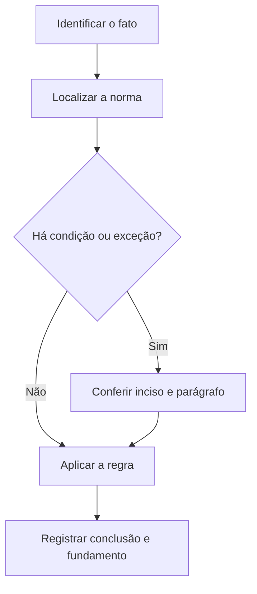

# Livro-texto — Semana 10 | Versão 2.0

**Cargo:** Oficial de Justiça — TJSP | **Banca:** VUNESP | **Período:** 28/12/2026 a 03/01/2027

## CPP final e Juizados Especiais Criminais

> **Status editorial:** ampliação didática das fichas originais, com referências ao edital. Este volume é um material de estudo revisável, não parecer jurídico nem transcrição integral da lei. Use o roteiro oficial e verifique retificações posteriores.

## Ideia central — entenda antes de decorar

Juizados Especiais Criminais e procedimentos comuns precisam de tratamento separado. Uma exceção processual não se torna regra geral.

## Mapa visual da semana

## Plano de sete sessões

| Sessão | Atividade | Produto de aprendizagem |
|---|---|---|
| 1 | Estudar **Resposta à acusação** e ler **CPP, arts. 396 e 396-A** | Esquema regra/condição/exceção em 5 linhas |
| 2 | Estudar **Júri e alistamento** e ler **CPP, arts. 436 a 446** | Esquema regra/condição/exceção em 5 linhas |
| 3 | Estudar **Nulidades processuais penais** e ler **CPP, art. 563** | Esquema regra/condição/exceção em 5 linhas |
| 4 | Estudar **Apelação criminal** e ler **CPP, art. 593** | Esquema regra/condição/exceção em 5 linhas |
| 5 | Estudar **Habeas corpus** e ler **CPP, art. 647** | Esquema regra/condição/exceção em 5 linhas |
| 6 | Estudar **Citação nos Juizados Especiais Criminais** e ler **Lei 9.099/95, arts. 66 a 68** | Esquema regra/condição/exceção em 5 linhas |
| 7 | Questões + uma discursiva + revisão dos erros | Registro D+1, D+7 e D+21 |

---

## Aulas com aplicação prática

### Aula 1 — Resposta à acusação

**Texto para conferir:** CPP, arts. 396 e 396-A.

**Entenda a regra.** O procedimento prevê citação e resposta escrita à acusação, na forma e prazo legais; leia expressamente os dispositivos do edital. Não basta memorizar o nome do instituto: identifique o verbo empregado no artigo, o sujeito que deve agir e os efeitos da conduta.

**Situação concreta.** Após receber a citação, a defesa precisa apresentar resposta escrita dentro do rito aplicável. Antes de escolher a alternativa, pergunte: quem deve agir? há ordem judicial? há prazo ou formalidade? existe exceção?

**Armadilha frequente.** A afirmação a seguir foi construída deliberadamente para estar errada: *A resposta à acusação é uma decisão redigida pelo oficial de justiça.* Confira no dispositivo indicado por que ela não corresponde à regra.

**Quadro de leitura da lei seca.**

| Passo | O que registrar |
|---|---|
| 1 — Sujeito | Quem pratica, requer, determina ou recebe o ato? |
| 2 — Hipótese | Em que situação a norma se aplica? |
| 3 — Forma | Existe local, prazo, procedimento ou requisito expresso? |
| 4 — Efeito | O que acontece com o cumprimento ou descumprimento? |
| 5 — Exceção | O artigo admite ressalva ou remete a outra norma? |

**Exercício guiado 1.** Reescreva a frase incorreta com o sujeito e a condição corretos. Depois explique o caso concreto em 4–6 linhas, citando **CPP, arts. 396 e 396-A**. **Critério de correção:** acertar sujeito, requisito, efeito e artigo.

### Aula 2 — Júri e alistamento

**Texto para conferir:** CPP, arts. 436 a 446.

**Entenda a regra.** O Código disciplina requisitos de participação no serviço do júri, alistamento e hipóteses de isenção ou escusa; não se trata de votação eleitoral. Não basta memorizar o nome do instituto: identifique o verbo empregado no artigo, o sujeito que deve agir e os efeitos da conduta.

**Situação concreta.** Um cidadão é convocado para prestar serviço como jurado e pergunta por regras de participação. Antes de escolher a alternativa, pergunte: quem deve agir? há ordem judicial? há prazo ou formalidade? existe exceção?

**Armadilha frequente.** A afirmação a seguir foi construída deliberadamente para estar errada: *O serviço do júri é sempre facultativo a todos, sem qualquer imposição legal.* Confira no dispositivo indicado por que ela não corresponde à regra.

**Quadro de leitura da lei seca.**

| Passo | O que registrar |
|---|---|
| 1 — Sujeito | Quem pratica, requer, determina ou recebe o ato? |
| 2 — Hipótese | Em que situação a norma se aplica? |
| 3 — Forma | Existe local, prazo, procedimento ou requisito expresso? |
| 4 — Efeito | O que acontece com o cumprimento ou descumprimento? |
| 5 — Exceção | O artigo admite ressalva ou remete a outra norma? |

**Exercício guiado 2.** Reescreva a frase incorreta com o sujeito e a condição corretos. Depois explique o caso concreto em 4–6 linhas, citando **CPP, arts. 436 a 446**. **Critério de correção:** acertar sujeito, requisito, efeito e artigo.

### Aula 3 — Nulidades processuais penais

**Texto para conferir:** CPP, art. 563.

**Entenda a regra.** Nenhum ato será declarado nulo se da nulidade não resultar prejuízo para acusação ou defesa; observe aplicação e exceções. Não basta memorizar o nome do instituto: identifique o verbo empregado no artigo, o sujeito que deve agir e os efeitos da conduta.

**Situação concreta.** Uma parte alega defeito processual, mas não demonstra prejuízo à acusação nem à defesa. Antes de escolher a alternativa, pergunte: quem deve agir? há ordem judicial? há prazo ou formalidade? existe exceção?

**Armadilha frequente.** A afirmação a seguir foi construída deliberadamente para estar errada: *No CPP, toda irregularidade formal gera nulidade automática independentemente de prejuízo.* Confira no dispositivo indicado por que ela não corresponde à regra.

**Quadro de leitura da lei seca.**

| Passo | O que registrar |
|---|---|
| 1 — Sujeito | Quem pratica, requer, determina ou recebe o ato? |
| 2 — Hipótese | Em que situação a norma se aplica? |
| 3 — Forma | Existe local, prazo, procedimento ou requisito expresso? |
| 4 — Efeito | O que acontece com o cumprimento ou descumprimento? |
| 5 — Exceção | O artigo admite ressalva ou remete a outra norma? |

**Exercício guiado 3.** Reescreva a frase incorreta com o sujeito e a condição corretos. Depois explique o caso concreto em 4–6 linhas, citando **CPP, art. 563**. **Critério de correção:** acertar sujeito, requisito, efeito e artigo.

### Aula 4 — Apelação criminal

**Texto para conferir:** CPP, art. 593.

**Entenda a regra.** O art. 593 prevê hipóteses de cabimento da apelação em processo penal; compare cabimento com outros meios impugnativos. Não basta memorizar o nome do instituto: identifique o verbo empregado no artigo, o sujeito que deve agir e os efeitos da conduta.

**Situação concreta.** Uma sentença penal é impugnada por recurso previsto no CPP. Antes de escolher a alternativa, pergunte: quem deve agir? há ordem judicial? há prazo ou formalidade? existe exceção?

**Armadilha frequente.** A afirmação a seguir foi construída deliberadamente para estar errada: *Apelação criminal é instrumento exclusivo do processo civil.* Confira no dispositivo indicado por que ela não corresponde à regra.

**Quadro de leitura da lei seca.**

| Passo | O que registrar |
|---|---|
| 1 — Sujeito | Quem pratica, requer, determina ou recebe o ato? |
| 2 — Hipótese | Em que situação a norma se aplica? |
| 3 — Forma | Existe local, prazo, procedimento ou requisito expresso? |
| 4 — Efeito | O que acontece com o cumprimento ou descumprimento? |
| 5 — Exceção | O artigo admite ressalva ou remete a outra norma? |

**Exercício guiado 4.** Reescreva a frase incorreta com o sujeito e a condição corretos. Depois explique o caso concreto em 4–6 linhas, citando **CPP, art. 593**. **Critério de correção:** acertar sujeito, requisito, efeito e artigo.

### Aula 5 — Habeas corpus

**Texto para conferir:** CPP, art. 647.

**Entenda a regra.** O habeas corpus tutela a liberdade de locomoção quando alguém sofre ou está ameaçado de sofrer violência ou coação ilegal, nos termos do CPP. Não basta memorizar o nome do instituto: identifique o verbo empregado no artigo, o sujeito que deve agir e os efeitos da conduta.

**Situação concreta.** Uma pessoa sofre ameaça ilegal à liberdade de ir e vir. Antes de escolher a alternativa, pergunte: quem deve agir? há ordem judicial? há prazo ou formalidade? existe exceção?

**Armadilha frequente.** A afirmação a seguir foi construída deliberadamente para estar errada: *Habeas corpus é o remédio destinado principalmente a cobrança tributária.* Confira no dispositivo indicado por que ela não corresponde à regra.

**Quadro de leitura da lei seca.**

| Passo | O que registrar |
|---|---|
| 1 — Sujeito | Quem pratica, requer, determina ou recebe o ato? |
| 2 — Hipótese | Em que situação a norma se aplica? |
| 3 — Forma | Existe local, prazo, procedimento ou requisito expresso? |
| 4 — Efeito | O que acontece com o cumprimento ou descumprimento? |
| 5 — Exceção | O artigo admite ressalva ou remete a outra norma? |

**Exercício guiado 5.** Reescreva a frase incorreta com o sujeito e a condição corretos. Depois explique o caso concreto em 4–6 linhas, citando **CPP, art. 647**. **Critério de correção:** acertar sujeito, requisito, efeito e artigo.

### Aula 6 — Citação nos Juizados Especiais Criminais

**Texto para conferir:** Lei 9.099/95, arts. 66 a 68.

**Entenda a regra.** A Lei dos Juizados prevê regras próprias de citação e intimação; a citação inicial, em regra, é pessoal e no próprio juizado, ou por mandado. Não basta memorizar o nome do instituto: identifique o verbo empregado no artigo, o sujeito que deve agir e os efeitos da conduta.

**Situação concreta.** Um acusado deve ser comunicado de audiência no Juizado Especial Criminal. Antes de escolher a alternativa, pergunte: quem deve agir? há ordem judicial? há prazo ou formalidade? existe exceção?

**Armadilha frequente.** A afirmação a seguir foi construída deliberadamente para estar errada: *Os Juizados Especiais Criminais exigem sempre citação por edital como primeira providência.* Confira no dispositivo indicado por que ela não corresponde à regra.

**Quadro de leitura da lei seca.**

| Passo | O que registrar |
|---|---|
| 1 — Sujeito | Quem pratica, requer, determina ou recebe o ato? |
| 2 — Hipótese | Em que situação a norma se aplica? |
| 3 — Forma | Existe local, prazo, procedimento ou requisito expresso? |
| 4 — Efeito | O que acontece com o cumprimento ou descumprimento? |
| 5 — Exceção | O artigo admite ressalva ou remete a outra norma? |

**Exercício guiado 6.** Reescreva a frase incorreta com o sujeito e a condição corretos. Depois explique o caso concreto em 4–6 linhas, citando **Lei 9.099/95, arts. 66 a 68**. **Critério de correção:** acertar sujeito, requisito, efeito e artigo.

## Comparando alternativas: como a banca tenta induzir ao erro

1. **Troca de sujeito:** um dever do juiz é atribuído ao oficial, ou vice-versa.
2. **Absolutização:** expressões como “sempre”, “nunca” e “em qualquer hipótese” escondem exceções.
3. **Mistura de ramos:** regra de citação penal é aplicada ao processo civil sem autorização legal.
4. **Omissão de requisito:** a alternativa descreve o ato, mas esquece um pressuposto, uma comunicação ou uma certificação.
5. **Inversão temporal:** um procedimento posterior aparece como requisito anterior, ou o contrário.

## Questões analíticas da semana (autorais)

1. **Caso: Resposta à acusação.** Após receber a citação, a defesa precisa apresentar resposta escrita dentro do rito aplicável. Explique a providência ou o conceito aplicável; identifique duas condições que você procuraria no texto legal e uma alternativa plausível, porém incorreta. Justifique com **CPP, arts. 396 e 396-A**.

2. **Caso: Júri e alistamento.** Um cidadão é convocado para prestar serviço como jurado e pergunta por regras de participação. Explique a providência ou o conceito aplicável; identifique duas condições que você procuraria no texto legal e uma alternativa plausível, porém incorreta. Justifique com **CPP, arts. 436 a 446**.

3. **Caso: Nulidades processuais penais.** Uma parte alega defeito processual, mas não demonstra prejuízo à acusação nem à defesa. Explique a providência ou o conceito aplicável; identifique duas condições que você procuraria no texto legal e uma alternativa plausível, porém incorreta. Justifique com **CPP, art. 563**.

4. **Caso: Apelação criminal.** Uma sentença penal é impugnada por recurso previsto no CPP. Explique a providência ou o conceito aplicável; identifique duas condições que você procuraria no texto legal e uma alternativa plausível, porém incorreta. Justifique com **CPP, art. 593**.

5. **Caso: Habeas corpus.** Uma pessoa sofre ameaça ilegal à liberdade de ir e vir. Explique a providência ou o conceito aplicável; identifique duas condições que você procuraria no texto legal e uma alternativa plausível, porém incorreta. Justifique com **CPP, art. 647**.

6. **Caso: Citação nos Juizados Especiais Criminais.** Um acusado deve ser comunicado de audiência no Juizado Especial Criminal. Explique a providência ou o conceito aplicável; identifique duas condições que você procuraria no texto legal e uma alternativa plausível, porém incorreta. Justifique com **Lei 9.099/95, arts. 66 a 68**.

### Proposta discursiva

Com base nos temas **Resposta à acusação** e **Habeas corpus**, descreva como um profissional deve identificar corretamente a norma aplicável a uma situação real, distinguindo competência, procedimento e documentação do ato. Cite os dispositivos do edital e construa uma conclusão em 10 a 15 linhas.

### Critério para autoavaliação (20 pontos)

| Aspecto | Pontos |
|---|---:|
| Identificação da norma e competência | 6 |
| Aplicação ao caso e condições legais | 7 |
| Exceções e documentação | 4 |
| Clareza, objetividade e escrita | 3 |

## Respostas esperadas aos exercícios analíticos

1. A resposta deve partir da regra: **O procedimento prevê citação e resposta escrita à acusação, na forma e prazo legais; leia expressamente os dispositivos do edital.** No caso: Após receber a citação, a defesa precisa apresentar resposta escrita dentro do rito aplicável. A hipótese errada a ser rebatida é: “A resposta à acusação é uma decisão redigida pelo oficial de justiça.”. O argumento definitivo deve apontar a redação completa de **CPP, arts. 396 e 396-A**, inclusive remissões e exceções.

2. A resposta deve partir da regra: **O Código disciplina requisitos de participação no serviço do júri, alistamento e hipóteses de isenção ou escusa; não se trata de votação eleitoral.** No caso: Um cidadão é convocado para prestar serviço como jurado e pergunta por regras de participação. A hipótese errada a ser rebatida é: “O serviço do júri é sempre facultativo a todos, sem qualquer imposição legal.”. O argumento definitivo deve apontar a redação completa de **CPP, arts. 436 a 446**, inclusive remissões e exceções.

3. A resposta deve partir da regra: **Nenhum ato será declarado nulo se da nulidade não resultar prejuízo para acusação ou defesa; observe aplicação e exceções.** No caso: Uma parte alega defeito processual, mas não demonstra prejuízo à acusação nem à defesa. A hipótese errada a ser rebatida é: “No CPP, toda irregularidade formal gera nulidade automática independentemente de prejuízo.”. O argumento definitivo deve apontar a redação completa de **CPP, art. 563**, inclusive remissões e exceções.

4. A resposta deve partir da regra: **O art. 593 prevê hipóteses de cabimento da apelação em processo penal; compare cabimento com outros meios impugnativos.** No caso: Uma sentença penal é impugnada por recurso previsto no CPP. A hipótese errada a ser rebatida é: “Apelação criminal é instrumento exclusivo do processo civil.”. O argumento definitivo deve apontar a redação completa de **CPP, art. 593**, inclusive remissões e exceções.

5. A resposta deve partir da regra: **O habeas corpus tutela a liberdade de locomoção quando alguém sofre ou está ameaçado de sofrer violência ou coação ilegal, nos termos do CPP.** No caso: Uma pessoa sofre ameaça ilegal à liberdade de ir e vir. A hipótese errada a ser rebatida é: “Habeas corpus é o remédio destinado principalmente a cobrança tributária.”. O argumento definitivo deve apontar a redação completa de **CPP, art. 647**, inclusive remissões e exceções.

6. A resposta deve partir da regra: **A Lei dos Juizados prevê regras próprias de citação e intimação; a citação inicial, em regra, é pessoal e no próprio juizado, ou por mandado.** No caso: Um acusado deve ser comunicado de audiência no Juizado Especial Criminal. A hipótese errada a ser rebatida é: “Os Juizados Especiais Criminais exigem sempre citação por edital como primeira providência.”. O argumento definitivo deve apontar a redação completa de **Lei 9.099/95, arts. 66 a 68**, inclusive remissões e exceções.

## Checklist de conclusão

- [ ] Li o capítulo, incluindo os exemplos.
- [ ] Conferi o texto completo de todos os artigos indicados nesta semana.
- [ ] Resolvi as seis questões analíticas sem consulta.
- [ ] Escrevi ao menos uma discursiva e revisei os erros.
- [ ] Registrei o que deve retornar nas revisões D+1, D+7 e D+21.

**Fonte primária:** [Edital 01/2026, Anexo VIII](https://drive.google.com/file/d/1YJSOt6SDpONIJLY1ahDa9D4y8vkTGwlJ/view) e [Roteiro de legislação por semana](../../legislacao/roteiro_corrigido.md).

**Nota:** As respostas comentadas são guias metodológicos, não substituem a consulta dos dispositivos integrais, e os exercícios autorais não são da VUNESP.