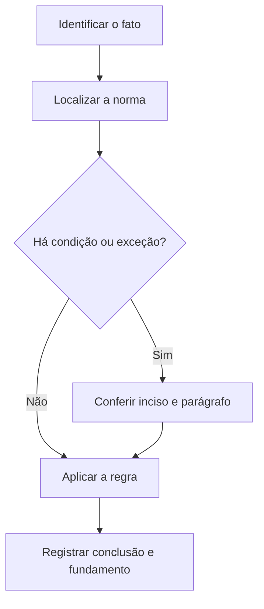

# Livro-texto — Semana 11 | Versão 2.0

**Cargo:** Oficial de Justiça — TJSP | **Banca:** VUNESP | **Período:** 04/01/2027 a 10/01/2027

## Princípios e organização do Processo Civil

> **Status editorial:** ampliação didática das fichas originais, com referências ao edital. Este volume é um material de estudo revisável, não parecer jurídico nem transcrição integral da lei. Use o roteiro oficial e verifique retificações posteriores.

## Ideia central — entenda antes de decorar

O processo civil organiza contraditório, competência, atos e colaboração entre sujeitos. Para o oficial de justiça, o que importa é identificar ordem, forma de cumprimento e documentação do resultado.

## Mapa visual da semana

## Plano de sete sessões

| Sessão | Atividade | Produto de aprendizagem |
|---|---|---|
| 1 | Estudar **Iniciativa e impulso oficial** e ler **CPC, art. 2º** | Esquema regra/condição/exceção em 5 linhas |
| 2 | Estudar **Cooperação processual** e ler **CPC, art. 6º** | Esquema regra/condição/exceção em 5 linhas |
| 3 | Estudar **Contraditório e não surpresa** e ler **CPC, arts. 9º e 10** | Esquema regra/condição/exceção em 5 linhas |
| 4 | Estudar **Competência territorial geral** e ler **CPC, art. 46** | Esquema regra/condição/exceção em 5 linhas |
| 5 | Estudar **Incapacidade processual e representação** e ler **CPC, arts. 70 a 76** | Esquema regra/condição/exceção em 5 linhas |
| 6 | Estudar **Pontuação e oração explicativa** e ler **Português: pontuação** | Esquema regra/condição/exceção em 5 linhas |
| 7 | Questões + uma discursiva + revisão dos erros | Registro D+1, D+7 e D+21 |

---

## Aulas com aplicação prática

### Aula 1 — Iniciativa e impulso oficial

**Texto para conferir:** CPC, art. 2º.

**Entenda a regra.** O processo começa por iniciativa da parte e se desenvolve por impulso oficial, ressalvadas as exceções legais. Não basta memorizar o nome do instituto: identifique o verbo empregado no artigo, o sujeito que deve agir e os efeitos da conduta.

**Situação concreta.** Uma pessoa ajuíza demanda e o processo segue com os atos impulsionados pelo aparelho judiciário. Antes de escolher a alternativa, pergunte: quem deve agir? há ordem judicial? há prazo ou formalidade? existe exceção?

**Armadilha frequente.** A afirmação a seguir foi construída deliberadamente para estar errada: *Todos os processos civis são iniciados de ofício pelo juiz, sem provocação.* Confira no dispositivo indicado por que ela não corresponde à regra.

**Quadro de leitura da lei seca.**

| Passo | O que registrar |
|---|---|
| 1 — Sujeito | Quem pratica, requer, determina ou recebe o ato? |
| 2 — Hipótese | Em que situação a norma se aplica? |
| 3 — Forma | Existe local, prazo, procedimento ou requisito expresso? |
| 4 — Efeito | O que acontece com o cumprimento ou descumprimento? |
| 5 — Exceção | O artigo admite ressalva ou remete a outra norma? |

**Exercício guiado 1.** Reescreva a frase incorreta com o sujeito e a condição corretos. Depois explique o caso concreto em 4–6 linhas, citando **CPC, art. 2º**. **Critério de correção:** acertar sujeito, requisito, efeito e artigo.

### Aula 2 — Cooperação processual

**Texto para conferir:** CPC, art. 6º.

**Entenda a regra.** Todos os sujeitos do processo devem cooperar entre si para obtenção, em tempo razoável, de decisão de mérito justa e efetiva. Não basta memorizar o nome do instituto: identifique o verbo empregado no artigo, o sujeito que deve agir e os efeitos da conduta.

**Situação concreta.** Em uma demanda, partes e órgãos judiciais devem evitar condutas que comprometam a solução justa. Antes de escolher a alternativa, pergunte: quem deve agir? há ordem judicial? há prazo ou formalidade? existe exceção?

**Armadilha frequente.** A afirmação a seguir foi construída deliberadamente para estar errada: *O dever de cooperação processual obriga apenas o autor da ação.* Confira no dispositivo indicado por que ela não corresponde à regra.

**Quadro de leitura da lei seca.**

| Passo | O que registrar |
|---|---|
| 1 — Sujeito | Quem pratica, requer, determina ou recebe o ato? |
| 2 — Hipótese | Em que situação a norma se aplica? |
| 3 — Forma | Existe local, prazo, procedimento ou requisito expresso? |
| 4 — Efeito | O que acontece com o cumprimento ou descumprimento? |
| 5 — Exceção | O artigo admite ressalva ou remete a outra norma? |

**Exercício guiado 2.** Reescreva a frase incorreta com o sujeito e a condição corretos. Depois explique o caso concreto em 4–6 linhas, citando **CPC, art. 6º**. **Critério de correção:** acertar sujeito, requisito, efeito e artigo.

### Aula 3 — Contraditório e não surpresa

**Texto para conferir:** CPC, arts. 9º e 10.

**Entenda a regra.** Em regra, não se profere decisão contra parte sem prévia oitiva; juiz não decide com base em fundamento sem oportunizar manifestação, mesmo se cognoscível de ofício, observadas exceções. Não basta memorizar o nome do instituto: identifique o verbo empregado no artigo, o sujeito que deve agir e os efeitos da conduta.

**Situação concreta.** O juiz pretende decidir sobre fundamento que nenhuma das partes discutiu. Antes de escolher a alternativa, pergunte: quem deve agir? há ordem judicial? há prazo ou formalidade? existe exceção?

**Armadilha frequente.** A afirmação a seguir foi construída deliberadamente para estar errada: *O juiz pode sempre usar fundamento novo sem ouvir as partes por considerá-lo de ordem pública.* Confira no dispositivo indicado por que ela não corresponde à regra.

**Quadro de leitura da lei seca.**

| Passo | O que registrar |
|---|---|
| 1 — Sujeito | Quem pratica, requer, determina ou recebe o ato? |
| 2 — Hipótese | Em que situação a norma se aplica? |
| 3 — Forma | Existe local, prazo, procedimento ou requisito expresso? |
| 4 — Efeito | O que acontece com o cumprimento ou descumprimento? |
| 5 — Exceção | O artigo admite ressalva ou remete a outra norma? |

**Exercício guiado 3.** Reescreva a frase incorreta com o sujeito e a condição corretos. Depois explique o caso concreto em 4–6 linhas, citando **CPC, arts. 9º e 10**. **Critério de correção:** acertar sujeito, requisito, efeito e artigo.

### Aula 4 — Competência territorial geral

**Texto para conferir:** CPC, art. 46.

**Entenda a regra.** A ação fundada em direito pessoal ou em direito real sobre bens móveis será proposta, em regra, no foro do domicílio do réu, ressalvadas exceções. Não basta memorizar o nome do instituto: identifique o verbo empregado no artigo, o sujeito que deve agir e os efeitos da conduta.

**Situação concreta.** Uma demanda pessoal é ajuizada e se pergunta qual foro geralmente se aplica. Antes de escolher a alternativa, pergunte: quem deve agir? há ordem judicial? há prazo ou formalidade? existe exceção?

**Armadilha frequente.** A afirmação a seguir foi construída deliberadamente para estar errada: *O foro da ação pessoal será necessariamente o da residência do autor em todos os casos.* Confira no dispositivo indicado por que ela não corresponde à regra.

**Quadro de leitura da lei seca.**

| Passo | O que registrar |
|---|---|
| 1 — Sujeito | Quem pratica, requer, determina ou recebe o ato? |
| 2 — Hipótese | Em que situação a norma se aplica? |
| 3 — Forma | Existe local, prazo, procedimento ou requisito expresso? |
| 4 — Efeito | O que acontece com o cumprimento ou descumprimento? |
| 5 — Exceção | O artigo admite ressalva ou remete a outra norma? |

**Exercício guiado 4.** Reescreva a frase incorreta com o sujeito e a condição corretos. Depois explique o caso concreto em 4–6 linhas, citando **CPC, art. 46**. **Critério de correção:** acertar sujeito, requisito, efeito e artigo.

### Aula 5 — Incapacidade processual e representação

**Texto para conferir:** CPC, arts. 70 a 76.

**Entenda a regra.** Toda pessoa no exercício de seus direitos tem capacidade para estar em juízo, observadas regras de representação e regularização da capacidade processual. Não basta memorizar o nome do instituto: identifique o verbo empregado no artigo, o sujeito que deve agir e os efeitos da conduta.

**Situação concreta.** Uma parte incapaz precisa atuar em juízo por meio de representação adequada. Antes de escolher a alternativa, pergunte: quem deve agir? há ordem judicial? há prazo ou formalidade? existe exceção?

**Armadilha frequente.** A afirmação a seguir foi construída deliberadamente para estar errada: *Uma parte incapaz sempre atua sozinha em juízo sem qualquer representação.* Confira no dispositivo indicado por que ela não corresponde à regra.

**Quadro de leitura da lei seca.**

| Passo | O que registrar |
|---|---|
| 1 — Sujeito | Quem pratica, requer, determina ou recebe o ato? |
| 2 — Hipótese | Em que situação a norma se aplica? |
| 3 — Forma | Existe local, prazo, procedimento ou requisito expresso? |
| 4 — Efeito | O que acontece com o cumprimento ou descumprimento? |
| 5 — Exceção | O artigo admite ressalva ou remete a outra norma? |

**Exercício guiado 5.** Reescreva a frase incorreta com o sujeito e a condição corretos. Depois explique o caso concreto em 4–6 linhas, citando **CPC, arts. 70 a 76**. **Critério de correção:** acertar sujeito, requisito, efeito e artigo.

### Aula 6 — Pontuação e oração explicativa

**Texto para conferir:** Português: pontuação.

**Entenda a regra.** A vírgula pode isolar elemento explicativo, mas sua retirada ou mudança de posição pode alterar o sentido; não se separam sujeito e predicado por vírgula sem motivo sintático. Não basta memorizar o nome do instituto: identifique o verbo empregado no artigo, o sujeito que deve agir e os efeitos da conduta.

**Situação concreta.** Compare: Os servidores, que chegaram cedo, entraram; e Os servidores que chegaram cedo entraram. Antes de escolher a alternativa, pergunte: quem deve agir? há ordem judicial? há prazo ou formalidade? existe exceção?

**Armadilha frequente.** A afirmação a seguir foi construída deliberadamente para estar errada: *A vírgula deve separar obrigatoriamente o sujeito de seu verbo em toda oração.* Confira no dispositivo indicado por que ela não corresponde à regra.

**Quadro de leitura da lei seca.**

| Passo | O que registrar |
|---|---|
| 1 — Sujeito | Quem pratica, requer, determina ou recebe o ato? |
| 2 — Hipótese | Em que situação a norma se aplica? |
| 3 — Forma | Existe local, prazo, procedimento ou requisito expresso? |
| 4 — Efeito | O que acontece com o cumprimento ou descumprimento? |
| 5 — Exceção | O artigo admite ressalva ou remete a outra norma? |

**Exercício guiado 6.** Reescreva a frase incorreta com o sujeito e a condição corretos. Depois explique o caso concreto em 4–6 linhas, citando **Português: pontuação**. **Critério de correção:** acertar sujeito, requisito, efeito e artigo.

## Comparando alternativas: como a banca tenta induzir ao erro

1. **Troca de sujeito:** um dever do juiz é atribuído ao oficial, ou vice-versa.
2. **Absolutização:** expressões como “sempre”, “nunca” e “em qualquer hipótese” escondem exceções.
3. **Mistura de ramos:** regra de citação penal é aplicada ao processo civil sem autorização legal.
4. **Omissão de requisito:** a alternativa descreve o ato, mas esquece um pressuposto, uma comunicação ou uma certificação.
5. **Inversão temporal:** um procedimento posterior aparece como requisito anterior, ou o contrário.

## Questões analíticas da semana (autorais)

1. **Caso: Iniciativa e impulso oficial.** Uma pessoa ajuíza demanda e o processo segue com os atos impulsionados pelo aparelho judiciário. Explique a providência ou o conceito aplicável; identifique duas condições que você procuraria no texto legal e uma alternativa plausível, porém incorreta. Justifique com **CPC, art. 2º**.

2. **Caso: Cooperação processual.** Em uma demanda, partes e órgãos judiciais devem evitar condutas que comprometam a solução justa. Explique a providência ou o conceito aplicável; identifique duas condições que você procuraria no texto legal e uma alternativa plausível, porém incorreta. Justifique com **CPC, art. 6º**.

3. **Caso: Contraditório e não surpresa.** O juiz pretende decidir sobre fundamento que nenhuma das partes discutiu. Explique a providência ou o conceito aplicável; identifique duas condições que você procuraria no texto legal e uma alternativa plausível, porém incorreta. Justifique com **CPC, arts. 9º e 10**.

4. **Caso: Competência territorial geral.** Uma demanda pessoal é ajuizada e se pergunta qual foro geralmente se aplica. Explique a providência ou o conceito aplicável; identifique duas condições que você procuraria no texto legal e uma alternativa plausível, porém incorreta. Justifique com **CPC, art. 46**.

5. **Caso: Incapacidade processual e representação.** Uma parte incapaz precisa atuar em juízo por meio de representação adequada. Explique a providência ou o conceito aplicável; identifique duas condições que você procuraria no texto legal e uma alternativa plausível, porém incorreta. Justifique com **CPC, arts. 70 a 76**.

6. **Caso: Pontuação e oração explicativa.** Compare: Os servidores, que chegaram cedo, entraram; e Os servidores que chegaram cedo entraram. Explique a providência ou o conceito aplicável; identifique duas condições que você procuraria no texto legal e uma alternativa plausível, porém incorreta. Justifique com **Português: pontuação**.

### Proposta discursiva

Com base nos temas **Iniciativa e impulso oficial** e **Incapacidade processual e representação**, descreva como um profissional deve identificar corretamente a norma aplicável a uma situação real, distinguindo competência, procedimento e documentação do ato. Cite os dispositivos do edital e construa uma conclusão em 10 a 15 linhas.

### Critério para autoavaliação (20 pontos)

| Aspecto | Pontos |
|---|---:|
| Identificação da norma e competência | 6 |
| Aplicação ao caso e condições legais | 7 |
| Exceções e documentação | 4 |
| Clareza, objetividade e escrita | 3 |

## Respostas esperadas aos exercícios analíticos

1. A resposta deve partir da regra: **O processo começa por iniciativa da parte e se desenvolve por impulso oficial, ressalvadas as exceções legais.** No caso: Uma pessoa ajuíza demanda e o processo segue com os atos impulsionados pelo aparelho judiciário. A hipótese errada a ser rebatida é: “Todos os processos civis são iniciados de ofício pelo juiz, sem provocação.”. O argumento definitivo deve apontar a redação completa de **CPC, art. 2º**, inclusive remissões e exceções.

2. A resposta deve partir da regra: **Todos os sujeitos do processo devem cooperar entre si para obtenção, em tempo razoável, de decisão de mérito justa e efetiva.** No caso: Em uma demanda, partes e órgãos judiciais devem evitar condutas que comprometam a solução justa. A hipótese errada a ser rebatida é: “O dever de cooperação processual obriga apenas o autor da ação.”. O argumento definitivo deve apontar a redação completa de **CPC, art. 6º**, inclusive remissões e exceções.

3. A resposta deve partir da regra: **Em regra, não se profere decisão contra parte sem prévia oitiva; juiz não decide com base em fundamento sem oportunizar manifestação, mesmo se cognoscível de ofício, observadas exceções.** No caso: O juiz pretende decidir sobre fundamento que nenhuma das partes discutiu. A hipótese errada a ser rebatida é: “O juiz pode sempre usar fundamento novo sem ouvir as partes por considerá-lo de ordem pública.”. O argumento definitivo deve apontar a redação completa de **CPC, arts. 9º e 10**, inclusive remissões e exceções.

4. A resposta deve partir da regra: **A ação fundada em direito pessoal ou em direito real sobre bens móveis será proposta, em regra, no foro do domicílio do réu, ressalvadas exceções.** No caso: Uma demanda pessoal é ajuizada e se pergunta qual foro geralmente se aplica. A hipótese errada a ser rebatida é: “O foro da ação pessoal será necessariamente o da residência do autor em todos os casos.”. O argumento definitivo deve apontar a redação completa de **CPC, art. 46**, inclusive remissões e exceções.

5. A resposta deve partir da regra: **Toda pessoa no exercício de seus direitos tem capacidade para estar em juízo, observadas regras de representação e regularização da capacidade processual.** No caso: Uma parte incapaz precisa atuar em juízo por meio de representação adequada. A hipótese errada a ser rebatida é: “Uma parte incapaz sempre atua sozinha em juízo sem qualquer representação.”. O argumento definitivo deve apontar a redação completa de **CPC, arts. 70 a 76**, inclusive remissões e exceções.

6. A resposta deve partir da regra: **A vírgula pode isolar elemento explicativo, mas sua retirada ou mudança de posição pode alterar o sentido; não se separam sujeito e predicado por vírgula sem motivo sintático.** No caso: Compare: Os servidores, que chegaram cedo, entraram; e Os servidores que chegaram cedo entraram. A hipótese errada a ser rebatida é: “A vírgula deve separar obrigatoriamente o sujeito de seu verbo em toda oração.”. O argumento definitivo deve apontar a redação completa de **Português: pontuação**, inclusive remissões e exceções.

## Checklist de conclusão

- [ ] Li o capítulo, incluindo os exemplos.
- [ ] Conferi o texto completo de todos os artigos indicados nesta semana.
- [ ] Resolvi as seis questões analíticas sem consulta.
- [ ] Escrevi ao menos uma discursiva e revisei os erros.
- [ ] Registrei o que deve retornar nas revisões D+1, D+7 e D+21.

**Fonte primária:** [Edital 01/2026, Anexo VIII](https://drive.google.com/file/d/1YJSOt6SDpONIJLY1ahDa9D4y8vkTGwlJ/view) e [Roteiro de legislação por semana](../../legislacao/roteiro_corrigido.md).

**Nota:** As respostas comentadas são guias metodológicos, não substituem a consulta dos dispositivos integrais, e os exercícios autorais não são da VUNESP.
