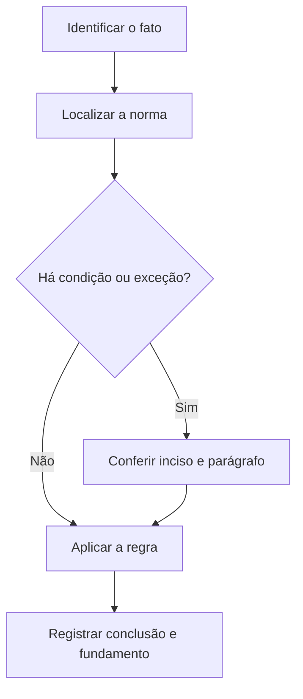

# Livro-texto — Semana 12 | Versão 2.0

**Cargo:** Oficial de Justiça — TJSP | **Banca:** VUNESP | **Período:** 11/01/2027 a 17/01/2027

## Gratuidade, sujeitos do processo e serviços da Justiça

> **Status editorial:** ampliação didática das fichas originais, com referências ao edital. Este volume é um material de estudo revisável, não parecer jurídico nem transcrição integral da lei. Use o roteiro oficial e verifique retificações posteriores.

## Ideia central — entenda antes de decorar

A gratuidade pode alterar despesas, mas não elimina requisitos processuais. O oficial de justiça integra o conjunto de auxiliares da Justiça e tem atribuições próprias definidas no CPC.

## Mapa visual da semana

## Plano de sete sessões

| Sessão | Atividade | Produto de aprendizagem |
|---|---|---|
| 1 | Estudar **Gratuidade da Justiça** e ler **CPC, art. 98** | Esquema regra/condição/exceção em 5 linhas |
| 2 | Estudar **Sucessão das partes** e ler **CPC, art. 110** | Esquema regra/condição/exceção em 5 linhas |
| 3 | Estudar **Chamamento ao processo** e ler **CPC, arts. 130 a 132** | Esquema regra/condição/exceção em 5 linhas |
| 4 | Estudar **Poderes-deveres do juiz** e ler **CPC, art. 139** | Esquema regra/condição/exceção em 5 linhas |
| 5 | Estudar **Incumbências do oficial de justiça** e ler **CPC, art. 154** | Esquema regra/condição/exceção em 5 linhas |
| 6 | Estudar **Referência de células no Excel** e ler **Informática: Excel** | Esquema regra/condição/exceção em 5 linhas |
| 7 | Questões + uma discursiva + revisão dos erros | Registro D+1, D+7 e D+21 |

---

## Aulas com aplicação prática

### Aula 1 — Gratuidade da Justiça

**Texto para conferir:** CPC, art. 98.

**Entenda a regra.** A pessoa natural ou jurídica, brasileira ou estrangeira, com insuficiência de recursos para despesas processuais e honorários, tem direito à gratuidade na forma da lei. Não basta memorizar o nome do instituto: identifique o verbo empregado no artigo, o sujeito que deve agir e os efeitos da conduta.

**Situação concreta.** Uma parte alega insuficiência de recursos para custear o processo. Antes de escolher a alternativa, pergunte: quem deve agir? há ordem judicial? há prazo ou formalidade? existe exceção?

**Armadilha frequente.** A afirmação a seguir foi construída deliberadamente para estar errada: *A gratuidade da Justiça só pode ser concedida a pessoa natural brasileira.* Confira no dispositivo indicado por que ela não corresponde à regra.

**Quadro de leitura da lei seca.**

| Passo | O que registrar |
|---|---|
| 1 — Sujeito | Quem pratica, requer, determina ou recebe o ato? |
| 2 — Hipótese | Em que situação a norma se aplica? |
| 3 — Forma | Existe local, prazo, procedimento ou requisito expresso? |
| 4 — Efeito | O que acontece com o cumprimento ou descumprimento? |
| 5 — Exceção | O artigo admite ressalva ou remete a outra norma? |

**Exercício guiado 1.** Reescreva a frase incorreta com o sujeito e a condição corretos. Depois explique o caso concreto em 4–6 linhas, citando **CPC, art. 98**. **Critério de correção:** acertar sujeito, requisito, efeito e artigo.

### Aula 2 — Sucessão das partes

**Texto para conferir:** CPC, art. 110.

**Entenda a regra.** Ocorrendo a morte de qualquer das partes, dar-se-á sucessão pelo espólio ou sucessores, observado o disposto no art. 313 do CPC. Não basta memorizar o nome do instituto: identifique o verbo empregado no artigo, o sujeito que deve agir e os efeitos da conduta.

**Situação concreta.** Uma parte falece durante a ação e o processo precisa regularizar a relação processual. Antes de escolher a alternativa, pergunte: quem deve agir? há ordem judicial? há prazo ou formalidade? existe exceção?

**Armadilha frequente.** A afirmação a seguir foi construída deliberadamente para estar errada: *A morte de qualquer parte extingue automaticamente todo processo sem possibilidade de sucessão.* Confira no dispositivo indicado por que ela não corresponde à regra.

**Quadro de leitura da lei seca.**

| Passo | O que registrar |
|---|---|
| 1 — Sujeito | Quem pratica, requer, determina ou recebe o ato? |
| 2 — Hipótese | Em que situação a norma se aplica? |
| 3 — Forma | Existe local, prazo, procedimento ou requisito expresso? |
| 4 — Efeito | O que acontece com o cumprimento ou descumprimento? |
| 5 — Exceção | O artigo admite ressalva ou remete a outra norma? |

**Exercício guiado 2.** Reescreva a frase incorreta com o sujeito e a condição corretos. Depois explique o caso concreto em 4–6 linhas, citando **CPC, art. 110**. **Critério de correção:** acertar sujeito, requisito, efeito e artigo.

### Aula 3 — Chamamento ao processo

**Texto para conferir:** CPC, arts. 130 a 132.

**Entenda a regra.** O chamamento ao processo tem hipóteses próprias envolvendo corresponsáveis, como afiançado ou devedores solidários, nos limites legais. Não basta memorizar o nome do instituto: identifique o verbo empregado no artigo, o sujeito que deve agir e os efeitos da conduta.

**Situação concreta.** Em ação de cobrança, discute-se chamar outros devedores solidários para integrar o processo. Antes de escolher a alternativa, pergunte: quem deve agir? há ordem judicial? há prazo ou formalidade? existe exceção?

**Armadilha frequente.** A afirmação a seguir foi construída deliberadamente para estar errada: *O chamamento ao processo ocorre automaticamente em todas as ações, sem requerimento.* Confira no dispositivo indicado por que ela não corresponde à regra.

**Quadro de leitura da lei seca.**

| Passo | O que registrar |
|---|---|
| 1 — Sujeito | Quem pratica, requer, determina ou recebe o ato? |
| 2 — Hipótese | Em que situação a norma se aplica? |
| 3 — Forma | Existe local, prazo, procedimento ou requisito expresso? |
| 4 — Efeito | O que acontece com o cumprimento ou descumprimento? |
| 5 — Exceção | O artigo admite ressalva ou remete a outra norma? |

**Exercício guiado 3.** Reescreva a frase incorreta com o sujeito e a condição corretos. Depois explique o caso concreto em 4–6 linhas, citando **CPC, arts. 130 a 132**. **Critério de correção:** acertar sujeito, requisito, efeito e artigo.

### Aula 4 — Poderes-deveres do juiz

**Texto para conferir:** CPC, art. 139.

**Entenda a regra.** Ao dirigir o processo, o juiz tem incumbências como assegurar igualdade de tratamento, velar pela duração razoável e adotar medidas previstas na lei. Não basta memorizar o nome do instituto: identifique o verbo empregado no artigo, o sujeito que deve agir e os efeitos da conduta.

**Situação concreta.** O magistrado busca garantir tratamento isonômico entre partes e cumprimento de atos. Antes de escolher a alternativa, pergunte: quem deve agir? há ordem judicial? há prazo ou formalidade? existe exceção?

**Armadilha frequente.** A afirmação a seguir foi construída deliberadamente para estar errada: *O juiz é proibido de adotar medidas destinadas a assegurar igualdade de tratamento.* Confira no dispositivo indicado por que ela não corresponde à regra.

**Quadro de leitura da lei seca.**

| Passo | O que registrar |
|---|---|
| 1 — Sujeito | Quem pratica, requer, determina ou recebe o ato? |
| 2 — Hipótese | Em que situação a norma se aplica? |
| 3 — Forma | Existe local, prazo, procedimento ou requisito expresso? |
| 4 — Efeito | O que acontece com o cumprimento ou descumprimento? |
| 5 — Exceção | O artigo admite ressalva ou remete a outra norma? |

**Exercício guiado 4.** Reescreva a frase incorreta com o sujeito e a condição corretos. Depois explique o caso concreto em 4–6 linhas, citando **CPC, art. 139**. **Critério de correção:** acertar sujeito, requisito, efeito e artigo.

### Aula 5 — Incumbências do oficial de justiça

**Texto para conferir:** CPC, art. 154.

**Entenda a regra.** O oficial cumpre pessoalmente citações, prisões, penhoras, arrestos e diligências próprias, certificando circunstâncias; auxilia o juiz e pratica os demais atos previstos. Não basta memorizar o nome do instituto: identifique o verbo empregado no artigo, o sujeito que deve agir e os efeitos da conduta.

**Situação concreta.** Ao cumprir mandado, o oficial certifica lugar, dia e hora e devolve o documento conforme o procedimento. Antes de escolher a alternativa, pergunte: quem deve agir? há ordem judicial? há prazo ou formalidade? existe exceção?

**Armadilha frequente.** A afirmação a seguir foi construída deliberadamente para estar errada: *O oficial pode dispensar a certificação e alterar a ordem judicial por preferência pessoal.* Confira no dispositivo indicado por que ela não corresponde à regra.

**Quadro de leitura da lei seca.**

| Passo | O que registrar |
|---|---|
| 1 — Sujeito | Quem pratica, requer, determina ou recebe o ato? |
| 2 — Hipótese | Em que situação a norma se aplica? |
| 3 — Forma | Existe local, prazo, procedimento ou requisito expresso? |
| 4 — Efeito | O que acontece com o cumprimento ou descumprimento? |
| 5 — Exceção | O artigo admite ressalva ou remete a outra norma? |

**Exercício guiado 5.** Reescreva a frase incorreta com o sujeito e a condição corretos. Depois explique o caso concreto em 4–6 linhas, citando **CPC, art. 154**. **Critério de correção:** acertar sujeito, requisito, efeito e artigo.

### Aula 6 — Referência de células no Excel

**Texto para conferir:** Informática: Excel.

**Entenda a regra.** A referência A1 é relativa; $A$1 fixa coluna e linha. Ao copiar fórmulas, compreender referências evita resultados errados. Não basta memorizar o nome do instituto: identifique o verbo empregado no artigo, o sujeito que deve agir e os efeitos da conduta.

**Situação concreta.** Em fórmula copiada para outra célula, deseja-se manter uma referência constante a uma célula de taxa. Antes de escolher a alternativa, pergunte: quem deve agir? há ordem judicial? há prazo ou formalidade? existe exceção?

**Armadilha frequente.** A afirmação a seguir foi construída deliberadamente para estar errada: *A referência $A$1 é relativa e muda sempre ao copiar a fórmula.* Confira no dispositivo indicado por que ela não corresponde à regra.

**Quadro de leitura da lei seca.**

| Passo | O que registrar |
|---|---|
| 1 — Sujeito | Quem pratica, requer, determina ou recebe o ato? |
| 2 — Hipótese | Em que situação a norma se aplica? |
| 3 — Forma | Existe local, prazo, procedimento ou requisito expresso? |
| 4 — Efeito | O que acontece com o cumprimento ou descumprimento? |
| 5 — Exceção | O artigo admite ressalva ou remete a outra norma? |

**Exercício guiado 6.** Reescreva a frase incorreta com o sujeito e a condição corretos. Depois explique o caso concreto em 4–6 linhas, citando **Informática: Excel**. **Critério de correção:** acertar sujeito, requisito, efeito e artigo.

## Comparando alternativas: como a banca tenta induzir ao erro

1. **Troca de sujeito:** um dever do juiz é atribuído ao oficial, ou vice-versa.
2. **Absolutização:** expressões como “sempre”, “nunca” e “em qualquer hipótese” escondem exceções.
3. **Mistura de ramos:** regra de citação penal é aplicada ao processo civil sem autorização legal.
4. **Omissão de requisito:** a alternativa descreve o ato, mas esquece um pressuposto, uma comunicação ou uma certificação.
5. **Inversão temporal:** um procedimento posterior aparece como requisito anterior, ou o contrário.

## Questões analíticas da semana (autorais)

1. **Caso: Gratuidade da Justiça.** Uma parte alega insuficiência de recursos para custear o processo. Explique a providência ou o conceito aplicável; identifique duas condições que você procuraria no texto legal e uma alternativa plausível, porém incorreta. Justifique com **CPC, art. 98**.

2. **Caso: Sucessão das partes.** Uma parte falece durante a ação e o processo precisa regularizar a relação processual. Explique a providência ou o conceito aplicável; identifique duas condições que você procuraria no texto legal e uma alternativa plausível, porém incorreta. Justifique com **CPC, art. 110**.

3. **Caso: Chamamento ao processo.** Em ação de cobrança, discute-se chamar outros devedores solidários para integrar o processo. Explique a providência ou o conceito aplicável; identifique duas condições que você procuraria no texto legal e uma alternativa plausível, porém incorreta. Justifique com **CPC, arts. 130 a 132**.

4. **Caso: Poderes-deveres do juiz.** O magistrado busca garantir tratamento isonômico entre partes e cumprimento de atos. Explique a providência ou o conceito aplicável; identifique duas condições que você procuraria no texto legal e uma alternativa plausível, porém incorreta. Justifique com **CPC, art. 139**.

5. **Caso: Incumbências do oficial de justiça.** Ao cumprir mandado, o oficial certifica lugar, dia e hora e devolve o documento conforme o procedimento. Explique a providência ou o conceito aplicável; identifique duas condições que você procuraria no texto legal e uma alternativa plausível, porém incorreta. Justifique com **CPC, art. 154**.

6. **Caso: Referência de células no Excel.** Em fórmula copiada para outra célula, deseja-se manter uma referência constante a uma célula de taxa. Explique a providência ou o conceito aplicável; identifique duas condições que você procuraria no texto legal e uma alternativa plausível, porém incorreta. Justifique com **Informática: Excel**.

### Proposta discursiva

Com base nos temas **Gratuidade da Justiça** e **Incumbências do oficial de justiça**, descreva como um profissional deve identificar corretamente a norma aplicável a uma situação real, distinguindo competência, procedimento e documentação do ato. Cite os dispositivos do edital e construa uma conclusão em 10 a 15 linhas.

### Critério para autoavaliação (20 pontos)

| Aspecto | Pontos |
|---|---:|
| Identificação da norma e competência | 6 |
| Aplicação ao caso e condições legais | 7 |
| Exceções e documentação | 4 |
| Clareza, objetividade e escrita | 3 |

## Respostas esperadas aos exercícios analíticos

1. A resposta deve partir da regra: **A pessoa natural ou jurídica, brasileira ou estrangeira, com insuficiência de recursos para despesas processuais e honorários, tem direito à gratuidade na forma da lei.** No caso: Uma parte alega insuficiência de recursos para custear o processo. A hipótese errada a ser rebatida é: “A gratuidade da Justiça só pode ser concedida a pessoa natural brasileira.”. O argumento definitivo deve apontar a redação completa de **CPC, art. 98**, inclusive remissões e exceções.

2. A resposta deve partir da regra: **Ocorrendo a morte de qualquer das partes, dar-se-á sucessão pelo espólio ou sucessores, observado o disposto no art. 313 do CPC.** No caso: Uma parte falece durante a ação e o processo precisa regularizar a relação processual. A hipótese errada a ser rebatida é: “A morte de qualquer parte extingue automaticamente todo processo sem possibilidade de sucessão.”. O argumento definitivo deve apontar a redação completa de **CPC, art. 110**, inclusive remissões e exceções.

3. A resposta deve partir da regra: **O chamamento ao processo tem hipóteses próprias envolvendo corresponsáveis, como afiançado ou devedores solidários, nos limites legais.** No caso: Em ação de cobrança, discute-se chamar outros devedores solidários para integrar o processo. A hipótese errada a ser rebatida é: “O chamamento ao processo ocorre automaticamente em todas as ações, sem requerimento.”. O argumento definitivo deve apontar a redação completa de **CPC, arts. 130 a 132**, inclusive remissões e exceções.

4. A resposta deve partir da regra: **Ao dirigir o processo, o juiz tem incumbências como assegurar igualdade de tratamento, velar pela duração razoável e adotar medidas previstas na lei.** No caso: O magistrado busca garantir tratamento isonômico entre partes e cumprimento de atos. A hipótese errada a ser rebatida é: “O juiz é proibido de adotar medidas destinadas a assegurar igualdade de tratamento.”. O argumento definitivo deve apontar a redação completa de **CPC, art. 139**, inclusive remissões e exceções.

5. A resposta deve partir da regra: **O oficial cumpre pessoalmente citações, prisões, penhoras, arrestos e diligências próprias, certificando circunstâncias; auxilia o juiz e pratica os demais atos previstos.** No caso: Ao cumprir mandado, o oficial certifica lugar, dia e hora e devolve o documento conforme o procedimento. A hipótese errada a ser rebatida é: “O oficial pode dispensar a certificação e alterar a ordem judicial por preferência pessoal.”. O argumento definitivo deve apontar a redação completa de **CPC, art. 154**, inclusive remissões e exceções.

6. A resposta deve partir da regra: **A referência A1 é relativa; $A$1 fixa coluna e linha. Ao copiar fórmulas, compreender referências evita resultados errados.** No caso: Em fórmula copiada para outra célula, deseja-se manter uma referência constante a uma célula de taxa. A hipótese errada a ser rebatida é: “A referência $A$1 é relativa e muda sempre ao copiar a fórmula.”. O argumento definitivo deve apontar a redação completa de **Informática: Excel**, inclusive remissões e exceções.

## Checklist de conclusão

- [ ] Li o capítulo, incluindo os exemplos.
- [ ] Conferi o texto completo de todos os artigos indicados nesta semana.
- [ ] Resolvi as seis questões analíticas sem consulta.
- [ ] Escrevi ao menos uma discursiva e revisei os erros.
- [ ] Registrei o que deve retornar nas revisões D+1, D+7 e D+21.

**Fonte primária:** [Edital 01/2026, Anexo VIII](https://drive.google.com/file/d/1YJSOt6SDpONIJLY1ahDa9D4y8vkTGwlJ/view) e [Roteiro de legislação por semana](../../legislacao/roteiro_corrigido.md).

**Nota:** As respostas comentadas são guias metodológicos, não substituem a consulta dos dispositivos integrais, e os exercícios autorais não são da VUNESP.