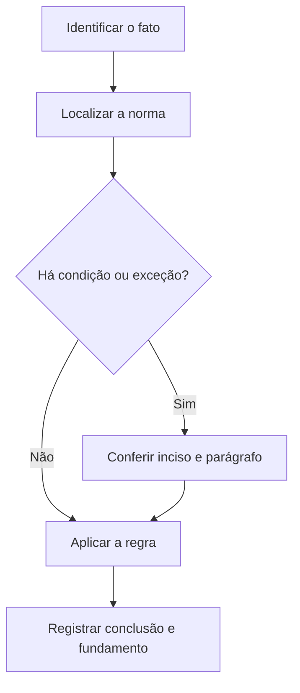

# Livro-texto — Semana 13 | Versão 2.0

**Cargo:** Oficial de Justiça — TJSP | **Banca:** VUNESP | **Período:** 18/01/2027 a 24/01/2027

## Atos processuais, citação e intimação

> **Status editorial:** ampliação didática das fichas originais, com referências ao edital. Este volume é um material de estudo revisável, não parecer jurídico nem transcrição integral da lei. Use o roteiro oficial e verifique retificações posteriores.

## Ideia central — entenda antes de decorar

Citação e intimação possuem finalidades diferentes e formalidades específicas. A VUNESP pode modificar uma palavra do artigo para criar alternativa errada.

## Mapa visual da semana

## Plano de sete sessões

| Sessão | Atividade | Produto de aprendizagem |
|---|---|---|
| 1 | Estudar **Pronunciamentos judiciais** e ler **CPC, art. 203** | Esquema regra/condição/exceção em 5 linhas |
| 2 | Estudar **Finalidade da citação** e ler **CPC, arts. 238 e 239** | Esquema regra/condição/exceção em 5 linhas |
| 3 | Estudar **Citação por oficial** e ler **CPC, arts. 249 a 251** | Esquema regra/condição/exceção em 5 linhas |
| 4 | Estudar **Citação com hora certa no CPC** e ler **CPC, arts. 252 a 254** | Esquema regra/condição/exceção em 5 linhas |
| 5 | Estudar **Intimação eletrônica e oficial** e ler **CPC, arts. 270 e 275** | Esquema regra/condição/exceção em 5 linhas |
| 6 | Estudar **Pronomes e referente** e ler **Português: pronomes** | Esquema regra/condição/exceção em 5 linhas |
| 7 | Questões + uma discursiva + revisão dos erros | Registro D+1, D+7 e D+21 |

---

## Aulas com aplicação prática

### Aula 1 — Pronunciamentos judiciais

**Texto para conferir:** CPC, art. 203.

**Entenda a regra.** Os pronunciamentos do juiz consistem em sentenças, decisões interlocutórias e despachos, com definições legais distintas. Não basta memorizar o nome do instituto: identifique o verbo empregado no artigo, o sujeito que deve agir e os efeitos da conduta.

**Situação concreta.** No processo, o juiz profere ato com conteúdo decisório sem encerrar fase de conhecimento. Antes de escolher a alternativa, pergunte: quem deve agir? há ordem judicial? há prazo ou formalidade? existe exceção?

**Armadilha frequente.** A afirmação a seguir foi construída deliberadamente para estar errada: *Toda manifestação escrita do juiz é necessariamente sentença.* Confira no dispositivo indicado por que ela não corresponde à regra.

**Quadro de leitura da lei seca.**

| Passo | O que registrar |
|---|---|
| 1 — Sujeito | Quem pratica, requer, determina ou recebe o ato? |
| 2 — Hipótese | Em que situação a norma se aplica? |
| 3 — Forma | Existe local, prazo, procedimento ou requisito expresso? |
| 4 — Efeito | O que acontece com o cumprimento ou descumprimento? |
| 5 — Exceção | O artigo admite ressalva ou remete a outra norma? |

**Exercício guiado 1.** Reescreva a frase incorreta com o sujeito e a condição corretos. Depois explique o caso concreto em 4–6 linhas, citando **CPC, art. 203**. **Critério de correção:** acertar sujeito, requisito, efeito e artigo.

### Aula 2 — Finalidade da citação

**Texto para conferir:** CPC, arts. 238 e 239.

**Entenda a regra.** A citação convoca réu, executado ou interessado para integrar a relação processual; sua validade é central para o processo, ressalvadas hipóteses previstas. Não basta memorizar o nome do instituto: identifique o verbo empregado no artigo, o sujeito que deve agir e os efeitos da conduta.

**Situação concreta.** O réu precisa tomar ciência formal de ação e ser chamado ao processo. Antes de escolher a alternativa, pergunte: quem deve agir? há ordem judicial? há prazo ou formalidade? existe exceção?

**Armadilha frequente.** A afirmação a seguir foi construída deliberadamente para estar errada: *Citação serve somente para comunicar decisões finais após o trânsito em julgado.* Confira no dispositivo indicado por que ela não corresponde à regra.

**Quadro de leitura da lei seca.**

| Passo | O que registrar |
|---|---|
| 1 — Sujeito | Quem pratica, requer, determina ou recebe o ato? |
| 2 — Hipótese | Em que situação a norma se aplica? |
| 3 — Forma | Existe local, prazo, procedimento ou requisito expresso? |
| 4 — Efeito | O que acontece com o cumprimento ou descumprimento? |
| 5 — Exceção | O artigo admite ressalva ou remete a outra norma? |

**Exercício guiado 2.** Reescreva a frase incorreta com o sujeito e a condição corretos. Depois explique o caso concreto em 4–6 linhas, citando **CPC, arts. 238 e 239**. **Critério de correção:** acertar sujeito, requisito, efeito e artigo.

### Aula 3 — Citação por oficial

**Texto para conferir:** CPC, arts. 249 a 251.

**Entenda a regra.** A citação por oficial ocorre nas hipóteses legais ou quando frustrada a via postal; o oficial procura o citando, lê o mandado, entrega a contrafé e certifica o ocorrido. Não basta memorizar o nome do instituto: identifique o verbo empregado no artigo, o sujeito que deve agir e os efeitos da conduta.

**Situação concreta.** A tentativa postal não funcionou e o juízo expede mandado a oficial. Antes de escolher a alternativa, pergunte: quem deve agir? há ordem judicial? há prazo ou formalidade? existe exceção?

**Armadilha frequente.** A afirmação a seguir foi construída deliberadamente para estar errada: *A atuação do oficial de justiça é obrigatória como primeira forma de citação em todo processo.* Confira no dispositivo indicado por que ela não corresponde à regra.

**Quadro de leitura da lei seca.**

| Passo | O que registrar |
|---|---|
| 1 — Sujeito | Quem pratica, requer, determina ou recebe o ato? |
| 2 — Hipótese | Em que situação a norma se aplica? |
| 3 — Forma | Existe local, prazo, procedimento ou requisito expresso? |
| 4 — Efeito | O que acontece com o cumprimento ou descumprimento? |
| 5 — Exceção | O artigo admite ressalva ou remete a outra norma? |

**Exercício guiado 3.** Reescreva a frase incorreta com o sujeito e a condição corretos. Depois explique o caso concreto em 4–6 linhas, citando **CPC, arts. 249 a 251**. **Critério de correção:** acertar sujeito, requisito, efeito e artigo.

### Aula 4 — Citação com hora certa no CPC

**Texto para conferir:** CPC, arts. 252 a 254.

**Entenda a regra.** Depois de duas buscas sem localizar o citando e com suspeita de ocultação, o oficial intima pessoa da família ou vizinho e retorna no dia útil imediato, na hora designada. Não basta memorizar o nome do instituto: identifique o verbo empregado no artigo, o sujeito que deve agir e os efeitos da conduta.

**Situação concreta.** Duas diligências frustradas e indícios de ocultação levam à comunicação do retorno para citação. Antes de escolher a alternativa, pergunte: quem deve agir? há ordem judicial? há prazo ou formalidade? existe exceção?

**Armadilha frequente.** A afirmação a seguir foi construída deliberadamente para estar errada: *Uma única busca frustrada, sem suspeita de ocultação, autoriza automaticamente hora certa.* Confira no dispositivo indicado por que ela não corresponde à regra.

**Quadro de leitura da lei seca.**

| Passo | O que registrar |
|---|---|
| 1 — Sujeito | Quem pratica, requer, determina ou recebe o ato? |
| 2 — Hipótese | Em que situação a norma se aplica? |
| 3 — Forma | Existe local, prazo, procedimento ou requisito expresso? |
| 4 — Efeito | O que acontece com o cumprimento ou descumprimento? |
| 5 — Exceção | O artigo admite ressalva ou remete a outra norma? |

**Exercício guiado 4.** Reescreva a frase incorreta com o sujeito e a condição corretos. Depois explique o caso concreto em 4–6 linhas, citando **CPC, arts. 252 a 254**. **Critério de correção:** acertar sujeito, requisito, efeito e artigo.

### Aula 5 — Intimação eletrônica e oficial

**Texto para conferir:** CPC, arts. 270 e 275.

**Entenda a regra.** As intimações são feitas, sempre que possível, por meio eletrônico; via oficial de justiça é prevista quando frustradas as demais formas nas condições legais. Não basta memorizar o nome do instituto: identifique o verbo empregado no artigo, o sujeito que deve agir e os efeitos da conduta.

**Situação concreta.** Um ato precisa ser intimado e o procedimento eletrônico não conseguiu alcançar a parte. Antes de escolher a alternativa, pergunte: quem deve agir? há ordem judicial? há prazo ou formalidade? existe exceção?

**Armadilha frequente.** A afirmação a seguir foi construída deliberadamente para estar errada: *Todas as intimações começam obrigatoriamente com diligência presencial por oficial.* Confira no dispositivo indicado por que ela não corresponde à regra.

**Quadro de leitura da lei seca.**

| Passo | O que registrar |
|---|---|
| 1 — Sujeito | Quem pratica, requer, determina ou recebe o ato? |
| 2 — Hipótese | Em que situação a norma se aplica? |
| 3 — Forma | Existe local, prazo, procedimento ou requisito expresso? |
| 4 — Efeito | O que acontece com o cumprimento ou descumprimento? |
| 5 — Exceção | O artigo admite ressalva ou remete a outra norma? |

**Exercício guiado 5.** Reescreva a frase incorreta com o sujeito e a condição corretos. Depois explique o caso concreto em 4–6 linhas, citando **CPC, arts. 270 e 275**. **Critério de correção:** acertar sujeito, requisito, efeito e artigo.

### Aula 6 — Pronomes e referente

**Texto para conferir:** Português: pronomes.

**Entenda a regra.** Na leitura, um pronome pode retomar termo ou ideia anteriormente apresentada; localização do antecedente depende de coerência sintática e semântica. Não basta memorizar o nome do instituto: identifique o verbo empregado no artigo, o sujeito que deve agir e os efeitos da conduta.

**Situação concreta.** No trecho: A audiência foi remarcada e isso foi comunicado às partes, determine o que isso retoma. Antes de escolher a alternativa, pergunte: quem deve agir? há ordem judicial? há prazo ou formalidade? existe exceção?

**Armadilha frequente.** A afirmação a seguir foi construída deliberadamente para estar errada: *O pronome isso só pode retomar substantivo isolado, nunca uma oração ou ideia.* Confira no dispositivo indicado por que ela não corresponde à regra.

**Quadro de leitura da lei seca.**

| Passo | O que registrar |
|---|---|
| 1 — Sujeito | Quem pratica, requer, determina ou recebe o ato? |
| 2 — Hipótese | Em que situação a norma se aplica? |
| 3 — Forma | Existe local, prazo, procedimento ou requisito expresso? |
| 4 — Efeito | O que acontece com o cumprimento ou descumprimento? |
| 5 — Exceção | O artigo admite ressalva ou remete a outra norma? |

**Exercício guiado 6.** Reescreva a frase incorreta com o sujeito e a condição corretos. Depois explique o caso concreto em 4–6 linhas, citando **Português: pronomes**. **Critério de correção:** acertar sujeito, requisito, efeito e artigo.

## Comparando alternativas: como a banca tenta induzir ao erro

1. **Troca de sujeito:** um dever do juiz é atribuído ao oficial, ou vice-versa.
2. **Absolutização:** expressões como “sempre”, “nunca” e “em qualquer hipótese” escondem exceções.
3. **Mistura de ramos:** regra de citação penal é aplicada ao processo civil sem autorização legal.
4. **Omissão de requisito:** a alternativa descreve o ato, mas esquece um pressuposto, uma comunicação ou uma certificação.
5. **Inversão temporal:** um procedimento posterior aparece como requisito anterior, ou o contrário.

## Questões analíticas da semana (autorais)

1. **Caso: Pronunciamentos judiciais.** No processo, o juiz profere ato com conteúdo decisório sem encerrar fase de conhecimento. Explique a providência ou o conceito aplicável; identifique duas condições que você procuraria no texto legal e uma alternativa plausível, porém incorreta. Justifique com **CPC, art. 203**.

2. **Caso: Finalidade da citação.** O réu precisa tomar ciência formal de ação e ser chamado ao processo. Explique a providência ou o conceito aplicável; identifique duas condições que você procuraria no texto legal e uma alternativa plausível, porém incorreta. Justifique com **CPC, arts. 238 e 239**.

3. **Caso: Citação por oficial.** A tentativa postal não funcionou e o juízo expede mandado a oficial. Explique a providência ou o conceito aplicável; identifique duas condições que você procuraria no texto legal e uma alternativa plausível, porém incorreta. Justifique com **CPC, arts. 249 a 251**.

4. **Caso: Citação com hora certa no CPC.** Duas diligências frustradas e indícios de ocultação levam à comunicação do retorno para citação. Explique a providência ou o conceito aplicável; identifique duas condições que você procuraria no texto legal e uma alternativa plausível, porém incorreta. Justifique com **CPC, arts. 252 a 254**.

5. **Caso: Intimação eletrônica e oficial.** Um ato precisa ser intimado e o procedimento eletrônico não conseguiu alcançar a parte. Explique a providência ou o conceito aplicável; identifique duas condições que você procuraria no texto legal e uma alternativa plausível, porém incorreta. Justifique com **CPC, arts. 270 e 275**.

6. **Caso: Pronomes e referente.** No trecho: A audiência foi remarcada e isso foi comunicado às partes, determine o que isso retoma. Explique a providência ou o conceito aplicável; identifique duas condições que você procuraria no texto legal e uma alternativa plausível, porém incorreta. Justifique com **Português: pronomes**.

### Proposta discursiva

Com base nos temas **Pronunciamentos judiciais** e **Intimação eletrônica e oficial**, descreva como um profissional deve identificar corretamente a norma aplicável a uma situação real, distinguindo competência, procedimento e documentação do ato. Cite os dispositivos do edital e construa uma conclusão em 10 a 15 linhas.

### Critério para autoavaliação (20 pontos)

| Aspecto | Pontos |
|---|---:|
| Identificação da norma e competência | 6 |
| Aplicação ao caso e condições legais | 7 |
| Exceções e documentação | 4 |
| Clareza, objetividade e escrita | 3 |

## Respostas esperadas aos exercícios analíticos

1. A resposta deve partir da regra: **Os pronunciamentos do juiz consistem em sentenças, decisões interlocutórias e despachos, com definições legais distintas.** No caso: No processo, o juiz profere ato com conteúdo decisório sem encerrar fase de conhecimento. A hipótese errada a ser rebatida é: “Toda manifestação escrita do juiz é necessariamente sentença.”. O argumento definitivo deve apontar a redação completa de **CPC, art. 203**, inclusive remissões e exceções.

2. A resposta deve partir da regra: **A citação convoca réu, executado ou interessado para integrar a relação processual; sua validade é central para o processo, ressalvadas hipóteses previstas.** No caso: O réu precisa tomar ciência formal de ação e ser chamado ao processo. A hipótese errada a ser rebatida é: “Citação serve somente para comunicar decisões finais após o trânsito em julgado.”. O argumento definitivo deve apontar a redação completa de **CPC, arts. 238 e 239**, inclusive remissões e exceções.

3. A resposta deve partir da regra: **A citação por oficial ocorre nas hipóteses legais ou quando frustrada a via postal; o oficial procura o citando, lê o mandado, entrega a contrafé e certifica o ocorrido.** No caso: A tentativa postal não funcionou e o juízo expede mandado a oficial. A hipótese errada a ser rebatida é: “A atuação do oficial de justiça é obrigatória como primeira forma de citação em todo processo.”. O argumento definitivo deve apontar a redação completa de **CPC, arts. 249 a 251**, inclusive remissões e exceções.

4. A resposta deve partir da regra: **Depois de duas buscas sem localizar o citando e com suspeita de ocultação, o oficial intima pessoa da família ou vizinho e retorna no dia útil imediato, na hora designada.** No caso: Duas diligências frustradas e indícios de ocultação levam à comunicação do retorno para citação. A hipótese errada a ser rebatida é: “Uma única busca frustrada, sem suspeita de ocultação, autoriza automaticamente hora certa.”. O argumento definitivo deve apontar a redação completa de **CPC, arts. 252 a 254**, inclusive remissões e exceções.

5. A resposta deve partir da regra: **As intimações são feitas, sempre que possível, por meio eletrônico; via oficial de justiça é prevista quando frustradas as demais formas nas condições legais.** No caso: Um ato precisa ser intimado e o procedimento eletrônico não conseguiu alcançar a parte. A hipótese errada a ser rebatida é: “Todas as intimações começam obrigatoriamente com diligência presencial por oficial.”. O argumento definitivo deve apontar a redação completa de **CPC, arts. 270 e 275**, inclusive remissões e exceções.

6. A resposta deve partir da regra: **Na leitura, um pronome pode retomar termo ou ideia anteriormente apresentada; localização do antecedente depende de coerência sintática e semântica.** No caso: No trecho: A audiência foi remarcada e isso foi comunicado às partes, determine o que isso retoma. A hipótese errada a ser rebatida é: “O pronome isso só pode retomar substantivo isolado, nunca uma oração ou ideia.”. O argumento definitivo deve apontar a redação completa de **Português: pronomes**, inclusive remissões e exceções.

## Checklist de conclusão

- [ ] Li o capítulo, incluindo os exemplos.
- [ ] Conferi o texto completo de todos os artigos indicados nesta semana.
- [ ] Resolvi as seis questões analíticas sem consulta.
- [ ] Escrevi ao menos uma discursiva e revisei os erros.
- [ ] Registrei o que deve retornar nas revisões D+1, D+7 e D+21.

**Fonte primária:** [Edital 01/2026, Anexo VIII](https://drive.google.com/file/d/1YJSOt6SDpONIJLY1ahDa9D4y8vkTGwlJ/view) e [Roteiro de legislação por semana](../../legislacao/roteiro_corrigido.md).

**Nota:** As respostas comentadas são guias metodológicos, não substituem a consulta dos dispositivos integrais, e os exercícios autorais não são da VUNESP.
