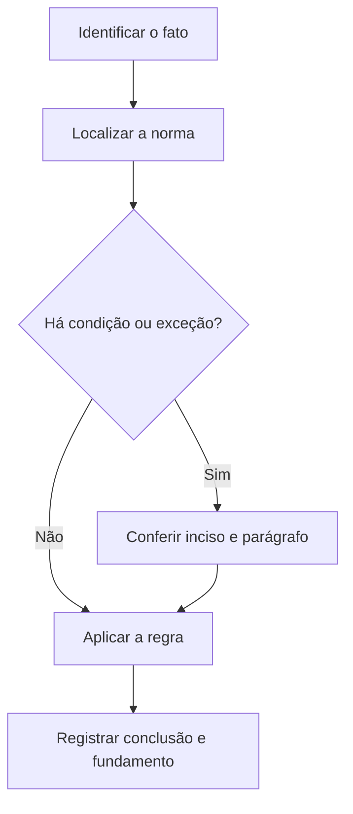

# Livro-texto — Semana 14 | Versão 2.0

**Cargo:** Oficial de Justiça — TJSP | **Banca:** VUNESP | **Período:** 25/01/2027 a 31/01/2027

## Prova civil, coisa julgada, alimentos e tutela possessória

> **Status editorial:** ampliação didática das fichas originais, com referências ao edital. Este volume é um material de estudo revisável, não parecer jurídico nem transcrição integral da lei. Use o roteiro oficial e verifique retificações posteriores.

## Ideia central — entenda antes de decorar

Prova, coisa julgada, alimentos e tutela possessória são situações com sujeitos e procedimentos distintos. Organize cada aula como: pressuposto, ato, consequência e exceção.

## Mapa visual da semana

## Plano de sete sessões

| Sessão | Atividade | Produto de aprendizagem |
|---|---|---|
| 1 | Estudar **Testemunhas no processo civil** e ler **CPC, arts. 447 a 449** | Esquema regra/condição/exceção em 5 linhas |
| 2 | Estudar **Coisa julgada material** e ler **CPC, art. 502** | Esquema regra/condição/exceção em 5 linhas |
| 3 | Estudar **Cumprimento de obrigação alimentar** e ler **CPC, art. 528** | Esquema regra/condição/exceção em 5 linhas |
| 4 | Estudar **Cumprimento de obrigação de fazer** e ler **CPC, art. 536** | Esquema regra/condição/exceção em 5 linhas |
| 5 | Estudar **Manutenção e reintegração de posse** e ler **CPC, art. 560** | Esquema regra/condição/exceção em 5 linhas |
| 6 | Estudar **Média aritmética** e ler **Matemática: média** | Esquema regra/condição/exceção em 5 linhas |
| 7 | Questões + uma discursiva + revisão dos erros | Registro D+1, D+7 e D+21 |

---

## Aulas com aplicação prática

### Aula 1 — Testemunhas no processo civil

**Texto para conferir:** CPC, arts. 447 a 449.

**Entenda a regra.** Todas as pessoas podem depor como testemunhas, com exceções de incapacidade, impedimento ou suspeição nos termos legais. Não basta memorizar o nome do instituto: identifique o verbo empregado no artigo, o sujeito que deve agir e os efeitos da conduta.

**Situação concreta.** Uma testemunha é arrolada e o juiz precisa verificar impedimento ou suspeição previstos na lei. Antes de escolher a alternativa, pergunte: quem deve agir? há ordem judicial? há prazo ou formalidade? existe exceção?

**Armadilha frequente.** A afirmação a seguir foi construída deliberadamente para estar errada: *O CPC determina que toda pessoa seja testemunha sem qualquer restrição possível.* Confira no dispositivo indicado por que ela não corresponde à regra.

**Quadro de leitura da lei seca.**

| Passo | O que registrar |
|---|---|
| 1 — Sujeito | Quem pratica, requer, determina ou recebe o ato? |
| 2 — Hipótese | Em que situação a norma se aplica? |
| 3 — Forma | Existe local, prazo, procedimento ou requisito expresso? |
| 4 — Efeito | O que acontece com o cumprimento ou descumprimento? |
| 5 — Exceção | O artigo admite ressalva ou remete a outra norma? |

**Exercício guiado 1.** Reescreva a frase incorreta com o sujeito e a condição corretos. Depois explique o caso concreto em 4–6 linhas, citando **CPC, arts. 447 a 449**. **Critério de correção:** acertar sujeito, requisito, efeito e artigo.

### Aula 2 — Coisa julgada material

**Texto para conferir:** CPC, art. 502.

**Entenda a regra.** Coisa julgada material é a autoridade que torna imutável e indiscutível decisão de mérito não mais sujeita a recurso. Não basta memorizar o nome do instituto: identifique o verbo empregado no artigo, o sujeito que deve agir e os efeitos da conduta.

**Situação concreta.** Uma decisão de mérito transitou em julgado e discute-se sua estabilidade. Antes de escolher a alternativa, pergunte: quem deve agir? há ordem judicial? há prazo ou formalidade? existe exceção?

**Armadilha frequente.** A afirmação a seguir foi construída deliberadamente para estar errada: *Toda decisão interlocutória, mesmo recorrível, constitui automaticamente coisa julgada material.* Confira no dispositivo indicado por que ela não corresponde à regra.

**Quadro de leitura da lei seca.**

| Passo | O que registrar |
|---|---|
| 1 — Sujeito | Quem pratica, requer, determina ou recebe o ato? |
| 2 — Hipótese | Em que situação a norma se aplica? |
| 3 — Forma | Existe local, prazo, procedimento ou requisito expresso? |
| 4 — Efeito | O que acontece com o cumprimento ou descumprimento? |
| 5 — Exceção | O artigo admite ressalva ou remete a outra norma? |

**Exercício guiado 2.** Reescreva a frase incorreta com o sujeito e a condição corretos. Depois explique o caso concreto em 4–6 linhas, citando **CPC, art. 502**. **Critério de correção:** acertar sujeito, requisito, efeito e artigo.

### Aula 3 — Cumprimento de obrigação alimentar

**Texto para conferir:** CPC, art. 528.

**Entenda a regra.** O cumprimento de sentença de alimentos possui procedimento próprio com intimação e consequências específicas para o inadimplemento, conforme os requisitos legais. Não basta memorizar o nome do instituto: identifique o verbo empregado no artigo, o sujeito que deve agir e os efeitos da conduta.

**Situação concreta.** O devedor de prestação alimentar é intimado no procedimento de cumprimento da decisão. Antes de escolher a alternativa, pergunte: quem deve agir? há ordem judicial? há prazo ou formalidade? existe exceção?

**Armadilha frequente.** A afirmação a seguir foi construída deliberadamente para estar errada: *A cobrança judicial de alimentos sempre segue exclusivamente o rito de execução fiscal.* Confira no dispositivo indicado por que ela não corresponde à regra.

**Quadro de leitura da lei seca.**

| Passo | O que registrar |
|---|---|
| 1 — Sujeito | Quem pratica, requer, determina ou recebe o ato? |
| 2 — Hipótese | Em que situação a norma se aplica? |
| 3 — Forma | Existe local, prazo, procedimento ou requisito expresso? |
| 4 — Efeito | O que acontece com o cumprimento ou descumprimento? |
| 5 — Exceção | O artigo admite ressalva ou remete a outra norma? |

**Exercício guiado 3.** Reescreva a frase incorreta com o sujeito e a condição corretos. Depois explique o caso concreto em 4–6 linhas, citando **CPC, art. 528**. **Critério de correção:** acertar sujeito, requisito, efeito e artigo.

### Aula 4 — Cumprimento de obrigação de fazer

**Texto para conferir:** CPC, art. 536.

**Entenda a regra.** O juiz pode determinar medidas necessárias à satisfação de obrigação de fazer ou não fazer reconhecida em título judicial. Não basta memorizar o nome do instituto: identifique o verbo empregado no artigo, o sujeito que deve agir e os efeitos da conduta.

**Situação concreta.** Uma sentença determina obrigação de fazer e o juízo avalia medida para sua efetivação. Antes de escolher a alternativa, pergunte: quem deve agir? há ordem judicial? há prazo ou formalidade? existe exceção?

**Armadilha frequente.** A afirmação a seguir foi construída deliberadamente para estar errada: *O CPC impede qualquer providência judicial para efetivar obrigação de fazer.* Confira no dispositivo indicado por que ela não corresponde à regra.

**Quadro de leitura da lei seca.**

| Passo | O que registrar |
|---|---|
| 1 — Sujeito | Quem pratica, requer, determina ou recebe o ato? |
| 2 — Hipótese | Em que situação a norma se aplica? |
| 3 — Forma | Existe local, prazo, procedimento ou requisito expresso? |
| 4 — Efeito | O que acontece com o cumprimento ou descumprimento? |
| 5 — Exceção | O artigo admite ressalva ou remete a outra norma? |

**Exercício guiado 4.** Reescreva a frase incorreta com o sujeito e a condição corretos. Depois explique o caso concreto em 4–6 linhas, citando **CPC, art. 536**. **Critério de correção:** acertar sujeito, requisito, efeito e artigo.

### Aula 5 — Manutenção e reintegração de posse

**Texto para conferir:** CPC, art. 560.

**Entenda a regra.** O possuidor tem direito a ser mantido na posse em caso de turbação e reintegrado em caso de esbulho, conforme distinção legal. Não basta memorizar o nome do instituto: identifique o verbo empregado no artigo, o sujeito que deve agir e os efeitos da conduta.

**Situação concreta.** Alguém perde completamente sua posse após esbulho e pretende retomá-la em juízo. Antes de escolher a alternativa, pergunte: quem deve agir? há ordem judicial? há prazo ou formalidade? existe exceção?

**Armadilha frequente.** A afirmação a seguir foi construída deliberadamente para estar errada: *Turbação e esbulho são sinônimos, sempre com o mesmo pedido possessório.* Confira no dispositivo indicado por que ela não corresponde à regra.

**Quadro de leitura da lei seca.**

| Passo | O que registrar |
|---|---|
| 1 — Sujeito | Quem pratica, requer, determina ou recebe o ato? |
| 2 — Hipótese | Em que situação a norma se aplica? |
| 3 — Forma | Existe local, prazo, procedimento ou requisito expresso? |
| 4 — Efeito | O que acontece com o cumprimento ou descumprimento? |
| 5 — Exceção | O artigo admite ressalva ou remete a outra norma? |

**Exercício guiado 5.** Reescreva a frase incorreta com o sujeito e a condição corretos. Depois explique o caso concreto em 4–6 linhas, citando **CPC, art. 560**. **Critério de correção:** acertar sujeito, requisito, efeito e artigo.

### Aula 6 — Média aritmética

**Texto para conferir:** Matemática: média.

**Entenda a regra.** Média aritmética simples é soma dos valores dividida pela quantidade; na ponderada usa-se soma dos produtos valor×peso dividida pela soma dos pesos. Não basta memorizar o nome do instituto: identifique o verbo empregado no artigo, o sujeito que deve agir e os efeitos da conduta.

**Situação concreta.** Notas 6, 8 e 10 geram média simples 8. Antes de escolher a alternativa, pergunte: quem deve agir? há ordem judicial? há prazo ou formalidade? existe exceção?

**Armadilha frequente.** A afirmação a seguir foi construída deliberadamente para estar errada: *Média ponderada pode ser calculada ignorando todos os pesos informados.* Confira no dispositivo indicado por que ela não corresponde à regra.

**Quadro de leitura da lei seca.**

| Passo | O que registrar |
|---|---|
| 1 — Sujeito | Quem pratica, requer, determina ou recebe o ato? |
| 2 — Hipótese | Em que situação a norma se aplica? |
| 3 — Forma | Existe local, prazo, procedimento ou requisito expresso? |
| 4 — Efeito | O que acontece com o cumprimento ou descumprimento? |
| 5 — Exceção | O artigo admite ressalva ou remete a outra norma? |

**Exercício guiado 6.** Reescreva a frase incorreta com o sujeito e a condição corretos. Depois explique o caso concreto em 4–6 linhas, citando **Matemática: média**. **Critério de correção:** acertar sujeito, requisito, efeito e artigo.

## Comparando alternativas: como a banca tenta induzir ao erro

1. **Troca de sujeito:** um dever do juiz é atribuído ao oficial, ou vice-versa.
2. **Absolutização:** expressões como “sempre”, “nunca” e “em qualquer hipótese” escondem exceções.
3. **Mistura de ramos:** regra de citação penal é aplicada ao processo civil sem autorização legal.
4. **Omissão de requisito:** a alternativa descreve o ato, mas esquece um pressuposto, uma comunicação ou uma certificação.
5. **Inversão temporal:** um procedimento posterior aparece como requisito anterior, ou o contrário.

## Questões analíticas da semana (autorais)

1. **Caso: Testemunhas no processo civil.** Uma testemunha é arrolada e o juiz precisa verificar impedimento ou suspeição previstos na lei. Explique a providência ou o conceito aplicável; identifique duas condições que você procuraria no texto legal e uma alternativa plausível, porém incorreta. Justifique com **CPC, arts. 447 a 449**.

2. **Caso: Coisa julgada material.** Uma decisão de mérito transitou em julgado e discute-se sua estabilidade. Explique a providência ou o conceito aplicável; identifique duas condições que você procuraria no texto legal e uma alternativa plausível, porém incorreta. Justifique com **CPC, art. 502**.

3. **Caso: Cumprimento de obrigação alimentar.** O devedor de prestação alimentar é intimado no procedimento de cumprimento da decisão. Explique a providência ou o conceito aplicável; identifique duas condições que você procuraria no texto legal e uma alternativa plausível, porém incorreta. Justifique com **CPC, art. 528**.

4. **Caso: Cumprimento de obrigação de fazer.** Uma sentença determina obrigação de fazer e o juízo avalia medida para sua efetivação. Explique a providência ou o conceito aplicável; identifique duas condições que você procuraria no texto legal e uma alternativa plausível, porém incorreta. Justifique com **CPC, art. 536**.

5. **Caso: Manutenção e reintegração de posse.** Alguém perde completamente sua posse após esbulho e pretende retomá-la em juízo. Explique a providência ou o conceito aplicável; identifique duas condições que você procuraria no texto legal e uma alternativa plausível, porém incorreta. Justifique com **CPC, art. 560**.

6. **Caso: Média aritmética.** Notas 6, 8 e 10 geram média simples 8. Explique a providência ou o conceito aplicável; identifique duas condições que você procuraria no texto legal e uma alternativa plausível, porém incorreta. Justifique com **Matemática: média**.

### Proposta discursiva

Com base nos temas **Testemunhas no processo civil** e **Manutenção e reintegração de posse**, descreva como um profissional deve identificar corretamente a norma aplicável a uma situação real, distinguindo competência, procedimento e documentação do ato. Cite os dispositivos do edital e construa uma conclusão em 10 a 15 linhas.

### Critério para autoavaliação (20 pontos)

| Aspecto | Pontos |
|---|---:|
| Identificação da norma e competência | 6 |
| Aplicação ao caso e condições legais | 7 |
| Exceções e documentação | 4 |
| Clareza, objetividade e escrita | 3 |

## Respostas esperadas aos exercícios analíticos

1. A resposta deve partir da regra: **Todas as pessoas podem depor como testemunhas, com exceções de incapacidade, impedimento ou suspeição nos termos legais.** No caso: Uma testemunha é arrolada e o juiz precisa verificar impedimento ou suspeição previstos na lei. A hipótese errada a ser rebatida é: “O CPC determina que toda pessoa seja testemunha sem qualquer restrição possível.”. O argumento definitivo deve apontar a redação completa de **CPC, arts. 447 a 449**, inclusive remissões e exceções.

2. A resposta deve partir da regra: **Coisa julgada material é a autoridade que torna imutável e indiscutível decisão de mérito não mais sujeita a recurso.** No caso: Uma decisão de mérito transitou em julgado e discute-se sua estabilidade. A hipótese errada a ser rebatida é: “Toda decisão interlocutória, mesmo recorrível, constitui automaticamente coisa julgada material.”. O argumento definitivo deve apontar a redação completa de **CPC, art. 502**, inclusive remissões e exceções.

3. A resposta deve partir da regra: **O cumprimento de sentença de alimentos possui procedimento próprio com intimação e consequências específicas para o inadimplemento, conforme os requisitos legais.** No caso: O devedor de prestação alimentar é intimado no procedimento de cumprimento da decisão. A hipótese errada a ser rebatida é: “A cobrança judicial de alimentos sempre segue exclusivamente o rito de execução fiscal.”. O argumento definitivo deve apontar a redação completa de **CPC, art. 528**, inclusive remissões e exceções.

4. A resposta deve partir da regra: **O juiz pode determinar medidas necessárias à satisfação de obrigação de fazer ou não fazer reconhecida em título judicial.** No caso: Uma sentença determina obrigação de fazer e o juízo avalia medida para sua efetivação. A hipótese errada a ser rebatida é: “O CPC impede qualquer providência judicial para efetivar obrigação de fazer.”. O argumento definitivo deve apontar a redação completa de **CPC, art. 536**, inclusive remissões e exceções.

5. A resposta deve partir da regra: **O possuidor tem direito a ser mantido na posse em caso de turbação e reintegrado em caso de esbulho, conforme distinção legal.** No caso: Alguém perde completamente sua posse após esbulho e pretende retomá-la em juízo. A hipótese errada a ser rebatida é: “Turbação e esbulho são sinônimos, sempre com o mesmo pedido possessório.”. O argumento definitivo deve apontar a redação completa de **CPC, art. 560**, inclusive remissões e exceções.

6. A resposta deve partir da regra: **Média aritmética simples é soma dos valores dividida pela quantidade; na ponderada usa-se soma dos produtos valor×peso dividida pela soma dos pesos.** No caso: Notas 6, 8 e 10 geram média simples 8. A hipótese errada a ser rebatida é: “Média ponderada pode ser calculada ignorando todos os pesos informados.”. O argumento definitivo deve apontar a redação completa de **Matemática: média**, inclusive remissões e exceções.

## Checklist de conclusão

- [ ] Li o capítulo, incluindo os exemplos.
- [ ] Conferi o texto completo de todos os artigos indicados nesta semana.
- [ ] Resolvi as seis questões analíticas sem consulta.
- [ ] Escrevi ao menos uma discursiva e revisei os erros.
- [ ] Registrei o que deve retornar nas revisões D+1, D+7 e D+21.

**Fonte primária:** [Edital 01/2026, Anexo VIII](https://drive.google.com/file/d/1YJSOt6SDpONIJLY1ahDa9D4y8vkTGwlJ/view) e [Roteiro de legislação por semana](../../legislacao/roteiro_corrigido.md).

**Nota:** As respostas comentadas são guias metodológicos, não substituem a consulta dos dispositivos integrais, e os exercícios autorais não são da VUNESP.