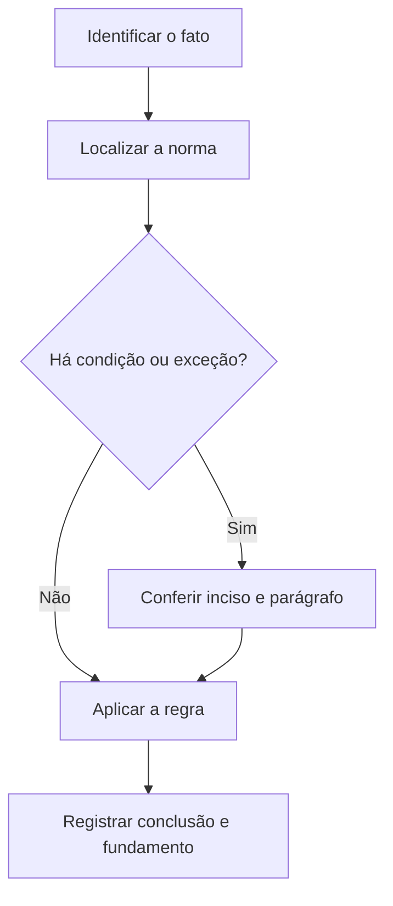

# Livro-texto — Semana 15 | Versão 2.0

**Cargo:** Oficial de Justiça — TJSP | **Banca:** VUNESP | **Período:** 01/02/2027 a 07/02/2027

## Inventário, família e atos executivos no CPC

> **Status editorial:** ampliação didática das fichas originais, com referências ao edital. Este volume é um material de estudo revisável, não parecer jurídico nem transcrição integral da lei. Use o roteiro oficial e verifique retificações posteriores.

## Ideia central — entenda antes de decorar

Inventário, atos de família e cumprimento executivo podem exigir diligência em campo. Não confunda a ordem de penhora, avaliação e atos de expropriação.

## Mapa visual da semana

## Plano de sete sessões

| Sessão | Atividade | Produto de aprendizagem |
|---|---|---|
| 1 | Estudar **Citação no inventário** e ler **CPC, art. 626** | Esquema regra/condição/exceção em 5 linhas |
| 2 | Estudar **Audiência em ações de família** e ler **CPC, art. 695** | Esquema regra/condição/exceção em 5 linhas |
| 3 | Estudar **Interdição e entrevista** e ler **CPC, art. 751** | Esquema regra/condição/exceção em 5 linhas |
| 4 | Estudar **Averbação da execução** e ler **CPC, art. 782** | Esquema regra/condição/exceção em 5 linhas |
| 5 | Estudar **Penhora e objeto da execução** e ler **CPC, art. 831** | Esquema regra/condição/exceção em 5 linhas |
| 6 | Estudar **Bens impenhoráveis** e ler **CPC, art. 833** | Esquema regra/condição/exceção em 5 linhas |
| 7 | Questões + uma discursiva + revisão dos erros | Registro D+1, D+7 e D+21 |

---

## Aulas com aplicação prática

### Aula 1 — Citação no inventário

**Texto para conferir:** CPC, art. 626.

**Entenda a regra.** O CPC prevê citações e intimações de interessados no inventário; observe destinatários e procedimento estabelecido no dispositivo. Não basta memorizar o nome do instituto: identifique o verbo empregado no artigo, o sujeito que deve agir e os efeitos da conduta.

**Situação concreta.** Em inventário, o juiz determina a comunicação formal a sujeitos que podem participar. Antes de escolher a alternativa, pergunte: quem deve agir? há ordem judicial? há prazo ou formalidade? existe exceção?

**Armadilha frequente.** A afirmação a seguir foi construída deliberadamente para estar errada: *O inventário sempre dispensa comunicação aos herdeiros e demais interessados.* Confira no dispositivo indicado por que ela não corresponde à regra.

**Quadro de leitura da lei seca.**

| Passo | O que registrar |
|---|---|
| 1 — Sujeito | Quem pratica, requer, determina ou recebe o ato? |
| 2 — Hipótese | Em que situação a norma se aplica? |
| 3 — Forma | Existe local, prazo, procedimento ou requisito expresso? |
| 4 — Efeito | O que acontece com o cumprimento ou descumprimento? |
| 5 — Exceção | O artigo admite ressalva ou remete a outra norma? |

**Exercício guiado 1.** Reescreva a frase incorreta com o sujeito e a condição corretos. Depois explique o caso concreto em 4–6 linhas, citando **CPC, art. 626**. **Critério de correção:** acertar sujeito, requisito, efeito e artigo.

### Aula 2 — Audiência em ações de família

**Texto para conferir:** CPC, art. 695.

**Entenda a regra.** Recebida a petição inicial e tomadas providências relativas à tutela provisória, se for o caso, o juiz ordenará a citação do réu para comparecer à audiência de mediação e conciliação. Não basta memorizar o nome do instituto: identifique o verbo empregado no artigo, o sujeito que deve agir e os efeitos da conduta.

**Situação concreta.** O réu em ação de família é convocado a uma audiência de tentativa de solução consensual. Antes de escolher a alternativa, pergunte: quem deve agir? há ordem judicial? há prazo ou formalidade? existe exceção?

**Armadilha frequente.** A afirmação a seguir foi construída deliberadamente para estar errada: *O réu em ação de família é sempre citado apenas para oferecer recurso de apelação.* Confira no dispositivo indicado por que ela não corresponde à regra.

**Quadro de leitura da lei seca.**

| Passo | O que registrar |
|---|---|
| 1 — Sujeito | Quem pratica, requer, determina ou recebe o ato? |
| 2 — Hipótese | Em que situação a norma se aplica? |
| 3 — Forma | Existe local, prazo, procedimento ou requisito expresso? |
| 4 — Efeito | O que acontece com o cumprimento ou descumprimento? |
| 5 — Exceção | O artigo admite ressalva ou remete a outra norma? |

**Exercício guiado 2.** Reescreva a frase incorreta com o sujeito e a condição corretos. Depois explique o caso concreto em 4–6 linhas, citando **CPC, art. 695**. **Critério de correção:** acertar sujeito, requisito, efeito e artigo.

### Aula 3 — Interdição e entrevista

**Texto para conferir:** CPC, art. 751.

**Entenda a regra.** O interditando deve ser citado para comparecer perante o juiz para entrevista, na forma prevista no dispositivo, com garantias próprias. Não basta memorizar o nome do instituto: identifique o verbo empregado no artigo, o sujeito que deve agir e os efeitos da conduta.

**Situação concreta.** Em processo de interdição, o juiz programa entrevista e exige citação adequada do interessado. Antes de escolher a alternativa, pergunte: quem deve agir? há ordem judicial? há prazo ou formalidade? existe exceção?

**Armadilha frequente.** A afirmação a seguir foi construída deliberadamente para estar errada: *O processo de interdição elimina automaticamente a necessidade de ouvir a pessoa envolvida.* Confira no dispositivo indicado por que ela não corresponde à regra.

**Quadro de leitura da lei seca.**

| Passo | O que registrar |
|---|---|
| 1 — Sujeito | Quem pratica, requer, determina ou recebe o ato? |
| 2 — Hipótese | Em que situação a norma se aplica? |
| 3 — Forma | Existe local, prazo, procedimento ou requisito expresso? |
| 4 — Efeito | O que acontece com o cumprimento ou descumprimento? |
| 5 — Exceção | O artigo admite ressalva ou remete a outra norma? |

**Exercício guiado 3.** Reescreva a frase incorreta com o sujeito e a condição corretos. Depois explique o caso concreto em 4–6 linhas, citando **CPC, art. 751**. **Critério de correção:** acertar sujeito, requisito, efeito e artigo.

### Aula 4 — Averbação da execução

**Texto para conferir:** CPC, art. 782.

**Entenda a regra.** O exequente pode obter certidão para averbação da execução nos registros de bens sujeitos a penhora, conforme regras e efeitos do artigo. Não basta memorizar o nome do instituto: identifique o verbo empregado no artigo, o sujeito que deve agir e os efeitos da conduta.

**Situação concreta.** Credor pretende averbar informação de execução nos registros competentes. Antes de escolher a alternativa, pergunte: quem deve agir? há ordem judicial? há prazo ou formalidade? existe exceção?

**Armadilha frequente.** A afirmação a seguir foi construída deliberadamente para estar errada: *A averbação de execução nunca é prevista pelo CPC.* Confira no dispositivo indicado por que ela não corresponde à regra.

**Quadro de leitura da lei seca.**

| Passo | O que registrar |
|---|---|
| 1 — Sujeito | Quem pratica, requer, determina ou recebe o ato? |
| 2 — Hipótese | Em que situação a norma se aplica? |
| 3 — Forma | Existe local, prazo, procedimento ou requisito expresso? |
| 4 — Efeito | O que acontece com o cumprimento ou descumprimento? |
| 5 — Exceção | O artigo admite ressalva ou remete a outra norma? |

**Exercício guiado 4.** Reescreva a frase incorreta com o sujeito e a condição corretos. Depois explique o caso concreto em 4–6 linhas, citando **CPC, art. 782**. **Critério de correção:** acertar sujeito, requisito, efeito e artigo.

### Aula 5 — Penhora e objeto da execução

**Texto para conferir:** CPC, art. 831.

**Entenda a regra.** A penhora deve recair sobre tantos bens quantos bastem para pagamento do principal atualizado, juros, custas e honorários advocatícios. Não basta memorizar o nome do instituto: identifique o verbo empregado no artigo, o sujeito que deve agir e os efeitos da conduta.

**Situação concreta.** O oficial identifica bens a constritar de forma suficiente para responder pela execução. Antes de escolher a alternativa, pergunte: quem deve agir? há ordem judicial? há prazo ou formalidade? existe exceção?

**Armadilha frequente.** A afirmação a seguir foi construída deliberadamente para estar errada: *O oficial pode sempre penhorar todo o patrimônio, sem relação com a satisfação do crédito.* Confira no dispositivo indicado por que ela não corresponde à regra.

**Quadro de leitura da lei seca.**

| Passo | O que registrar |
|---|---|
| 1 — Sujeito | Quem pratica, requer, determina ou recebe o ato? |
| 2 — Hipótese | Em que situação a norma se aplica? |
| 3 — Forma | Existe local, prazo, procedimento ou requisito expresso? |
| 4 — Efeito | O que acontece com o cumprimento ou descumprimento? |
| 5 — Exceção | O artigo admite ressalva ou remete a outra norma? |

**Exercício guiado 5.** Reescreva a frase incorreta com o sujeito e a condição corretos. Depois explique o caso concreto em 4–6 linhas, citando **CPC, art. 831**. **Critério de correção:** acertar sujeito, requisito, efeito e artigo.

### Aula 6 — Bens impenhoráveis

**Texto para conferir:** CPC, art. 833.

**Entenda a regra.** O CPC lista bens impenhoráveis com exceções legais: a análise exige enquadramento do bem e atenção ao caso concreto. Não basta memorizar o nome do instituto: identifique o verbo empregado no artigo, o sujeito que deve agir e os efeitos da conduta.

**Situação concreta.** Em diligência, identifica-se bem alegadamente protegido de penhora. Antes de escolher a alternativa, pergunte: quem deve agir? há ordem judicial? há prazo ou formalidade? existe exceção?

**Armadilha frequente.** A afirmação a seguir foi construída deliberadamente para estar errada: *Todo bem localizado na residência do devedor é, sem exceções, sempre penhorável.* Confira no dispositivo indicado por que ela não corresponde à regra.

**Quadro de leitura da lei seca.**

| Passo | O que registrar |
|---|---|
| 1 — Sujeito | Quem pratica, requer, determina ou recebe o ato? |
| 2 — Hipótese | Em que situação a norma se aplica? |
| 3 — Forma | Existe local, prazo, procedimento ou requisito expresso? |
| 4 — Efeito | O que acontece com o cumprimento ou descumprimento? |
| 5 — Exceção | O artigo admite ressalva ou remete a outra norma? |

**Exercício guiado 6.** Reescreva a frase incorreta com o sujeito e a condição corretos. Depois explique o caso concreto em 4–6 linhas, citando **CPC, art. 833**. **Critério de correção:** acertar sujeito, requisito, efeito e artigo.

## Comparando alternativas: como a banca tenta induzir ao erro

1. **Troca de sujeito:** um dever do juiz é atribuído ao oficial, ou vice-versa.
2. **Absolutização:** expressões como “sempre”, “nunca” e “em qualquer hipótese” escondem exceções.
3. **Mistura de ramos:** regra de citação penal é aplicada ao processo civil sem autorização legal.
4. **Omissão de requisito:** a alternativa descreve o ato, mas esquece um pressuposto, uma comunicação ou uma certificação.
5. **Inversão temporal:** um procedimento posterior aparece como requisito anterior, ou o contrário.

## Questões analíticas da semana (autorais)

1. **Caso: Citação no inventário.** Em inventário, o juiz determina a comunicação formal a sujeitos que podem participar. Explique a providência ou o conceito aplicável; identifique duas condições que você procuraria no texto legal e uma alternativa plausível, porém incorreta. Justifique com **CPC, art. 626**.

2. **Caso: Audiência em ações de família.** O réu em ação de família é convocado a uma audiência de tentativa de solução consensual. Explique a providência ou o conceito aplicável; identifique duas condições que você procuraria no texto legal e uma alternativa plausível, porém incorreta. Justifique com **CPC, art. 695**.

3. **Caso: Interdição e entrevista.** Em processo de interdição, o juiz programa entrevista e exige citação adequada do interessado. Explique a providência ou o conceito aplicável; identifique duas condições que você procuraria no texto legal e uma alternativa plausível, porém incorreta. Justifique com **CPC, art. 751**.

4. **Caso: Averbação da execução.** Credor pretende averbar informação de execução nos registros competentes. Explique a providência ou o conceito aplicável; identifique duas condições que você procuraria no texto legal e uma alternativa plausível, porém incorreta. Justifique com **CPC, art. 782**.

5. **Caso: Penhora e objeto da execução.** O oficial identifica bens a constritar de forma suficiente para responder pela execução. Explique a providência ou o conceito aplicável; identifique duas condições que você procuraria no texto legal e uma alternativa plausível, porém incorreta. Justifique com **CPC, art. 831**.

6. **Caso: Bens impenhoráveis.** Em diligência, identifica-se bem alegadamente protegido de penhora. Explique a providência ou o conceito aplicável; identifique duas condições que você procuraria no texto legal e uma alternativa plausível, porém incorreta. Justifique com **CPC, art. 833**.

### Proposta discursiva

Com base nos temas **Citação no inventário** e **Penhora e objeto da execução**, descreva como um profissional deve identificar corretamente a norma aplicável a uma situação real, distinguindo competência, procedimento e documentação do ato. Cite os dispositivos do edital e construa uma conclusão em 10 a 15 linhas.

### Critério para autoavaliação (20 pontos)

| Aspecto | Pontos |
|---|---:|
| Identificação da norma e competência | 6 |
| Aplicação ao caso e condições legais | 7 |
| Exceções e documentação | 4 |
| Clareza, objetividade e escrita | 3 |

## Respostas esperadas aos exercícios analíticos

1. A resposta deve partir da regra: **O CPC prevê citações e intimações de interessados no inventário; observe destinatários e procedimento estabelecido no dispositivo.** No caso: Em inventário, o juiz determina a comunicação formal a sujeitos que podem participar. A hipótese errada a ser rebatida é: “O inventário sempre dispensa comunicação aos herdeiros e demais interessados.”. O argumento definitivo deve apontar a redação completa de **CPC, art. 626**, inclusive remissões e exceções.

2. A resposta deve partir da regra: **Recebida a petição inicial e tomadas providências relativas à tutela provisória, se for o caso, o juiz ordenará a citação do réu para comparecer à audiência de mediação e conciliação.** No caso: O réu em ação de família é convocado a uma audiência de tentativa de solução consensual. A hipótese errada a ser rebatida é: “O réu em ação de família é sempre citado apenas para oferecer recurso de apelação.”. O argumento definitivo deve apontar a redação completa de **CPC, art. 695**, inclusive remissões e exceções.

3. A resposta deve partir da regra: **O interditando deve ser citado para comparecer perante o juiz para entrevista, na forma prevista no dispositivo, com garantias próprias.** No caso: Em processo de interdição, o juiz programa entrevista e exige citação adequada do interessado. A hipótese errada a ser rebatida é: “O processo de interdição elimina automaticamente a necessidade de ouvir a pessoa envolvida.”. O argumento definitivo deve apontar a redação completa de **CPC, art. 751**, inclusive remissões e exceções.

4. A resposta deve partir da regra: **O exequente pode obter certidão para averbação da execução nos registros de bens sujeitos a penhora, conforme regras e efeitos do artigo.** No caso: Credor pretende averbar informação de execução nos registros competentes. A hipótese errada a ser rebatida é: “A averbação de execução nunca é prevista pelo CPC.”. O argumento definitivo deve apontar a redação completa de **CPC, art. 782**, inclusive remissões e exceções.

5. A resposta deve partir da regra: **A penhora deve recair sobre tantos bens quantos bastem para pagamento do principal atualizado, juros, custas e honorários advocatícios.** No caso: O oficial identifica bens a constritar de forma suficiente para responder pela execução. A hipótese errada a ser rebatida é: “O oficial pode sempre penhorar todo o patrimônio, sem relação com a satisfação do crédito.”. O argumento definitivo deve apontar a redação completa de **CPC, art. 831**, inclusive remissões e exceções.

6. A resposta deve partir da regra: **O CPC lista bens impenhoráveis com exceções legais: a análise exige enquadramento do bem e atenção ao caso concreto.** No caso: Em diligência, identifica-se bem alegadamente protegido de penhora. A hipótese errada a ser rebatida é: “Todo bem localizado na residência do devedor é, sem exceções, sempre penhorável.”. O argumento definitivo deve apontar a redação completa de **CPC, art. 833**, inclusive remissões e exceções.

## Checklist de conclusão

- [ ] Li o capítulo, incluindo os exemplos.
- [ ] Conferi o texto completo de todos os artigos indicados nesta semana.
- [ ] Resolvi as seis questões analíticas sem consulta.
- [ ] Escrevi ao menos uma discursiva e revisei os erros.
- [ ] Registrei o que deve retornar nas revisões D+1, D+7 e D+21.

**Fonte primária:** [Edital 01/2026, Anexo VIII](https://drive.google.com/file/d/1YJSOt6SDpONIJLY1ahDa9D4y8vkTGwlJ/view) e [Roteiro de legislação por semana](../../legislacao/roteiro_corrigido.md).

**Nota:** As respostas comentadas são guias metodológicos, não substituem a consulta dos dispositivos integrais, e os exercícios autorais não são da VUNESP.
