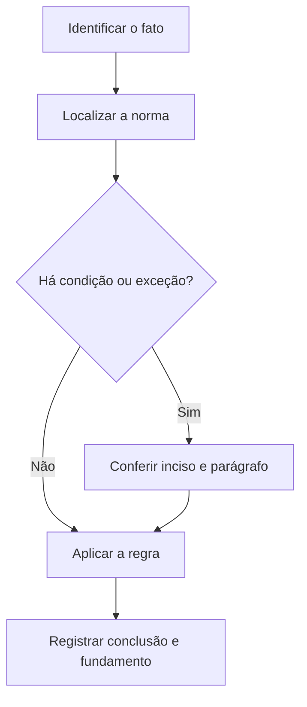

# Livro-texto — Semana 16 | Versão 2.0

**Cargo:** Oficial de Justiça — TJSP | **Banca:** VUNESP | **Período:** 08/02/2027 a 14/02/2027

## Avaliação, recursos e Juizados Cíveis

> **Status editorial:** ampliação didática das fichas originais, com referências ao edital. Este volume é um material de estudo revisável, não parecer jurídico nem transcrição integral da lei. Use o roteiro oficial e verifique retificações posteriores.

## Ideia central — entenda antes de decorar

Recursos, avaliação patrimonial e Juizados exigem identificação de prazos e legitimidade. Conferir literalmente os dispositivos do edital é indispensável.

## Mapa visual da semana

## Plano de sete sessões

| Sessão | Atividade | Produto de aprendizagem |
|---|---|---|
| 1 | Estudar **Avaliação de bens penhorados** e ler **CPC, art. 870** | Esquema regra/condição/exceção em 5 linhas |
| 2 | Estudar **Recursos do CPC** e ler **CPC, art. 994** | Esquema regra/condição/exceção em 5 linhas |
| 3 | Estudar **Apelação civil** e ler **CPC, arts. 1.009 e 1.010** | Esquema regra/condição/exceção em 5 linhas |
| 4 | Estudar **Agravo de instrumento** e ler **CPC, art. 1.015** | Esquema regra/condição/exceção em 5 linhas |
| 5 | Estudar **Embargos de declaração** e ler **CPC, art. 1.022** | Esquema regra/condição/exceção em 5 linhas |
| 6 | Estudar **Comunicação nos Juizados Cíveis** e ler **Lei 9.099/95, arts. 18 e 19** | Esquema regra/condição/exceção em 5 linhas |
| 7 | Questões + uma discursiva + revisão dos erros | Registro D+1, D+7 e D+21 |

---

## Aulas com aplicação prática

### Aula 1 — Avaliação de bens penhorados

**Texto para conferir:** CPC, art. 870.

**Entenda a regra.** Em regra, a avaliação é feita pelo oficial de justiça, com ressalvas e possibilidades de nomeação de avaliador quando o caso exigir conhecimento especializado. Não basta memorizar o nome do instituto: identifique o verbo empregado no artigo, o sujeito que deve agir e os efeitos da conduta.

**Situação concreta.** Um bem penhorado precisa receber avaliação para a execução prosseguir. Antes de escolher a alternativa, pergunte: quem deve agir? há ordem judicial? há prazo ou formalidade? existe exceção?

**Armadilha frequente.** A afirmação a seguir foi construída deliberadamente para estar errada: *A avaliação de bens no cumprimento de mandados jamais pode envolver o oficial de justiça.* Confira no dispositivo indicado por que ela não corresponde à regra.

**Quadro de leitura da lei seca.**

| Passo | O que registrar |
|---|---|
| 1 — Sujeito | Quem pratica, requer, determina ou recebe o ato? |
| 2 — Hipótese | Em que situação a norma se aplica? |
| 3 — Forma | Existe local, prazo, procedimento ou requisito expresso? |
| 4 — Efeito | O que acontece com o cumprimento ou descumprimento? |
| 5 — Exceção | O artigo admite ressalva ou remete a outra norma? |

**Exercício guiado 1.** Reescreva a frase incorreta com o sujeito e a condição corretos. Depois explique o caso concreto em 4–6 linhas, citando **CPC, art. 870**. **Critério de correção:** acertar sujeito, requisito, efeito e artigo.

### Aula 2 — Recursos do CPC

**Texto para conferir:** CPC, art. 994.

**Entenda a regra.** O Código enumera espécies de recursos como apelação, agravo de instrumento e embargos de declaração. A espécie depende da decisão e dos requisitos legais. Não basta memorizar o nome do instituto: identifique o verbo empregado no artigo, o sujeito que deve agir e os efeitos da conduta.

**Situação concreta.** Uma parte pretende impugnar decisão e precisa identificar o recurso adequado. Antes de escolher a alternativa, pergunte: quem deve agir? há ordem judicial? há prazo ou formalidade? existe exceção?

**Armadilha frequente.** A afirmação a seguir foi construída deliberadamente para estar errada: *O CPC permite usar sempre qualquer recurso contra qualquer ato, sem critérios.* Confira no dispositivo indicado por que ela não corresponde à regra.

**Quadro de leitura da lei seca.**

| Passo | O que registrar |
|---|---|
| 1 — Sujeito | Quem pratica, requer, determina ou recebe o ato? |
| 2 — Hipótese | Em que situação a norma se aplica? |
| 3 — Forma | Existe local, prazo, procedimento ou requisito expresso? |
| 4 — Efeito | O que acontece com o cumprimento ou descumprimento? |
| 5 — Exceção | O artigo admite ressalva ou remete a outra norma? |

**Exercício guiado 2.** Reescreva a frase incorreta com o sujeito e a condição corretos. Depois explique o caso concreto em 4–6 linhas, citando **CPC, art. 994**. **Critério de correção:** acertar sujeito, requisito, efeito e artigo.

### Aula 3 — Apelação civil

**Texto para conferir:** CPC, arts. 1.009 e 1.010.

**Entenda a regra.** Da sentença cabe apelação, nos termos do art. 1.009; o art. 1.010 descreve requisitos da petição de interposição e razões. Não basta memorizar o nome do instituto: identifique o verbo empregado no artigo, o sujeito que deve agir e os efeitos da conduta.

**Situação concreta.** Uma parte deseja recorrer de sentença cível. Antes de escolher a alternativa, pergunte: quem deve agir? há ordem judicial? há prazo ou formalidade? existe exceção?

**Armadilha frequente.** A afirmação a seguir foi construída deliberadamente para estar errada: *A apelação civil é recurso típico exclusivo contra despacho de mero expediente.* Confira no dispositivo indicado por que ela não corresponde à regra.

**Quadro de leitura da lei seca.**

| Passo | O que registrar |
|---|---|
| 1 — Sujeito | Quem pratica, requer, determina ou recebe o ato? |
| 2 — Hipótese | Em que situação a norma se aplica? |
| 3 — Forma | Existe local, prazo, procedimento ou requisito expresso? |
| 4 — Efeito | O que acontece com o cumprimento ou descumprimento? |
| 5 — Exceção | O artigo admite ressalva ou remete a outra norma? |

**Exercício guiado 3.** Reescreva a frase incorreta com o sujeito e a condição corretos. Depois explique o caso concreto em 4–6 linhas, citando **CPC, arts. 1.009 e 1.010**. **Critério de correção:** acertar sujeito, requisito, efeito e artigo.

### Aula 4 — Agravo de instrumento

**Texto para conferir:** CPC, art. 1.015.

**Entenda a regra.** O art. 1.015 indica hipóteses de cabimento do agravo de instrumento; conferir incisos e interpretação jurisprudencial relevante. Não basta memorizar o nome do instituto: identifique o verbo empregado no artigo, o sujeito que deve agir e os efeitos da conduta.

**Situação concreta.** Uma decisão interlocutória sobre tema legalmente previsto desafia recurso específico. Antes de escolher a alternativa, pergunte: quem deve agir? há ordem judicial? há prazo ou formalidade? existe exceção?

**Armadilha frequente.** A afirmação a seguir foi construída deliberadamente para estar errada: *Agravo de instrumento sempre serve para atacar sentença final em vez de apelação.* Confira no dispositivo indicado por que ela não corresponde à regra.

**Quadro de leitura da lei seca.**

| Passo | O que registrar |
|---|---|
| 1 — Sujeito | Quem pratica, requer, determina ou recebe o ato? |
| 2 — Hipótese | Em que situação a norma se aplica? |
| 3 — Forma | Existe local, prazo, procedimento ou requisito expresso? |
| 4 — Efeito | O que acontece com o cumprimento ou descumprimento? |
| 5 — Exceção | O artigo admite ressalva ou remete a outra norma? |

**Exercício guiado 4.** Reescreva a frase incorreta com o sujeito e a condição corretos. Depois explique o caso concreto em 4–6 linhas, citando **CPC, art. 1.015**. **Critério de correção:** acertar sujeito, requisito, efeito e artigo.

### Aula 5 — Embargos de declaração

**Texto para conferir:** CPC, art. 1.022.

**Entenda a regra.** Embargos de declaração são cabíveis para esclarecer obscuridade, eliminar contradição, suprir omissão ou corrigir erro material. Não basta memorizar o nome do instituto: identifique o verbo empregado no artigo, o sujeito que deve agir e os efeitos da conduta.

**Situação concreta.** O juízo omitiu ponto sobre o qual deveria pronunciar-se em decisão. Antes de escolher a alternativa, pergunte: quem deve agir? há ordem judicial? há prazo ou formalidade? existe exceção?

**Armadilha frequente.** A afirmação a seguir foi construída deliberadamente para estar errada: *Embargos de declaração servem apenas para iniciar novo processo, sem relação com decisão anterior.* Confira no dispositivo indicado por que ela não corresponde à regra.

**Quadro de leitura da lei seca.**

| Passo | O que registrar |
|---|---|
| 1 — Sujeito | Quem pratica, requer, determina ou recebe o ato? |
| 2 — Hipótese | Em que situação a norma se aplica? |
| 3 — Forma | Existe local, prazo, procedimento ou requisito expresso? |
| 4 — Efeito | O que acontece com o cumprimento ou descumprimento? |
| 5 — Exceção | O artigo admite ressalva ou remete a outra norma? |

**Exercício guiado 5.** Reescreva a frase incorreta com o sujeito e a condição corretos. Depois explique o caso concreto em 4–6 linhas, citando **CPC, art. 1.022**. **Critério de correção:** acertar sujeito, requisito, efeito e artigo.

### Aula 6 — Comunicação nos Juizados Cíveis

**Texto para conferir:** Lei 9.099/95, arts. 18 e 19.

**Entenda a regra.** A Lei dos Juizados Especiais traz regras próprias de citação e intimações, inclusive forma postal e atos realizados quando necessário por oficial de justiça. Não basta memorizar o nome do instituto: identifique o verbo empregado no artigo, o sujeito que deve agir e os efeitos da conduta.

**Situação concreta.** Uma causa de menor complexidade tramita no Juizado Especial Cível e exige citação adequada. Antes de escolher a alternativa, pergunte: quem deve agir? há ordem judicial? há prazo ou formalidade? existe exceção?

**Armadilha frequente.** A afirmação a seguir foi construída deliberadamente para estar errada: *Nos Juizados Cíveis, toda intimação é proibida por meio idôneo não presencial.* Confira no dispositivo indicado por que ela não corresponde à regra.

**Quadro de leitura da lei seca.**

| Passo | O que registrar |
|---|---|
| 1 — Sujeito | Quem pratica, requer, determina ou recebe o ato? |
| 2 — Hipótese | Em que situação a norma se aplica? |
| 3 — Forma | Existe local, prazo, procedimento ou requisito expresso? |
| 4 — Efeito | O que acontece com o cumprimento ou descumprimento? |
| 5 — Exceção | O artigo admite ressalva ou remete a outra norma? |

**Exercício guiado 6.** Reescreva a frase incorreta com o sujeito e a condição corretos. Depois explique o caso concreto em 4–6 linhas, citando **Lei 9.099/95, arts. 18 e 19**. **Critério de correção:** acertar sujeito, requisito, efeito e artigo.

## Comparando alternativas: como a banca tenta induzir ao erro

1. **Troca de sujeito:** um dever do juiz é atribuído ao oficial, ou vice-versa.
2. **Absolutização:** expressões como “sempre”, “nunca” e “em qualquer hipótese” escondem exceções.
3. **Mistura de ramos:** regra de citação penal é aplicada ao processo civil sem autorização legal.
4. **Omissão de requisito:** a alternativa descreve o ato, mas esquece um pressuposto, uma comunicação ou uma certificação.
5. **Inversão temporal:** um procedimento posterior aparece como requisito anterior, ou o contrário.

## Questões analíticas da semana (autorais)

1. **Caso: Avaliação de bens penhorados.** Um bem penhorado precisa receber avaliação para a execução prosseguir. Explique a providência ou o conceito aplicável; identifique duas condições que você procuraria no texto legal e uma alternativa plausível, porém incorreta. Justifique com **CPC, art. 870**.

2. **Caso: Recursos do CPC.** Uma parte pretende impugnar decisão e precisa identificar o recurso adequado. Explique a providência ou o conceito aplicável; identifique duas condições que você procuraria no texto legal e uma alternativa plausível, porém incorreta. Justifique com **CPC, art. 994**.

3. **Caso: Apelação civil.** Uma parte deseja recorrer de sentença cível. Explique a providência ou o conceito aplicável; identifique duas condições que você procuraria no texto legal e uma alternativa plausível, porém incorreta. Justifique com **CPC, arts. 1.009 e 1.010**.

4. **Caso: Agravo de instrumento.** Uma decisão interlocutória sobre tema legalmente previsto desafia recurso específico. Explique a providência ou o conceito aplicável; identifique duas condições que você procuraria no texto legal e uma alternativa plausível, porém incorreta. Justifique com **CPC, art. 1.015**.

5. **Caso: Embargos de declaração.** O juízo omitiu ponto sobre o qual deveria pronunciar-se em decisão. Explique a providência ou o conceito aplicável; identifique duas condições que você procuraria no texto legal e uma alternativa plausível, porém incorreta. Justifique com **CPC, art. 1.022**.

6. **Caso: Comunicação nos Juizados Cíveis.** Uma causa de menor complexidade tramita no Juizado Especial Cível e exige citação adequada. Explique a providência ou o conceito aplicável; identifique duas condições que você procuraria no texto legal e uma alternativa plausível, porém incorreta. Justifique com **Lei 9.099/95, arts. 18 e 19**.

### Proposta discursiva

Com base nos temas **Avaliação de bens penhorados** e **Embargos de declaração**, descreva como um profissional deve identificar corretamente a norma aplicável a uma situação real, distinguindo competência, procedimento e documentação do ato. Cite os dispositivos do edital e construa uma conclusão em 10 a 15 linhas.

### Critério para autoavaliação (20 pontos)

| Aspecto | Pontos |
|---|---:|
| Identificação da norma e competência | 6 |
| Aplicação ao caso e condições legais | 7 |
| Exceções e documentação | 4 |
| Clareza, objetividade e escrita | 3 |

## Respostas esperadas aos exercícios analíticos

1. A resposta deve partir da regra: **Em regra, a avaliação é feita pelo oficial de justiça, com ressalvas e possibilidades de nomeação de avaliador quando o caso exigir conhecimento especializado.** No caso: Um bem penhorado precisa receber avaliação para a execução prosseguir. A hipótese errada a ser rebatida é: “A avaliação de bens no cumprimento de mandados jamais pode envolver o oficial de justiça.”. O argumento definitivo deve apontar a redação completa de **CPC, art. 870**, inclusive remissões e exceções.

2. A resposta deve partir da regra: **O Código enumera espécies de recursos como apelação, agravo de instrumento e embargos de declaração. A espécie depende da decisão e dos requisitos legais.** No caso: Uma parte pretende impugnar decisão e precisa identificar o recurso adequado. A hipótese errada a ser rebatida é: “O CPC permite usar sempre qualquer recurso contra qualquer ato, sem critérios.”. O argumento definitivo deve apontar a redação completa de **CPC, art. 994**, inclusive remissões e exceções.

3. A resposta deve partir da regra: **Da sentença cabe apelação, nos termos do art. 1.009; o art. 1.010 descreve requisitos da petição de interposição e razões.** No caso: Uma parte deseja recorrer de sentença cível. A hipótese errada a ser rebatida é: “A apelação civil é recurso típico exclusivo contra despacho de mero expediente.”. O argumento definitivo deve apontar a redação completa de **CPC, arts. 1.009 e 1.010**, inclusive remissões e exceções.

4. A resposta deve partir da regra: **O art. 1.015 indica hipóteses de cabimento do agravo de instrumento; conferir incisos e interpretação jurisprudencial relevante.** No caso: Uma decisão interlocutória sobre tema legalmente previsto desafia recurso específico. A hipótese errada a ser rebatida é: “Agravo de instrumento sempre serve para atacar sentença final em vez de apelação.”. O argumento definitivo deve apontar a redação completa de **CPC, art. 1.015**, inclusive remissões e exceções.

5. A resposta deve partir da regra: **Embargos de declaração são cabíveis para esclarecer obscuridade, eliminar contradição, suprir omissão ou corrigir erro material.** No caso: O juízo omitiu ponto sobre o qual deveria pronunciar-se em decisão. A hipótese errada a ser rebatida é: “Embargos de declaração servem apenas para iniciar novo processo, sem relação com decisão anterior.”. O argumento definitivo deve apontar a redação completa de **CPC, art. 1.022**, inclusive remissões e exceções.

6. A resposta deve partir da regra: **A Lei dos Juizados Especiais traz regras próprias de citação e intimações, inclusive forma postal e atos realizados quando necessário por oficial de justiça.** No caso: Uma causa de menor complexidade tramita no Juizado Especial Cível e exige citação adequada. A hipótese errada a ser rebatida é: “Nos Juizados Cíveis, toda intimação é proibida por meio idôneo não presencial.”. O argumento definitivo deve apontar a redação completa de **Lei 9.099/95, arts. 18 e 19**, inclusive remissões e exceções.

## Checklist de conclusão

- [ ] Li o capítulo, incluindo os exemplos.
- [ ] Conferi o texto completo de todos os artigos indicados nesta semana.
- [ ] Resolvi as seis questões analíticas sem consulta.
- [ ] Escrevi ao menos uma discursiva e revisei os erros.
- [ ] Registrei o que deve retornar nas revisões D+1, D+7 e D+21.

**Fonte primária:** [Edital 01/2026, Anexo VIII](https://drive.google.com/file/d/1YJSOt6SDpONIJLY1ahDa9D4y8vkTGwlJ/view) e [Roteiro de legislação por semana](../../legislacao/roteiro_corrigido.md).

**Nota:** As respostas comentadas são guias metodológicos, não substituem a consulta dos dispositivos integrais, e os exercícios autorais não são da VUNESP.
