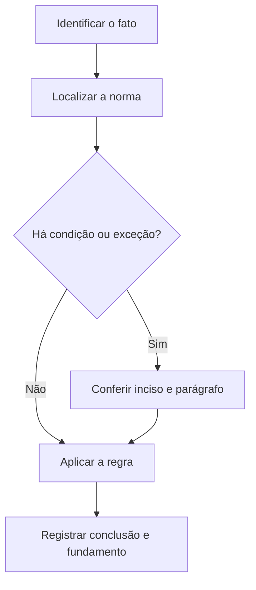

# Livro-texto — Semana 17 | Versão 2.0

**Cargo:** Oficial de Justiça — TJSP | **Banca:** VUNESP | **Período:** 15/02/2027 a 21/02/2027

## Direito Civil: pessoas, domicílio, vícios e prescrição

> **Status editorial:** ampliação didática das fichas originais, com referências ao edital. Este volume é um material de estudo revisável, não parecer jurídico nem transcrição integral da lei. Use o roteiro oficial e verifique retificações posteriores.

## Ideia central — entenda antes de decorar

Direito Civil define personalidade, domicílio e validade dos negócios. Aprenda a distinguir capacidade, existência do ato e eventual vício antes de memorizar consequências.

## Mapa visual da semana

## Plano de sete sessões

| Sessão | Atividade | Produto de aprendizagem |
|---|---|---|
| 1 | Estudar **Início da personalidade civil** e ler **CC, art. 2º** | Esquema regra/condição/exceção em 5 linhas |
| 2 | Estudar **Incapacidade civil absoluta** e ler **CC, art. 3º** | Esquema regra/condição/exceção em 5 linhas |
| 3 | Estudar **Direitos da personalidade** e ler **CC, arts. 11 a 21** | Esquema regra/condição/exceção em 5 linhas |
| 4 | Estudar **Domicílio da pessoa natural** e ler **CC, art. 70** | Esquema regra/condição/exceção em 5 linhas |
| 5 | Estudar **Erro no negócio jurídico** e ler **CC, art. 138** | Esquema regra/condição/exceção em 5 linhas |
| 6 | Estudar **Prescrição** e ler **CC, art. 189** | Esquema regra/condição/exceção em 5 linhas |
| 7 | Questões + uma discursiva + revisão dos erros | Registro D+1, D+7 e D+21 |

---

## Aulas com aplicação prática

### Aula 1 — Início da personalidade civil

**Texto para conferir:** CC, art. 2º.

**Entenda a regra.** A personalidade civil da pessoa começa do nascimento com vida; a lei põe a salvo, desde a concepção, os direitos do nascituro. Não basta memorizar o nome do instituto: identifique o verbo empregado no artigo, o sujeito que deve agir e os efeitos da conduta.

**Situação concreta.** Em questão sobre personalidade, compara-se nascimento com vida e proteção de direitos do nascituro. Antes de escolher a alternativa, pergunte: quem deve agir? há ordem judicial? há prazo ou formalidade? existe exceção?

**Armadilha frequente.** A afirmação a seguir foi construída deliberadamente para estar errada: *A personalidade civil só começa quando a pessoa completa 18 anos.* Confira no dispositivo indicado por que ela não corresponde à regra.

**Quadro de leitura da lei seca.**

| Passo | O que registrar |
|---|---|
| 1 — Sujeito | Quem pratica, requer, determina ou recebe o ato? |
| 2 — Hipótese | Em que situação a norma se aplica? |
| 3 — Forma | Existe local, prazo, procedimento ou requisito expresso? |
| 4 — Efeito | O que acontece com o cumprimento ou descumprimento? |
| 5 — Exceção | O artigo admite ressalva ou remete a outra norma? |

**Exercício guiado 1.** Reescreva a frase incorreta com o sujeito e a condição corretos. Depois explique o caso concreto em 4–6 linhas, citando **CC, art. 2º**. **Critério de correção:** acertar sujeito, requisito, efeito e artigo.

### Aula 2 — Incapacidade civil absoluta

**Texto para conferir:** CC, art. 3º.

**Entenda a regra.** São absolutamente incapazes de exercer pessoalmente atos da vida civil os menores de 16 anos. Outros limites de capacidade estão regulados em dispositivos próprios. Não basta memorizar o nome do instituto: identifique o verbo empregado no artigo, o sujeito que deve agir e os efeitos da conduta.

**Situação concreta.** Uma criança de 14 anos precisa praticar ato da vida civil e surge dúvida sobre capacidade. Antes de escolher a alternativa, pergunte: quem deve agir? há ordem judicial? há prazo ou formalidade? existe exceção?

**Armadilha frequente.** A afirmação a seguir foi construída deliberadamente para estar errada: *Toda pessoa com deficiência é automaticamente absolutamente incapaz civil.* Confira no dispositivo indicado por que ela não corresponde à regra.

**Quadro de leitura da lei seca.**

| Passo | O que registrar |
|---|---|
| 1 — Sujeito | Quem pratica, requer, determina ou recebe o ato? |
| 2 — Hipótese | Em que situação a norma se aplica? |
| 3 — Forma | Existe local, prazo, procedimento ou requisito expresso? |
| 4 — Efeito | O que acontece com o cumprimento ou descumprimento? |
| 5 — Exceção | O artigo admite ressalva ou remete a outra norma? |

**Exercício guiado 2.** Reescreva a frase incorreta com o sujeito e a condição corretos. Depois explique o caso concreto em 4–6 linhas, citando **CC, art. 3º**. **Critério de correção:** acertar sujeito, requisito, efeito e artigo.

### Aula 3 — Direitos da personalidade

**Texto para conferir:** CC, arts. 11 a 21.

**Entenda a regra.** Direitos da personalidade recebem tutela específica, com regras sobre disponibilidade e proteção da imagem, nome e vida privada. Não basta memorizar o nome do instituto: identifique o verbo empregado no artigo, o sujeito que deve agir e os efeitos da conduta.

**Situação concreta.** Uma pessoa questiona divulgação não autorizada que atinge sua imagem e privacidade. Antes de escolher a alternativa, pergunte: quem deve agir? há ordem judicial? há prazo ou formalidade? existe exceção?

**Armadilha frequente.** A afirmação a seguir foi construída deliberadamente para estar errada: *Direitos da personalidade podem ser livremente renunciados em bloco para sempre.* Confira no dispositivo indicado por que ela não corresponde à regra.

**Quadro de leitura da lei seca.**

| Passo | O que registrar |
|---|---|
| 1 — Sujeito | Quem pratica, requer, determina ou recebe o ato? |
| 2 — Hipótese | Em que situação a norma se aplica? |
| 3 — Forma | Existe local, prazo, procedimento ou requisito expresso? |
| 4 — Efeito | O que acontece com o cumprimento ou descumprimento? |
| 5 — Exceção | O artigo admite ressalva ou remete a outra norma? |

**Exercício guiado 3.** Reescreva a frase incorreta com o sujeito e a condição corretos. Depois explique o caso concreto em 4–6 linhas, citando **CC, arts. 11 a 21**. **Critério de correção:** acertar sujeito, requisito, efeito e artigo.

### Aula 4 — Domicílio da pessoa natural

**Texto para conferir:** CC, art. 70.

**Entenda a regra.** Domicílio da pessoa natural é o lugar onde ela estabelece residência com ânimo definitivo; compare com situações especiais dos artigos seguintes. Não basta memorizar o nome do instituto: identifique o verbo empregado no artigo, o sujeito que deve agir e os efeitos da conduta.

**Situação concreta.** Uma pessoa mantém moradia de modo estável e pretende identificar seu domicílio civil. Antes de escolher a alternativa, pergunte: quem deve agir? há ordem judicial? há prazo ou formalidade? existe exceção?

**Armadilha frequente.** A afirmação a seguir foi construída deliberadamente para estar errada: *Domicílio civil é sempre, sem exceção, o local em que a pessoa nasceu.* Confira no dispositivo indicado por que ela não corresponde à regra.

**Quadro de leitura da lei seca.**

| Passo | O que registrar |
|---|---|
| 1 — Sujeito | Quem pratica, requer, determina ou recebe o ato? |
| 2 — Hipótese | Em que situação a norma se aplica? |
| 3 — Forma | Existe local, prazo, procedimento ou requisito expresso? |
| 4 — Efeito | O que acontece com o cumprimento ou descumprimento? |
| 5 — Exceção | O artigo admite ressalva ou remete a outra norma? |

**Exercício guiado 4.** Reescreva a frase incorreta com o sujeito e a condição corretos. Depois explique o caso concreto em 4–6 linhas, citando **CC, art. 70**. **Critério de correção:** acertar sujeito, requisito, efeito e artigo.

### Aula 5 — Erro no negócio jurídico

**Texto para conferir:** CC, art. 138.

**Entenda a regra.** São anuláveis os negócios jurídicos quando as declarações de vontade emanarem de erro substancial que poderia ser percebido por pessoa de diligência normal, nas circunstâncias do negócio. Não basta memorizar o nome do instituto: identifique o verbo empregado no artigo, o sujeito que deve agir e os efeitos da conduta.

**Situação concreta.** Alguém manifesta vontade fundada em erro substancial relevante para contratar. Antes de escolher a alternativa, pergunte: quem deve agir? há ordem judicial? há prazo ou formalidade? existe exceção?

**Armadilha frequente.** A afirmação a seguir foi construída deliberadamente para estar errada: *Qualquer erro mínimo e irrelevante necessariamente gera nulidade absoluta do negócio.* Confira no dispositivo indicado por que ela não corresponde à regra.

**Quadro de leitura da lei seca.**

| Passo | O que registrar |
|---|---|
| 1 — Sujeito | Quem pratica, requer, determina ou recebe o ato? |
| 2 — Hipótese | Em que situação a norma se aplica? |
| 3 — Forma | Existe local, prazo, procedimento ou requisito expresso? |
| 4 — Efeito | O que acontece com o cumprimento ou descumprimento? |
| 5 — Exceção | O artigo admite ressalva ou remete a outra norma? |

**Exercício guiado 5.** Reescreva a frase incorreta com o sujeito e a condição corretos. Depois explique o caso concreto em 4–6 linhas, citando **CC, art. 138**. **Critério de correção:** acertar sujeito, requisito, efeito e artigo.

### Aula 6 — Prescrição

**Texto para conferir:** CC, art. 189.

**Entenda a regra.** Violado o direito, nasce para o titular a pretensão, sujeita à prescrição conforme os prazos legais. O foco do edital, neste ponto, é o art. 189. Não basta memorizar o nome do instituto: identifique o verbo empregado no artigo, o sujeito que deve agir e os efeitos da conduta.

**Situação concreta.** Uma pretensão de cobrança surge com a violação de direito e há discussão sobre decurso do prazo. Antes de escolher a alternativa, pergunte: quem deve agir? há ordem judicial? há prazo ou formalidade? existe exceção?

**Armadilha frequente.** A afirmação a seguir foi construída deliberadamente para estar errada: *Prescrição é sinônimo de inexistência automática do direito material desde sua origem.* Confira no dispositivo indicado por que ela não corresponde à regra.

**Quadro de leitura da lei seca.**

| Passo | O que registrar |
|---|---|
| 1 — Sujeito | Quem pratica, requer, determina ou recebe o ato? |
| 2 — Hipótese | Em que situação a norma se aplica? |
| 3 — Forma | Existe local, prazo, procedimento ou requisito expresso? |
| 4 — Efeito | O que acontece com o cumprimento ou descumprimento? |
| 5 — Exceção | O artigo admite ressalva ou remete a outra norma? |

**Exercício guiado 6.** Reescreva a frase incorreta com o sujeito e a condição corretos. Depois explique o caso concreto em 4–6 linhas, citando **CC, art. 189**. **Critério de correção:** acertar sujeito, requisito, efeito e artigo.

## Comparando alternativas: como a banca tenta induzir ao erro

1. **Troca de sujeito:** um dever do juiz é atribuído ao oficial, ou vice-versa.
2. **Absolutização:** expressões como “sempre”, “nunca” e “em qualquer hipótese” escondem exceções.
3. **Mistura de ramos:** regra de citação penal é aplicada ao processo civil sem autorização legal.
4. **Omissão de requisito:** a alternativa descreve o ato, mas esquece um pressuposto, uma comunicação ou uma certificação.
5. **Inversão temporal:** um procedimento posterior aparece como requisito anterior, ou o contrário.

## Questões analíticas da semana (autorais)

1. **Caso: Início da personalidade civil.** Em questão sobre personalidade, compara-se nascimento com vida e proteção de direitos do nascituro. Explique a providência ou o conceito aplicável; identifique duas condições que você procuraria no texto legal e uma alternativa plausível, porém incorreta. Justifique com **CC, art. 2º**.

2. **Caso: Incapacidade civil absoluta.** Uma criança de 14 anos precisa praticar ato da vida civil e surge dúvida sobre capacidade. Explique a providência ou o conceito aplicável; identifique duas condições que você procuraria no texto legal e uma alternativa plausível, porém incorreta. Justifique com **CC, art. 3º**.

3. **Caso: Direitos da personalidade.** Uma pessoa questiona divulgação não autorizada que atinge sua imagem e privacidade. Explique a providência ou o conceito aplicável; identifique duas condições que você procuraria no texto legal e uma alternativa plausível, porém incorreta. Justifique com **CC, arts. 11 a 21**.

4. **Caso: Domicílio da pessoa natural.** Uma pessoa mantém moradia de modo estável e pretende identificar seu domicílio civil. Explique a providência ou o conceito aplicável; identifique duas condições que você procuraria no texto legal e uma alternativa plausível, porém incorreta. Justifique com **CC, art. 70**.

5. **Caso: Erro no negócio jurídico.** Alguém manifesta vontade fundada em erro substancial relevante para contratar. Explique a providência ou o conceito aplicável; identifique duas condições que você procuraria no texto legal e uma alternativa plausível, porém incorreta. Justifique com **CC, art. 138**.

6. **Caso: Prescrição.** Uma pretensão de cobrança surge com a violação de direito e há discussão sobre decurso do prazo. Explique a providência ou o conceito aplicável; identifique duas condições que você procuraria no texto legal e uma alternativa plausível, porém incorreta. Justifique com **CC, art. 189**.

### Proposta discursiva

Com base nos temas **Início da personalidade civil** e **Erro no negócio jurídico**, descreva como um profissional deve identificar corretamente a norma aplicável a uma situação real, distinguindo competência, procedimento e documentação do ato. Cite os dispositivos do edital e construa uma conclusão em 10 a 15 linhas.

### Critério para autoavaliação (20 pontos)

| Aspecto | Pontos |
|---|---:|
| Identificação da norma e competência | 6 |
| Aplicação ao caso e condições legais | 7 |
| Exceções e documentação | 4 |
| Clareza, objetividade e escrita | 3 |

## Respostas esperadas aos exercícios analíticos

1. A resposta deve partir da regra: **A personalidade civil da pessoa começa do nascimento com vida; a lei põe a salvo, desde a concepção, os direitos do nascituro.** No caso: Em questão sobre personalidade, compara-se nascimento com vida e proteção de direitos do nascituro. A hipótese errada a ser rebatida é: “A personalidade civil só começa quando a pessoa completa 18 anos.”. O argumento definitivo deve apontar a redação completa de **CC, art. 2º**, inclusive remissões e exceções.

2. A resposta deve partir da regra: **São absolutamente incapazes de exercer pessoalmente atos da vida civil os menores de 16 anos. Outros limites de capacidade estão regulados em dispositivos próprios.** No caso: Uma criança de 14 anos precisa praticar ato da vida civil e surge dúvida sobre capacidade. A hipótese errada a ser rebatida é: “Toda pessoa com deficiência é automaticamente absolutamente incapaz civil.”. O argumento definitivo deve apontar a redação completa de **CC, art. 3º**, inclusive remissões e exceções.

3. A resposta deve partir da regra: **Direitos da personalidade recebem tutela específica, com regras sobre disponibilidade e proteção da imagem, nome e vida privada.** No caso: Uma pessoa questiona divulgação não autorizada que atinge sua imagem e privacidade. A hipótese errada a ser rebatida é: “Direitos da personalidade podem ser livremente renunciados em bloco para sempre.”. O argumento definitivo deve apontar a redação completa de **CC, arts. 11 a 21**, inclusive remissões e exceções.

4. A resposta deve partir da regra: **Domicílio da pessoa natural é o lugar onde ela estabelece residência com ânimo definitivo; compare com situações especiais dos artigos seguintes.** No caso: Uma pessoa mantém moradia de modo estável e pretende identificar seu domicílio civil. A hipótese errada a ser rebatida é: “Domicílio civil é sempre, sem exceção, o local em que a pessoa nasceu.”. O argumento definitivo deve apontar a redação completa de **CC, art. 70**, inclusive remissões e exceções.

5. A resposta deve partir da regra: **São anuláveis os negócios jurídicos quando as declarações de vontade emanarem de erro substancial que poderia ser percebido por pessoa de diligência normal, nas circunstâncias do negócio.** No caso: Alguém manifesta vontade fundada em erro substancial relevante para contratar. A hipótese errada a ser rebatida é: “Qualquer erro mínimo e irrelevante necessariamente gera nulidade absoluta do negócio.”. O argumento definitivo deve apontar a redação completa de **CC, art. 138**, inclusive remissões e exceções.

6. A resposta deve partir da regra: **Violado o direito, nasce para o titular a pretensão, sujeita à prescrição conforme os prazos legais. O foco do edital, neste ponto, é o art. 189.** No caso: Uma pretensão de cobrança surge com a violação de direito e há discussão sobre decurso do prazo. A hipótese errada a ser rebatida é: “Prescrição é sinônimo de inexistência automática do direito material desde sua origem.”. O argumento definitivo deve apontar a redação completa de **CC, art. 189**, inclusive remissões e exceções.

## Checklist de conclusão

- [ ] Li o capítulo, incluindo os exemplos.
- [ ] Conferi o texto completo de todos os artigos indicados nesta semana.
- [ ] Resolvi as seis questões analíticas sem consulta.
- [ ] Escrevi ao menos uma discursiva e revisei os erros.
- [ ] Registrei o que deve retornar nas revisões D+1, D+7 e D+21.

**Fonte primária:** [Edital 01/2026, Anexo VIII](https://drive.google.com/file/d/1YJSOt6SDpONIJLY1ahDa9D4y8vkTGwlJ/view) e [Roteiro de legislação por semana](../../legislacao/roteiro_corrigido.md).

**Nota:** As respostas comentadas são guias metodológicos, não substituem a consulta dos dispositivos integrais, e os exercícios autorais não são da VUNESP.