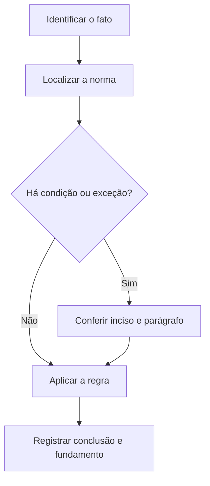

# Livro-texto — Semana 18 | Versão 2.0

**Cargo:** Oficial de Justiça — TJSP | **Banca:** VUNESP | **Período:** 22/02/2027 a 28/02/2027

## Direito Civil aplicado, LINDB e execução fiscal

> **Status editorial:** ampliação didática das fichas originais, com referências ao edital. Este volume é um material de estudo revisável, não parecer jurídico nem transcrição integral da lei. Use o roteiro oficial e verifique retificações posteriores.

## Ideia central — entenda antes de decorar

Representação civil, posse, LINDB e execução fiscal apresentam regimes especiais. Leia as referências isoladamente e depois contraste as regras.

## Mapa visual da semana

## Plano de sete sessões

| Sessão | Atividade | Produto de aprendizagem |
|---|---|---|
| 1 | Estudar **Mandato** e ler **CC, art. 653** | Esquema regra/condição/exceção em 5 linhas |
| 2 | Estudar **Posse** e ler **CC, art. 1.196** | Esquema regra/condição/exceção em 5 linhas |
| 3 | Estudar **Penhor civil** e ler **CC, art. 1.431** | Esquema regra/condição/exceção em 5 linhas |
| 4 | Estudar **Vigência e revogação da lei** e ler **LINDB, arts. 1º e 2º** | Esquema regra/condição/exceção em 5 linhas |
| 5 | Estudar **Execução fiscal e citação** e ler **Lei 6.830/80, arts. 7º e 8º** | Esquema regra/condição/exceção em 5 linhas |
| 6 | Estudar **Atos processuais digitais** e ler **Resolução CNJ 354/2020, arts. 8º a 10** | Esquema regra/condição/exceção em 5 linhas |
| 7 | Questões + uma discursiva + revisão dos erros | Registro D+1, D+7 e D+21 |

---

## Aulas com aplicação prática

### Aula 1 — Mandato

**Texto para conferir:** CC, art. 653.

**Entenda a regra.** Opera-se mandato quando alguém recebe poderes de outrem para, em seu nome, praticar atos ou administrar interesses; a procuração é o instrumento do mandato. Não basta memorizar o nome do instituto: identifique o verbo empregado no artigo, o sujeito que deve agir e os efeitos da conduta.

**Situação concreta.** Uma pessoa confere poderes escritos a outra para representá-la em determinados atos. Antes de escolher a alternativa, pergunte: quem deve agir? há ordem judicial? há prazo ou formalidade? existe exceção?

**Armadilha frequente.** A afirmação a seguir foi construída deliberadamente para estar errada: *Mandato só existe quando o mandatário se torna proprietário de todos os bens do mandante.* Confira no dispositivo indicado por que ela não corresponde à regra.

**Quadro de leitura da lei seca.**

| Passo | O que registrar |
|---|---|
| 1 — Sujeito | Quem pratica, requer, determina ou recebe o ato? |
| 2 — Hipótese | Em que situação a norma se aplica? |
| 3 — Forma | Existe local, prazo, procedimento ou requisito expresso? |
| 4 — Efeito | O que acontece com o cumprimento ou descumprimento? |
| 5 — Exceção | O artigo admite ressalva ou remete a outra norma? |

**Exercício guiado 1.** Reescreva a frase incorreta com o sujeito e a condição corretos. Depois explique o caso concreto em 4–6 linhas, citando **CC, art. 653**. **Critério de correção:** acertar sujeito, requisito, efeito e artigo.

### Aula 2 — Posse

**Texto para conferir:** CC, art. 1.196.

**Entenda a regra.** Considera-se possuidor quem tem de fato o exercício, pleno ou não, de algum dos poderes inerentes à propriedade. Não basta memorizar o nome do instituto: identifique o verbo empregado no artigo, o sujeito que deve agir e os efeitos da conduta.

**Situação concreta.** Uma pessoa exerce de fato poderes sobre um bem, ainda que não seja proprietária. Antes de escolher a alternativa, pergunte: quem deve agir? há ordem judicial? há prazo ou formalidade? existe exceção?

**Armadilha frequente.** A afirmação a seguir foi construída deliberadamente para estar errada: *Somente o proprietário registrado pode ser possuidor para fins do Código Civil.* Confira no dispositivo indicado por que ela não corresponde à regra.

**Quadro de leitura da lei seca.**

| Passo | O que registrar |
|---|---|
| 1 — Sujeito | Quem pratica, requer, determina ou recebe o ato? |
| 2 — Hipótese | Em que situação a norma se aplica? |
| 3 — Forma | Existe local, prazo, procedimento ou requisito expresso? |
| 4 — Efeito | O que acontece com o cumprimento ou descumprimento? |
| 5 — Exceção | O artigo admite ressalva ou remete a outra norma? |

**Exercício guiado 2.** Reescreva a frase incorreta com o sujeito e a condição corretos. Depois explique o caso concreto em 4–6 linhas, citando **CC, art. 1.196**. **Critério de correção:** acertar sujeito, requisito, efeito e artigo.

### Aula 3 — Penhor civil

**Texto para conferir:** CC, art. 1.431.

**Entenda a regra.** O penhor, em regra, constitui-se pela transferência efetiva da posse de coisa móvel suscetível de alienação, em garantia do débito, com ressalvas legais. Não basta memorizar o nome do instituto: identifique o verbo empregado no artigo, o sujeito que deve agir e os efeitos da conduta.

**Situação concreta.** Um devedor oferece bem móvel como garantia real de dívida nos termos da lei. Antes de escolher a alternativa, pergunte: quem deve agir? há ordem judicial? há prazo ou formalidade? existe exceção?

**Armadilha frequente.** A afirmação a seguir foi construída deliberadamente para estar errada: *Penhor civil e penhora judicial são o mesmo instituto e seguem o mesmo procedimento.* Confira no dispositivo indicado por que ela não corresponde à regra.

**Quadro de leitura da lei seca.**

| Passo | O que registrar |
|---|---|
| 1 — Sujeito | Quem pratica, requer, determina ou recebe o ato? |
| 2 — Hipótese | Em que situação a norma se aplica? |
| 3 — Forma | Existe local, prazo, procedimento ou requisito expresso? |
| 4 — Efeito | O que acontece com o cumprimento ou descumprimento? |
| 5 — Exceção | O artigo admite ressalva ou remete a outra norma? |

**Exercício guiado 3.** Reescreva a frase incorreta com o sujeito e a condição corretos. Depois explique o caso concreto em 4–6 linhas, citando **CC, art. 1.431**. **Critério de correção:** acertar sujeito, requisito, efeito e artigo.

### Aula 4 — Vigência e revogação da lei

**Texto para conferir:** LINDB, arts. 1º e 2º.

**Entenda a regra.** Salvo disposição contrária, a lei começa a vigorar em todo o país 45 dias depois de oficialmente publicada; a lei posterior pode revogar a anterior nas hipóteses legais. Não basta memorizar o nome do instituto: identifique o verbo empregado no artigo, o sujeito que deve agir e os efeitos da conduta.

**Situação concreta.** Uma lei é publicada sem artigo específico de vigência, e é necessário calcular quando entra em vigor. Antes de escolher a alternativa, pergunte: quem deve agir? há ordem judicial? há prazo ou formalidade? existe exceção?

**Armadilha frequente.** A afirmação a seguir foi construída deliberadamente para estar errada: *Toda lei federal entra em vigor obrigatoriamente no próprio dia da publicação.* Confira no dispositivo indicado por que ela não corresponde à regra.

**Quadro de leitura da lei seca.**

| Passo | O que registrar |
|---|---|
| 1 — Sujeito | Quem pratica, requer, determina ou recebe o ato? |
| 2 — Hipótese | Em que situação a norma se aplica? |
| 3 — Forma | Existe local, prazo, procedimento ou requisito expresso? |
| 4 — Efeito | O que acontece com o cumprimento ou descumprimento? |
| 5 — Exceção | O artigo admite ressalva ou remete a outra norma? |

**Exercício guiado 4.** Reescreva a frase incorreta com o sujeito e a condição corretos. Depois explique o caso concreto em 4–6 linhas, citando **LINDB, arts. 1º e 2º**. **Critério de correção:** acertar sujeito, requisito, efeito e artigo.

### Aula 5 — Execução fiscal e citação

**Texto para conferir:** Lei 6.830/80, arts. 7º e 8º.

**Entenda a regra.** A execução judicial da dívida ativa segue regras especiais; o despacho inicial pode conter ordens necessárias, e a citação do executado obedece a formas previstas no art. 8º. Não basta memorizar o nome do instituto: identifique o verbo empregado no artigo, o sujeito que deve agir e os efeitos da conduta.

**Situação concreta.** A Fazenda Pública cobra judicialmente dívida ativa e necessita citar o executado. Antes de escolher a alternativa, pergunte: quem deve agir? há ordem judicial? há prazo ou formalidade? existe exceção?

**Armadilha frequente.** A afirmação a seguir foi construída deliberadamente para estar errada: *Execução fiscal jamais admite citação ou penhora de bens.* Confira no dispositivo indicado por que ela não corresponde à regra.

**Quadro de leitura da lei seca.**

| Passo | O que registrar |
|---|---|
| 1 — Sujeito | Quem pratica, requer, determina ou recebe o ato? |
| 2 — Hipótese | Em que situação a norma se aplica? |
| 3 — Forma | Existe local, prazo, procedimento ou requisito expresso? |
| 4 — Efeito | O que acontece com o cumprimento ou descumprimento? |
| 5 — Exceção | O artigo admite ressalva ou remete a outra norma? |

**Exercício guiado 5.** Reescreva a frase incorreta com o sujeito e a condição corretos. Depois explique o caso concreto em 4–6 linhas, citando **Lei 6.830/80, arts. 7º e 8º**. **Critério de correção:** acertar sujeito, requisito, efeito e artigo.

### Aula 6 — Atos processuais digitais

**Texto para conferir:** Resolução CNJ 354/2020, arts. 8º a 10.

**Entenda a regra.** A regulamentação prevê cumprimento digital de determinados atos processuais e procedimentos para comunicações, respeitando autenticidade, identificação e demais requisitos aplicáveis. Não basta memorizar o nome do instituto: identifique o verbo empregado no artigo, o sujeito que deve agir e os efeitos da conduta.

**Situação concreta.** Uma comunicação judicial é realizada por meio digital e precisa ser documentada adequadamente. Antes de escolher a alternativa, pergunte: quem deve agir? há ordem judicial? há prazo ou formalidade? existe exceção?

**Armadilha frequente.** A afirmação a seguir foi construída deliberadamente para estar errada: *Basta enviar mensagem por aplicativo sem identificar destinatário ou documentar a diligência para considerar qualquer ato válido.* Confira no dispositivo indicado por que ela não corresponde à regra.

**Quadro de leitura da lei seca.**

| Passo | O que registrar |
|---|---|
| 1 — Sujeito | Quem pratica, requer, determina ou recebe o ato? |
| 2 — Hipótese | Em que situação a norma se aplica? |
| 3 — Forma | Existe local, prazo, procedimento ou requisito expresso? |
| 4 — Efeito | O que acontece com o cumprimento ou descumprimento? |
| 5 — Exceção | O artigo admite ressalva ou remete a outra norma? |

**Exercício guiado 6.** Reescreva a frase incorreta com o sujeito e a condição corretos. Depois explique o caso concreto em 4–6 linhas, citando **Resolução CNJ 354/2020, arts. 8º a 10**. **Critério de correção:** acertar sujeito, requisito, efeito e artigo.

## Comparando alternativas: como a banca tenta induzir ao erro

1. **Troca de sujeito:** um dever do juiz é atribuído ao oficial, ou vice-versa.
2. **Absolutização:** expressões como “sempre”, “nunca” e “em qualquer hipótese” escondem exceções.
3. **Mistura de ramos:** regra de citação penal é aplicada ao processo civil sem autorização legal.
4. **Omissão de requisito:** a alternativa descreve o ato, mas esquece um pressuposto, uma comunicação ou uma certificação.
5. **Inversão temporal:** um procedimento posterior aparece como requisito anterior, ou o contrário.

## Questões analíticas da semana (autorais)

1. **Caso: Mandato.** Uma pessoa confere poderes escritos a outra para representá-la em determinados atos. Explique a providência ou o conceito aplicável; identifique duas condições que você procuraria no texto legal e uma alternativa plausível, porém incorreta. Justifique com **CC, art. 653**.

2. **Caso: Posse.** Uma pessoa exerce de fato poderes sobre um bem, ainda que não seja proprietária. Explique a providência ou o conceito aplicável; identifique duas condições que você procuraria no texto legal e uma alternativa plausível, porém incorreta. Justifique com **CC, art. 1.196**.

3. **Caso: Penhor civil.** Um devedor oferece bem móvel como garantia real de dívida nos termos da lei. Explique a providência ou o conceito aplicável; identifique duas condições que você procuraria no texto legal e uma alternativa plausível, porém incorreta. Justifique com **CC, art. 1.431**.

4. **Caso: Vigência e revogação da lei.** Uma lei é publicada sem artigo específico de vigência, e é necessário calcular quando entra em vigor. Explique a providência ou o conceito aplicável; identifique duas condições que você procuraria no texto legal e uma alternativa plausível, porém incorreta. Justifique com **LINDB, arts. 1º e 2º**.

5. **Caso: Execução fiscal e citação.** A Fazenda Pública cobra judicialmente dívida ativa e necessita citar o executado. Explique a providência ou o conceito aplicável; identifique duas condições que você procuraria no texto legal e uma alternativa plausível, porém incorreta. Justifique com **Lei 6.830/80, arts. 7º e 8º**.

6. **Caso: Atos processuais digitais.** Uma comunicação judicial é realizada por meio digital e precisa ser documentada adequadamente. Explique a providência ou o conceito aplicável; identifique duas condições que você procuraria no texto legal e uma alternativa plausível, porém incorreta. Justifique com **Resolução CNJ 354/2020, arts. 8º a 10**.

### Proposta discursiva

Com base nos temas **Mandato** e **Execução fiscal e citação**, descreva como um profissional deve identificar corretamente a norma aplicável a uma situação real, distinguindo competência, procedimento e documentação do ato. Cite os dispositivos do edital e construa uma conclusão em 10 a 15 linhas.

### Critério para autoavaliação (20 pontos)

| Aspecto | Pontos |
|---|---:|
| Identificação da norma e competência | 6 |
| Aplicação ao caso e condições legais | 7 |
| Exceções e documentação | 4 |
| Clareza, objetividade e escrita | 3 |

## Respostas esperadas aos exercícios analíticos

1. A resposta deve partir da regra: **Opera-se mandato quando alguém recebe poderes de outrem para, em seu nome, praticar atos ou administrar interesses; a procuração é o instrumento do mandato.** No caso: Uma pessoa confere poderes escritos a outra para representá-la em determinados atos. A hipótese errada a ser rebatida é: “Mandato só existe quando o mandatário se torna proprietário de todos os bens do mandante.”. O argumento definitivo deve apontar a redação completa de **CC, art. 653**, inclusive remissões e exceções.

2. A resposta deve partir da regra: **Considera-se possuidor quem tem de fato o exercício, pleno ou não, de algum dos poderes inerentes à propriedade.** No caso: Uma pessoa exerce de fato poderes sobre um bem, ainda que não seja proprietária. A hipótese errada a ser rebatida é: “Somente o proprietário registrado pode ser possuidor para fins do Código Civil.”. O argumento definitivo deve apontar a redação completa de **CC, art. 1.196**, inclusive remissões e exceções.

3. A resposta deve partir da regra: **O penhor, em regra, constitui-se pela transferência efetiva da posse de coisa móvel suscetível de alienação, em garantia do débito, com ressalvas legais.** No caso: Um devedor oferece bem móvel como garantia real de dívida nos termos da lei. A hipótese errada a ser rebatida é: “Penhor civil e penhora judicial são o mesmo instituto e seguem o mesmo procedimento.”. O argumento definitivo deve apontar a redação completa de **CC, art. 1.431**, inclusive remissões e exceções.

4. A resposta deve partir da regra: **Salvo disposição contrária, a lei começa a vigorar em todo o país 45 dias depois de oficialmente publicada; a lei posterior pode revogar a anterior nas hipóteses legais.** No caso: Uma lei é publicada sem artigo específico de vigência, e é necessário calcular quando entra em vigor. A hipótese errada a ser rebatida é: “Toda lei federal entra em vigor obrigatoriamente no próprio dia da publicação.”. O argumento definitivo deve apontar a redação completa de **LINDB, arts. 1º e 2º**, inclusive remissões e exceções.

5. A resposta deve partir da regra: **A execução judicial da dívida ativa segue regras especiais; o despacho inicial pode conter ordens necessárias, e a citação do executado obedece a formas previstas no art. 8º.** No caso: A Fazenda Pública cobra judicialmente dívida ativa e necessita citar o executado. A hipótese errada a ser rebatida é: “Execução fiscal jamais admite citação ou penhora de bens.”. O argumento definitivo deve apontar a redação completa de **Lei 6.830/80, arts. 7º e 8º**, inclusive remissões e exceções.

6. A resposta deve partir da regra: **A regulamentação prevê cumprimento digital de determinados atos processuais e procedimentos para comunicações, respeitando autenticidade, identificação e demais requisitos aplicáveis.** No caso: Uma comunicação judicial é realizada por meio digital e precisa ser documentada adequadamente. A hipótese errada a ser rebatida é: “Basta enviar mensagem por aplicativo sem identificar destinatário ou documentar a diligência para considerar qualquer ato válido.”. O argumento definitivo deve apontar a redação completa de **Resolução CNJ 354/2020, arts. 8º a 10**, inclusive remissões e exceções.

## Checklist de conclusão

- [ ] Li o capítulo, incluindo os exemplos.
- [ ] Conferi o texto completo de todos os artigos indicados nesta semana.
- [ ] Resolvi as seis questões analíticas sem consulta.
- [ ] Escrevi ao menos uma discursiva e revisei os erros.
- [ ] Registrei o que deve retornar nas revisões D+1, D+7 e D+21.

**Fonte primária:** [Edital 01/2026, Anexo VIII](https://drive.google.com/file/d/1YJSOt6SDpONIJLY1ahDa9D4y8vkTGwlJ/view) e [Roteiro de legislação por semana](../../legislacao/roteiro_corrigido.md).

**Nota:** As respostas comentadas são guias metodológicos, não substituem a consulta dos dispositivos integrais, e os exercícios autorais não são da VUNESP.
