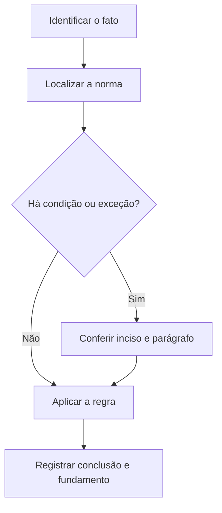

# Livro-texto — Semana 19 | Versão 2.0

**Cargo:** Oficial de Justiça — TJSP | **Banca:** VUNESP | **Período:** 01/03/2027 a 07/03/2027

## Normas da Corregedoria, LBI e atualidades

> **Status editorial:** ampliação didática das fichas originais, com referências ao edital. Este volume é um material de estudo revisável, não parecer jurídico nem transcrição integral da lei. Use o roteiro oficial e verifique retificações posteriores.

## Ideia central — entenda antes de decorar

Normas da Corregedoria exigem leitura literal. A legislação de inclusão e as regras administrativas também interferem na forma como os atos judiciais se tornam acessíveis.

## Mapa visual da semana

## Plano de sete sessões

| Sessão | Atividade | Produto de aprendizagem |
|---|---|---|
| 1 | Estudar **Normas Judiciais da Corregedoria** e ler **Normas CGJ SP, Tomo I (Anexo VIII)** | Esquema regra/condição/exceção em 5 linhas |
| 2 | Estudar **Cumprimento de mandados** e ler **Normas CGJ SP, Tomo I, Cap. VII** | Esquema regra/condição/exceção em 5 linhas |
| 3 | Estudar **Custas judiciais estaduais** e ler **Lei 11.608/2003 (SP)** | Esquema regra/condição/exceção em 5 linhas |
| 4 | Estudar **Barreiras e acessibilidade** e ler **Lei 13.146/2015, arts. 1º a 13** | Esquema regra/condição/exceção em 5 linhas |
| 5 | Estudar **Trabalho e acesso à Justiça PcD** e ler **LBI, arts. 34 a 38 e 79 a 87** | Esquema regra/condição/exceção em 5 linhas |
| 6 | Estudar **Atualidades e leitura crítica** e ler **Atualidades: a partir do 1º semestre de 2026** | Esquema regra/condição/exceção em 5 linhas |
| 7 | Questões + uma discursiva + revisão dos erros | Registro D+1, D+7 e D+21 |

---

## Aulas com aplicação prática

### Aula 1 — Normas Judiciais da Corregedoria

**Texto para conferir:** Normas CGJ SP, Tomo I (Anexo VIII).

**Entenda a regra.** As Normas da Corregedoria orientam rotinas da serventia e o cumprimento de atos; estude exatamente os artigos e capítulos que o edital enumera, evitando material antigo ou de outra unidade federativa. Não basta memorizar o nome do instituto: identifique o verbo empregado no artigo, o sujeito que deve agir e os efeitos da conduta.

**Situação concreta.** Uma diligência segue rotina local do TJSP e a questão exige o texto do Tomo I vigente. Antes de escolher a alternativa, pergunte: quem deve agir? há ordem judicial? há prazo ou formalidade? existe exceção?

**Armadilha frequente.** A afirmação a seguir foi construída deliberadamente para estar errada: *Normas da Corregedoria de qualquer outro estado substituem automaticamente as normas do TJSP.* Confira no dispositivo indicado por que ela não corresponde à regra.

**Quadro de leitura da lei seca.**

| Passo | O que registrar |
|---|---|
| 1 — Sujeito | Quem pratica, requer, determina ou recebe o ato? |
| 2 — Hipótese | Em que situação a norma se aplica? |
| 3 — Forma | Existe local, prazo, procedimento ou requisito expresso? |
| 4 — Efeito | O que acontece com o cumprimento ou descumprimento? |
| 5 — Exceção | O artigo admite ressalva ou remete a outra norma? |

**Exercício guiado 1.** Reescreva a frase incorreta com o sujeito e a condição corretos. Depois explique o caso concreto em 4–6 linhas, citando **Normas CGJ SP, Tomo I (Anexo VIII)**. **Critério de correção:** acertar sujeito, requisito, efeito e artigo.

### Aula 2 — Cumprimento de mandados

**Texto para conferir:** Normas CGJ SP, Tomo I, Cap. VII.

**Entenda a regra.** O capítulo sobre oficiais de justiça e mandados exige leitura integral dos artigos 994 a 1.091-A do Tomo I, com atenção a cumprimento, devolução, certidão e controles. Não basta memorizar o nome do instituto: identifique o verbo empregado no artigo, o sujeito que deve agir e os efeitos da conduta.

**Situação concreta.** Um mandado é cumprido e precisa ser documentado e devolvido de acordo com regras locais. Antes de escolher a alternativa, pergunte: quem deve agir? há ordem judicial? há prazo ou formalidade? existe exceção?

**Armadilha frequente.** A afirmação a seguir foi construída deliberadamente para estar errada: *Basta conhecer o CPC para dispensar a leitura das rotinas específicas do TJSP.* Confira no dispositivo indicado por que ela não corresponde à regra.

**Quadro de leitura da lei seca.**

| Passo | O que registrar |
|---|---|
| 1 — Sujeito | Quem pratica, requer, determina ou recebe o ato? |
| 2 — Hipótese | Em que situação a norma se aplica? |
| 3 — Forma | Existe local, prazo, procedimento ou requisito expresso? |
| 4 — Efeito | O que acontece com o cumprimento ou descumprimento? |
| 5 — Exceção | O artigo admite ressalva ou remete a outra norma? |

**Exercício guiado 2.** Reescreva a frase incorreta com o sujeito e a condição corretos. Depois explique o caso concreto em 4–6 linhas, citando **Normas CGJ SP, Tomo I, Cap. VII**. **Critério de correção:** acertar sujeito, requisito, efeito e artigo.

### Aula 3 — Custas judiciais estaduais

**Texto para conferir:** Lei 11.608/2003 (SP).

**Entenda a regra.** A Lei paulista disciplina taxa judiciária e temas correlatos; diferencie conceitos de custas, despesas e hipóteses legais de recolhimento, com leitura do texto atualizado. Não basta memorizar o nome do instituto: identifique o verbo empregado no artigo, o sujeito que deve agir e os efeitos da conduta.

**Situação concreta.** Uma diligência envolve despesa ou taxa processual a ser tratada conforme regra estadual. Antes de escolher a alternativa, pergunte: quem deve agir? há ordem judicial? há prazo ou formalidade? existe exceção?

**Armadilha frequente.** A afirmação a seguir foi construída deliberadamente para estar errada: *Regras estaduais de taxa judiciária são irrelevantes para provas de servidores do TJSP.* Confira no dispositivo indicado por que ela não corresponde à regra.

**Quadro de leitura da lei seca.**

| Passo | O que registrar |
|---|---|
| 1 — Sujeito | Quem pratica, requer, determina ou recebe o ato? |
| 2 — Hipótese | Em que situação a norma se aplica? |
| 3 — Forma | Existe local, prazo, procedimento ou requisito expresso? |
| 4 — Efeito | O que acontece com o cumprimento ou descumprimento? |
| 5 — Exceção | O artigo admite ressalva ou remete a outra norma? |

**Exercício guiado 3.** Reescreva a frase incorreta com o sujeito e a condição corretos. Depois explique o caso concreto em 4–6 linhas, citando **Lei 11.608/2003 (SP)**. **Critério de correção:** acertar sujeito, requisito, efeito e artigo.

### Aula 4 — Barreiras e acessibilidade

**Texto para conferir:** Lei 13.146/2015, arts. 1º a 13.

**Entenda a regra.** A LBI orienta promoção da igualdade de oportunidades e identifica barreiras à participação; acessibilidade envolve ambientes, comunicação e serviços. Não basta memorizar o nome do instituto: identifique o verbo empregado no artigo, o sujeito que deve agir e os efeitos da conduta.

**Situação concreta.** Pessoa com deficiência solicita atendimento acessível para participar de procedimento público. Antes de escolher a alternativa, pergunte: quem deve agir? há ordem judicial? há prazo ou formalidade? existe exceção?

**Armadilha frequente.** A afirmação a seguir foi construída deliberadamente para estar errada: *Acessibilidade se limita a construir rampas, sem abranger comunicação ou informação.* Confira no dispositivo indicado por que ela não corresponde à regra.

**Quadro de leitura da lei seca.**

| Passo | O que registrar |
|---|---|
| 1 — Sujeito | Quem pratica, requer, determina ou recebe o ato? |
| 2 — Hipótese | Em que situação a norma se aplica? |
| 3 — Forma | Existe local, prazo, procedimento ou requisito expresso? |
| 4 — Efeito | O que acontece com o cumprimento ou descumprimento? |
| 5 — Exceção | O artigo admite ressalva ou remete a outra norma? |

**Exercício guiado 4.** Reescreva a frase incorreta com o sujeito e a condição corretos. Depois explique o caso concreto em 4–6 linhas, citando **Lei 13.146/2015, arts. 1º a 13**. **Critério de correção:** acertar sujeito, requisito, efeito e artigo.

### Aula 5 — Trabalho e acesso à Justiça PcD

**Texto para conferir:** LBI, arts. 34 a 38 e 79 a 87.

**Entenda a regra.** A LBI prevê direitos ao trabalho, inclusão e acesso à justiça, incluindo recursos de tecnologia assistiva e adaptações razoáveis, conforme cada dispositivo. Não basta memorizar o nome do instituto: identifique o verbo empregado no artigo, o sujeito que deve agir e os efeitos da conduta.

**Situação concreta.** Candidato com deficiência solicita recurso de acessibilidade em atividade relacionada à Justiça. Antes de escolher a alternativa, pergunte: quem deve agir? há ordem judicial? há prazo ou formalidade? existe exceção?

**Armadilha frequente.** A afirmação a seguir foi construída deliberadamente para estar errada: *O acesso à Justiça pode ser negado por deficiência quando há alternativas tecnológicas.* Confira no dispositivo indicado por que ela não corresponde à regra.

**Quadro de leitura da lei seca.**

| Passo | O que registrar |
|---|---|
| 1 — Sujeito | Quem pratica, requer, determina ou recebe o ato? |
| 2 — Hipótese | Em que situação a norma se aplica? |
| 3 — Forma | Existe local, prazo, procedimento ou requisito expresso? |
| 4 — Efeito | O que acontece com o cumprimento ou descumprimento? |
| 5 — Exceção | O artigo admite ressalva ou remete a outra norma? |

**Exercício guiado 5.** Reescreva a frase incorreta com o sujeito e a condição corretos. Depois explique o caso concreto em 4–6 linhas, citando **LBI, arts. 34 a 38 e 79 a 87**. **Critério de correção:** acertar sujeito, requisito, efeito e artigo.

### Aula 6 — Atualidades e leitura crítica

**Texto para conferir:** Atualidades: a partir do 1º semestre de 2026.

**Entenda a regra.** O edital inclui fatos políticos, econômicos, sociais e culturais nacionais e internacionais divulgados desde o primeiro semestre de 2026. Compare fontes, datas do fato e datas de publicação. Não basta memorizar o nome do instituto: identifique o verbo empregado no artigo, o sujeito que deve agir e os efeitos da conduta.

**Situação concreta.** Duas notícias descrevem um evento de 2026 com números distintos; é necessário verificar origem e data. Antes de escolher a alternativa, pergunte: quem deve agir? há ordem judicial? há prazo ou formalidade? existe exceção?

**Armadilha frequente.** A afirmação a seguir foi construída deliberadamente para estar errada: *Atualidades se resume obrigatoriamente a notícias de um único mês do ano de 2026.* Confira no dispositivo indicado por que ela não corresponde à regra.

**Quadro de leitura da lei seca.**

| Passo | O que registrar |
|---|---|
| 1 — Sujeito | Quem pratica, requer, determina ou recebe o ato? |
| 2 — Hipótese | Em que situação a norma se aplica? |
| 3 — Forma | Existe local, prazo, procedimento ou requisito expresso? |
| 4 — Efeito | O que acontece com o cumprimento ou descumprimento? |
| 5 — Exceção | O artigo admite ressalva ou remete a outra norma? |

**Exercício guiado 6.** Reescreva a frase incorreta com o sujeito e a condição corretos. Depois explique o caso concreto em 4–6 linhas, citando **Atualidades: a partir do 1º semestre de 2026**. **Critério de correção:** acertar sujeito, requisito, efeito e artigo.

## Comparando alternativas: como a banca tenta induzir ao erro

1. **Troca de sujeito:** um dever do juiz é atribuído ao oficial, ou vice-versa.
2. **Absolutização:** expressões como “sempre”, “nunca” e “em qualquer hipótese” escondem exceções.
3. **Mistura de ramos:** regra de citação penal é aplicada ao processo civil sem autorização legal.
4. **Omissão de requisito:** a alternativa descreve o ato, mas esquece um pressuposto, uma comunicação ou uma certificação.
5. **Inversão temporal:** um procedimento posterior aparece como requisito anterior, ou o contrário.

## Questões analíticas da semana (autorais)

1. **Caso: Normas Judiciais da Corregedoria.** Uma diligência segue rotina local do TJSP e a questão exige o texto do Tomo I vigente. Explique a providência ou o conceito aplicável; identifique duas condições que você procuraria no texto legal e uma alternativa plausível, porém incorreta. Justifique com **Normas CGJ SP, Tomo I (Anexo VIII)**.

2. **Caso: Cumprimento de mandados.** Um mandado é cumprido e precisa ser documentado e devolvido de acordo com regras locais. Explique a providência ou o conceito aplicável; identifique duas condições que você procuraria no texto legal e uma alternativa plausível, porém incorreta. Justifique com **Normas CGJ SP, Tomo I, Cap. VII**.

3. **Caso: Custas judiciais estaduais.** Uma diligência envolve despesa ou taxa processual a ser tratada conforme regra estadual. Explique a providência ou o conceito aplicável; identifique duas condições que você procuraria no texto legal e uma alternativa plausível, porém incorreta. Justifique com **Lei 11.608/2003 (SP)**.

4. **Caso: Barreiras e acessibilidade.** Pessoa com deficiência solicita atendimento acessível para participar de procedimento público. Explique a providência ou o conceito aplicável; identifique duas condições que você procuraria no texto legal e uma alternativa plausível, porém incorreta. Justifique com **Lei 13.146/2015, arts. 1º a 13**.

5. **Caso: Trabalho e acesso à Justiça PcD.** Candidato com deficiência solicita recurso de acessibilidade em atividade relacionada à Justiça. Explique a providência ou o conceito aplicável; identifique duas condições que você procuraria no texto legal e uma alternativa plausível, porém incorreta. Justifique com **LBI, arts. 34 a 38 e 79 a 87**.

6. **Caso: Atualidades e leitura crítica.** Duas notícias descrevem um evento de 2026 com números distintos; é necessário verificar origem e data. Explique a providência ou o conceito aplicável; identifique duas condições que você procuraria no texto legal e uma alternativa plausível, porém incorreta. Justifique com **Atualidades: a partir do 1º semestre de 2026**.

### Proposta discursiva

Com base nos temas **Normas Judiciais da Corregedoria** e **Trabalho e acesso à Justiça PcD**, descreva como um profissional deve identificar corretamente a norma aplicável a uma situação real, distinguindo competência, procedimento e documentação do ato. Cite os dispositivos do edital e construa uma conclusão em 10 a 15 linhas.

### Critério para autoavaliação (20 pontos)

| Aspecto | Pontos |
|---|---:|
| Identificação da norma e competência | 6 |
| Aplicação ao caso e condições legais | 7 |
| Exceções e documentação | 4 |
| Clareza, objetividade e escrita | 3 |

## Respostas esperadas aos exercícios analíticos

1. A resposta deve partir da regra: **As Normas da Corregedoria orientam rotinas da serventia e o cumprimento de atos; estude exatamente os artigos e capítulos que o edital enumera, evitando material antigo ou de outra unidade federativa.** No caso: Uma diligência segue rotina local do TJSP e a questão exige o texto do Tomo I vigente. A hipótese errada a ser rebatida é: “Normas da Corregedoria de qualquer outro estado substituem automaticamente as normas do TJSP.”. O argumento definitivo deve apontar a redação completa de **Normas CGJ SP, Tomo I (Anexo VIII)**, inclusive remissões e exceções.

2. A resposta deve partir da regra: **O capítulo sobre oficiais de justiça e mandados exige leitura integral dos artigos 994 a 1.091-A do Tomo I, com atenção a cumprimento, devolução, certidão e controles.** No caso: Um mandado é cumprido e precisa ser documentado e devolvido de acordo com regras locais. A hipótese errada a ser rebatida é: “Basta conhecer o CPC para dispensar a leitura das rotinas específicas do TJSP.”. O argumento definitivo deve apontar a redação completa de **Normas CGJ SP, Tomo I, Cap. VII**, inclusive remissões e exceções.

3. A resposta deve partir da regra: **A Lei paulista disciplina taxa judiciária e temas correlatos; diferencie conceitos de custas, despesas e hipóteses legais de recolhimento, com leitura do texto atualizado.** No caso: Uma diligência envolve despesa ou taxa processual a ser tratada conforme regra estadual. A hipótese errada a ser rebatida é: “Regras estaduais de taxa judiciária são irrelevantes para provas de servidores do TJSP.”. O argumento definitivo deve apontar a redação completa de **Lei 11.608/2003 (SP)**, inclusive remissões e exceções.

4. A resposta deve partir da regra: **A LBI orienta promoção da igualdade de oportunidades e identifica barreiras à participação; acessibilidade envolve ambientes, comunicação e serviços.** No caso: Pessoa com deficiência solicita atendimento acessível para participar de procedimento público. A hipótese errada a ser rebatida é: “Acessibilidade se limita a construir rampas, sem abranger comunicação ou informação.”. O argumento definitivo deve apontar a redação completa de **Lei 13.146/2015, arts. 1º a 13**, inclusive remissões e exceções.

5. A resposta deve partir da regra: **A LBI prevê direitos ao trabalho, inclusão e acesso à justiça, incluindo recursos de tecnologia assistiva e adaptações razoáveis, conforme cada dispositivo.** No caso: Candidato com deficiência solicita recurso de acessibilidade em atividade relacionada à Justiça. A hipótese errada a ser rebatida é: “O acesso à Justiça pode ser negado por deficiência quando há alternativas tecnológicas.”. O argumento definitivo deve apontar a redação completa de **LBI, arts. 34 a 38 e 79 a 87**, inclusive remissões e exceções.

6. A resposta deve partir da regra: **O edital inclui fatos políticos, econômicos, sociais e culturais nacionais e internacionais divulgados desde o primeiro semestre de 2026. Compare fontes, datas do fato e datas de publicação.** No caso: Duas notícias descrevem um evento de 2026 com números distintos; é necessário verificar origem e data. A hipótese errada a ser rebatida é: “Atualidades se resume obrigatoriamente a notícias de um único mês do ano de 2026.”. O argumento definitivo deve apontar a redação completa de **Atualidades: a partir do 1º semestre de 2026**, inclusive remissões e exceções.

## Checklist de conclusão

- [ ] Li o capítulo, incluindo os exemplos.
- [ ] Conferi o texto completo de todos os artigos indicados nesta semana.
- [ ] Resolvi as seis questões analíticas sem consulta.
- [ ] Escrevi ao menos uma discursiva e revisei os erros.
- [ ] Registrei o que deve retornar nas revisões D+1, D+7 e D+21.

**Fonte primária:** [Edital 01/2026, Anexo VIII](https://drive.google.com/file/d/1YJSOt6SDpONIJLY1ahDa9D4y8vkTGwlJ/view) e [Roteiro de legislação por semana](../../legislacao/roteiro_corrigido.md).

**Nota:** As respostas comentadas são guias metodológicos, não substituem a consulta dos dispositivos integrais, e os exercícios autorais não são da VUNESP.