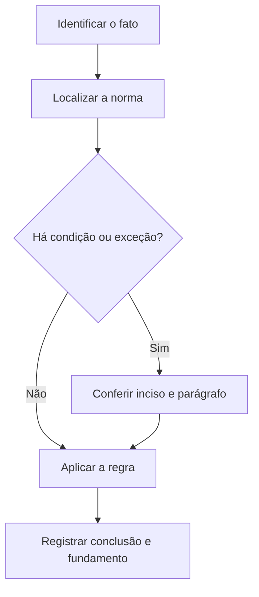

# Livro-texto — Semana 20 | Versão 2.0

**Cargo:** Oficial de Justiça — TJSP | **Banca:** VUNESP | **Período:** 08/03/2027 a 14/03/2027

## Revisão final, controle de tempo e prova

> **Status editorial:** ampliação didática das fichas originais, com referências ao edital. Este volume é um material de estudo revisável, não parecer jurídico nem transcrição integral da lei. Use o roteiro oficial e verifique retificações posteriores.

## Ideia central — entenda antes de decorar

Última semana: repassar os erros reais, não decorar um resumo novo. Execute provas em tempo controlado e mantenha um protocolo simples de respostas discursivas.

## Mapa visual da semana

## Plano de sete sessões

| Sessão | Atividade | Produto de aprendizagem |
|---|---|---|
| 1 | Estudar **Mínimo de Português** e ler **Edital 01/2026, Cap. X** | Esquema regra/condição/exceção em 5 linhas |
| 2 | Estudar **Mínimo de Conhecimentos Específicos** e ler **Edital 01/2026, Cap. X** | Esquema regra/condição/exceção em 5 linhas |
| 3 | Estudar **Discursivas eliminatórias** e ler **Edital 01/2026, Cap. XI** | Esquema regra/condição/exceção em 5 linhas |
| 4 | Estudar **Tempo de prova** e ler **Edital 01/2026, Cap. IX** | Esquema regra/condição/exceção em 5 linhas |
| 5 | Estudar **Revisão por erros** e ler **Técnica de estudos** | Esquema regra/condição/exceção em 5 linhas |
| 6 | Estudar **Preparação da véspera** e ler **Logística do edital** | Esquema regra/condição/exceção em 5 linhas |
| 7 | Questões + uma discursiva + revisão dos erros | Registro D+1, D+7 e D+21 |

---

## Aulas com aplicação prática

### Aula 1 — Mínimo de Português

**Texto para conferir:** Edital 01/2026, Cap. X.

**Entenda a regra.** O Bloco I possui 15 questões e exige pelo menos 50% de acertos: na prática, no mínimo 8 acertos, além da nota global de 5 na objetiva. Não basta memorizar o nome do instituto: identifique o verbo empregado no artigo, o sujeito que deve agir e os efeitos da conduta.

**Situação concreta.** Um candidato acerta apenas 7 questões de Português e soma 50 acertos na objetiva. Antes de escolher a alternativa, pergunte: quem deve agir? há ordem judicial? há prazo ou formalidade? existe exceção?

**Armadilha frequente.** A afirmação a seguir foi construída deliberadamente para estar errada: *Uma pontuação total alta dispensa automaticamente o mínimo de Português.* Confira no dispositivo indicado por que ela não corresponde à regra.

**Quadro de leitura da lei seca.**

| Passo | O que registrar |
|---|---|
| 1 — Sujeito | Quem pratica, requer, determina ou recebe o ato? |
| 2 — Hipótese | Em que situação a norma se aplica? |
| 3 — Forma | Existe local, prazo, procedimento ou requisito expresso? |
| 4 — Efeito | O que acontece com o cumprimento ou descumprimento? |
| 5 — Exceção | O artigo admite ressalva ou remete a outra norma? |

**Exercício guiado 1.** Reescreva a frase incorreta com o sujeito e a condição corretos. Depois explique o caso concreto em 4–6 linhas, citando **Edital 01/2026, Cap. X**. **Critério de correção:** acertar sujeito, requisito, efeito e artigo.

### Aula 2 — Mínimo de Conhecimentos Específicos

**Texto para conferir:** Edital 01/2026, Cap. X.

**Entenda a regra.** O Bloco II possui 40 questões e exige pelo menos 20 acertos. O bloco III tem caráter classificatório, sem corte próprio. Não basta memorizar o nome do instituto: identifique o verbo empregado no artigo, o sujeito que deve agir e os efeitos da conduta.

**Situação concreta.** Um candidato faz 19 acertos de Direito e excelente pontuação nos demais blocos. Antes de escolher a alternativa, pergunte: quem deve agir? há ordem judicial? há prazo ou formalidade? existe exceção?

**Armadilha frequente.** A afirmação a seguir foi construída deliberadamente para estar errada: *É suficiente acertar 19 em Específicos se Informática compensar a diferença.* Confira no dispositivo indicado por que ela não corresponde à regra.

**Quadro de leitura da lei seca.**

| Passo | O que registrar |
|---|---|
| 1 — Sujeito | Quem pratica, requer, determina ou recebe o ato? |
| 2 — Hipótese | Em que situação a norma se aplica? |
| 3 — Forma | Existe local, prazo, procedimento ou requisito expresso? |
| 4 — Efeito | O que acontece com o cumprimento ou descumprimento? |
| 5 — Exceção | O artigo admite ressalva ou remete a outra norma? |

**Exercício guiado 2.** Reescreva a frase incorreta com o sujeito e a condição corretos. Depois explique o caso concreto em 4–6 linhas, citando **Edital 01/2026, Cap. X**. **Critério de correção:** acertar sujeito, requisito, efeito e artigo.

### Aula 3 — Discursivas eliminatórias

**Texto para conferir:** Edital 01/2026, Cap. XI.

**Entenda a regra.** As duas questões discursivas cobrem Conhecimentos Específicos; a nota mínima geral é 24/40 e, para inscritos nas listas reservadas, é 19,2/40, conforme as regras do edital. Não basta memorizar o nome do instituto: identifique o verbo empregado no artigo, o sujeito que deve agir e os efeitos da conduta.

**Situação concreta.** Um candidato obtém 18 pontos nas discursivas, mesmo após bom desempenho na objetiva. Antes de escolher a alternativa, pergunte: quem deve agir? há ordem judicial? há prazo ou formalidade? existe exceção?

**Armadilha frequente.** A afirmação a seguir foi construída deliberadamente para estar errada: *A prova discursiva serve apenas para desempate e nunca elimina candidatos.* Confira no dispositivo indicado por que ela não corresponde à regra.

**Quadro de leitura da lei seca.**

| Passo | O que registrar |
|---|---|
| 1 — Sujeito | Quem pratica, requer, determina ou recebe o ato? |
| 2 — Hipótese | Em que situação a norma se aplica? |
| 3 — Forma | Existe local, prazo, procedimento ou requisito expresso? |
| 4 — Efeito | O que acontece com o cumprimento ou descumprimento? |
| 5 — Exceção | O artigo admite ressalva ou remete a outra norma? |

**Exercício guiado 3.** Reescreva a frase incorreta com o sujeito e a condição corretos. Depois explique o caso concreto em 4–6 linhas, citando **Edital 01/2026, Cap. XI**. **Critério de correção:** acertar sujeito, requisito, efeito e artigo.

### Aula 4 — Tempo de prova

**Texto para conferir:** Edital 01/2026, Cap. IX.

**Entenda a regra.** As provas objetiva e discursiva ocorrem na mesma sessão com duração máxima de cinco horas, ressalvada condição especial deferida. Distribuir o tempo antes evita abandono da redação. Não basta memorizar o nome do instituto: identifique o verbo empregado no artigo, o sujeito que deve agir e os efeitos da conduta.

**Situação concreta.** Uma pessoa resolve todas as objetivas e nota que restam poucos minutos para duas discursivas. Antes de escolher a alternativa, pergunte: quem deve agir? há ordem judicial? há prazo ou formalidade? existe exceção?

**Armadilha frequente.** A afirmação a seguir foi construída deliberadamente para estar errada: *As duas discursivas terão, por regra geral, uma segunda sessão em outro dia.* Confira no dispositivo indicado por que ela não corresponde à regra.

**Quadro de leitura da lei seca.**

| Passo | O que registrar |
|---|---|
| 1 — Sujeito | Quem pratica, requer, determina ou recebe o ato? |
| 2 — Hipótese | Em que situação a norma se aplica? |
| 3 — Forma | Existe local, prazo, procedimento ou requisito expresso? |
| 4 — Efeito | O que acontece com o cumprimento ou descumprimento? |
| 5 — Exceção | O artigo admite ressalva ou remete a outra norma? |

**Exercício guiado 4.** Reescreva a frase incorreta com o sujeito e a condição corretos. Depois explique o caso concreto em 4–6 linhas, citando **Edital 01/2026, Cap. IX**. **Critério de correção:** acertar sujeito, requisito, efeito e artigo.

### Aula 5 — Revisão por erros

**Texto para conferir:** Técnica de estudos.

**Entenda a regra.** Em revisão ativa, classifique falhas por desconhecimento da norma, interpretação, cálculo ou distração; corrija a causa, não apenas a alternativa. Não basta memorizar o nome do instituto: identifique o verbo empregado no artigo, o sujeito que deve agir e os efeitos da conduta.

**Situação concreta.** Um erro de citação decorre de confundir hora certa do CPC com o CPP. Antes de escolher a alternativa, pergunte: quem deve agir? há ordem judicial? há prazo ou formalidade? existe exceção?

**Armadilha frequente.** A afirmação a seguir foi construída deliberadamente para estar errada: *Revisar significa apenas reler o gabarito sem entender por que a resposta estava errada.* Confira no dispositivo indicado por que ela não corresponde à regra.

**Quadro de leitura da lei seca.**

| Passo | O que registrar |
|---|---|
| 1 — Sujeito | Quem pratica, requer, determina ou recebe o ato? |
| 2 — Hipótese | Em que situação a norma se aplica? |
| 3 — Forma | Existe local, prazo, procedimento ou requisito expresso? |
| 4 — Efeito | O que acontece com o cumprimento ou descumprimento? |
| 5 — Exceção | O artigo admite ressalva ou remete a outra norma? |

**Exercício guiado 5.** Reescreva a frase incorreta com o sujeito e a condição corretos. Depois explique o caso concreto em 4–6 linhas, citando **Técnica de estudos**. **Critério de correção:** acertar sujeito, requisito, efeito e artigo.

### Aula 6 — Preparação da véspera

**Texto para conferir:** Logística do edital.

**Entenda a regra.** Verifique convocação, horário, local, documento, materiais permitidos, deslocamento e condições de acessibilidade deferidas; a comunicação oficial prevalece sobre mensagens informativas. Não basta memorizar o nome do instituto: identifique o verbo empregado no artigo, o sujeito que deve agir e os efeitos da conduta.

**Situação concreta.** O candidato recebe um SMS, mas ainda precisa confirmar local de prova em fonte oficial. Antes de escolher a alternativa, pergunte: quem deve agir? há ordem judicial? há prazo ou formalidade? existe exceção?

**Armadilha frequente.** A afirmação a seguir foi construída deliberadamente para estar errada: *A mensagem de SMS substitui integralmente o edital de convocação oficial.* Confira no dispositivo indicado por que ela não corresponde à regra.

**Quadro de leitura da lei seca.**

| Passo | O que registrar |
|---|---|
| 1 — Sujeito | Quem pratica, requer, determina ou recebe o ato? |
| 2 — Hipótese | Em que situação a norma se aplica? |
| 3 — Forma | Existe local, prazo, procedimento ou requisito expresso? |
| 4 — Efeito | O que acontece com o cumprimento ou descumprimento? |
| 5 — Exceção | O artigo admite ressalva ou remete a outra norma? |

**Exercício guiado 6.** Reescreva a frase incorreta com o sujeito e a condição corretos. Depois explique o caso concreto em 4–6 linhas, citando **Logística do edital**. **Critério de correção:** acertar sujeito, requisito, efeito e artigo.

## Comparando alternativas: como a banca tenta induzir ao erro

1. **Troca de sujeito:** um dever do juiz é atribuído ao oficial, ou vice-versa.
2. **Absolutização:** expressões como “sempre”, “nunca” e “em qualquer hipótese” escondem exceções.
3. **Mistura de ramos:** regra de citação penal é aplicada ao processo civil sem autorização legal.
4. **Omissão de requisito:** a alternativa descreve o ato, mas esquece um pressuposto, uma comunicação ou uma certificação.
5. **Inversão temporal:** um procedimento posterior aparece como requisito anterior, ou o contrário.

## Questões analíticas da semana (autorais)

1. **Caso: Mínimo de Português.** Um candidato acerta apenas 7 questões de Português e soma 50 acertos na objetiva. Explique a providência ou o conceito aplicável; identifique duas condições que você procuraria no texto legal e uma alternativa plausível, porém incorreta. Justifique com **Edital 01/2026, Cap. X**.

2. **Caso: Mínimo de Conhecimentos Específicos.** Um candidato faz 19 acertos de Direito e excelente pontuação nos demais blocos. Explique a providência ou o conceito aplicável; identifique duas condições que você procuraria no texto legal e uma alternativa plausível, porém incorreta. Justifique com **Edital 01/2026, Cap. X**.

3. **Caso: Discursivas eliminatórias.** Um candidato obtém 18 pontos nas discursivas, mesmo após bom desempenho na objetiva. Explique a providência ou o conceito aplicável; identifique duas condições que você procuraria no texto legal e uma alternativa plausível, porém incorreta. Justifique com **Edital 01/2026, Cap. XI**.

4. **Caso: Tempo de prova.** Uma pessoa resolve todas as objetivas e nota que restam poucos minutos para duas discursivas. Explique a providência ou o conceito aplicável; identifique duas condições que você procuraria no texto legal e uma alternativa plausível, porém incorreta. Justifique com **Edital 01/2026, Cap. IX**.

5. **Caso: Revisão por erros.** Um erro de citação decorre de confundir hora certa do CPC com o CPP. Explique a providência ou o conceito aplicável; identifique duas condições que você procuraria no texto legal e uma alternativa plausível, porém incorreta. Justifique com **Técnica de estudos**.

6. **Caso: Preparação da véspera.** O candidato recebe um SMS, mas ainda precisa confirmar local de prova em fonte oficial. Explique a providência ou o conceito aplicável; identifique duas condições que você procuraria no texto legal e uma alternativa plausível, porém incorreta. Justifique com **Logística do edital**.

### Proposta discursiva

Com base nos temas **Mínimo de Português** e **Revisão por erros**, descreva como um profissional deve identificar corretamente a norma aplicável a uma situação real, distinguindo competência, procedimento e documentação do ato. Cite os dispositivos do edital e construa uma conclusão em 10 a 15 linhas.

### Critério para autoavaliação (20 pontos)

| Aspecto | Pontos |
|---|---:|
| Identificação da norma e competência | 6 |
| Aplicação ao caso e condições legais | 7 |
| Exceções e documentação | 4 |
| Clareza, objetividade e escrita | 3 |

## Respostas esperadas aos exercícios analíticos

1. A resposta deve partir da regra: **O Bloco I possui 15 questões e exige pelo menos 50% de acertos: na prática, no mínimo 8 acertos, além da nota global de 5 na objetiva.** No caso: Um candidato acerta apenas 7 questões de Português e soma 50 acertos na objetiva. A hipótese errada a ser rebatida é: “Uma pontuação total alta dispensa automaticamente o mínimo de Português.”. O argumento definitivo deve apontar a redação completa de **Edital 01/2026, Cap. X**, inclusive remissões e exceções.

2. A resposta deve partir da regra: **O Bloco II possui 40 questões e exige pelo menos 20 acertos. O bloco III tem caráter classificatório, sem corte próprio.** No caso: Um candidato faz 19 acertos de Direito e excelente pontuação nos demais blocos. A hipótese errada a ser rebatida é: “É suficiente acertar 19 em Específicos se Informática compensar a diferença.”. O argumento definitivo deve apontar a redação completa de **Edital 01/2026, Cap. X**, inclusive remissões e exceções.

3. A resposta deve partir da regra: **As duas questões discursivas cobrem Conhecimentos Específicos; a nota mínima geral é 24/40 e, para inscritos nas listas reservadas, é 19,2/40, conforme as regras do edital.** No caso: Um candidato obtém 18 pontos nas discursivas, mesmo após bom desempenho na objetiva. A hipótese errada a ser rebatida é: “A prova discursiva serve apenas para desempate e nunca elimina candidatos.”. O argumento definitivo deve apontar a redação completa de **Edital 01/2026, Cap. XI**, inclusive remissões e exceções.

4. A resposta deve partir da regra: **As provas objetiva e discursiva ocorrem na mesma sessão com duração máxima de cinco horas, ressalvada condição especial deferida. Distribuir o tempo antes evita abandono da redação.** No caso: Uma pessoa resolve todas as objetivas e nota que restam poucos minutos para duas discursivas. A hipótese errada a ser rebatida é: “As duas discursivas terão, por regra geral, uma segunda sessão em outro dia.”. O argumento definitivo deve apontar a redação completa de **Edital 01/2026, Cap. IX**, inclusive remissões e exceções.

5. A resposta deve partir da regra: **Em revisão ativa, classifique falhas por desconhecimento da norma, interpretação, cálculo ou distração; corrija a causa, não apenas a alternativa.** No caso: Um erro de citação decorre de confundir hora certa do CPC com o CPP. A hipótese errada a ser rebatida é: “Revisar significa apenas reler o gabarito sem entender por que a resposta estava errada.”. O argumento definitivo deve apontar a redação completa de **Técnica de estudos**, inclusive remissões e exceções.

6. A resposta deve partir da regra: **Verifique convocação, horário, local, documento, materiais permitidos, deslocamento e condições de acessibilidade deferidas; a comunicação oficial prevalece sobre mensagens informativas.** No caso: O candidato recebe um SMS, mas ainda precisa confirmar local de prova em fonte oficial. A hipótese errada a ser rebatida é: “A mensagem de SMS substitui integralmente o edital de convocação oficial.”. O argumento definitivo deve apontar a redação completa de **Logística do edital**, inclusive remissões e exceções.

## Checklist de conclusão

- [ ] Li o capítulo, incluindo os exemplos.
- [ ] Conferi o texto completo de todos os artigos indicados nesta semana.
- [ ] Resolvi as seis questões analíticas sem consulta.
- [ ] Escrevi ao menos uma discursiva e revisei os erros.
- [ ] Registrei o que deve retornar nas revisões D+1, D+7 e D+21.

**Fonte primária:** [Edital 01/2026, Anexo VIII](https://drive.google.com/file/d/1YJSOt6SDpONIJLY1ahDa9D4y8vkTGwlJ/view) e [Roteiro de legislação por semana](../../legislacao/roteiro_corrigido.md).

**Nota:** As respostas comentadas são guias metodológicos, não substituem a consulta dos dispositivos integrais, e os exercícios autorais não são da VUNESP.